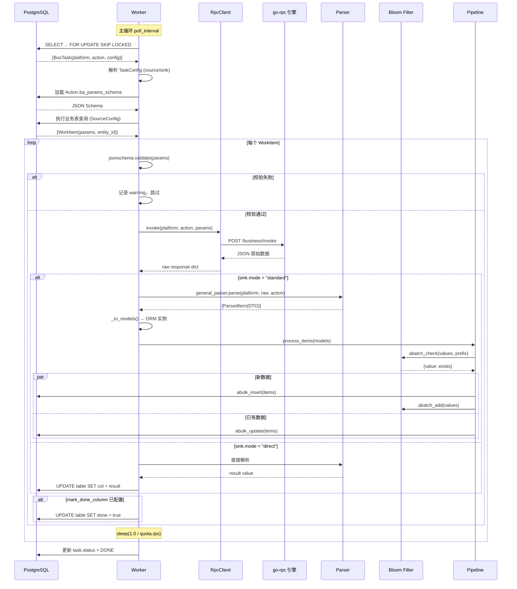

# CrawlStore 项目全面技术分析文档

> **项目名称**: CrawlStore (crawlstore)  
> **版本**: 0.1.0  
> **语言**: Python 3.10+  
> **最后更新**: 2026-06-29  
> **分支**: dev  
> **索引名**: crawlstore-local (GitNexus: 5409 符号, 9612 关系, 157 执行流)

---

## 目录

1. [项目概述](#1-项目概述)
2. [项目目录结构解析](#2-项目目录结构解析)
3. [核心模块分析](#3-核心模块分析)
4. [设计模式与架构风格分析](#4-设计模式与架构风格分析)
5. [可视化图表](#5-可视化图表)
6. [二次开发与架构优化建议](#6-二次开发与架构优化建议)
7. [新开发者实战入门指南](#7-新开发者实战入门指南)

---

## 1. 项目概述

CrawlStore 是一个**多平台爬虫数据采集调度与处理系统**，采用异步架构，通过 RPC 与底层采集执行引擎（go-rpc）通信，实现多平台的数据采集任务调度、结果解析、去重存储，并通过 FastAPI JSON API 为独立前端提供管理能力。

### 核心技术栈

| 层级 | 技术 | 说明 |
|------|------|------|
| 语言 | Python 3.10+ | 异步编程 (asyncio) |
| Web 框架 | FastAPI | `/api/crawler` JSON API |
| ORM | SQLAlchemy 2.0+ (async) | 异步数据库操作 |
| 数据库 | PostgreSQL | 业务数据与任务状态持久化 |
| 缓存/去重 | Redis (Bloom Filter) | 数据去重与限流 |
| RPC 通信 | httpx (async) | 与 go-rpc 引擎通信 |
| AI 运行时 | LangGraph + LangChain | 视频分析工作流编排与多 Provider 模型调用 |
| 配置管理 | TOML + dataclass | 类型安全配置 |
| 日志 | Loguru | 结构化日志 |
| 数据校验 | Pydantic v2 + jsonschema | 参数校验与 DTO |
| 测试 | pytest + pytest-asyncio | 异步测试支持 |

### Agent 目录

本地视频分析业务代码位于 `app/agents/tiktok_video_analysis.py`，由 LangGraph 工作流组织媒体处理、模型调用和结构化结果输出。

### LLM Provider 与模型配置

LLM 运行时使用 LangChain 模型适配器，由 LangGraph 编排视频分析执行路径：`VideoAnalysisWorker` 创建分析服务，媒体边界完成视频准备或转写，分析图调用所选模型并将结构化结果写入存储。Provider 与模型在管理 API 中维护；模型同步后可分别设置默认分析模型和默认转写模型，任务配置中的 `analysis.llm_model_id` 可覆盖默认分析模型。

Provider 的 `base_url` 会经过主机白名单校验。环境变量 `LLM_PROVIDER_ALLOWED_HOSTS` 用逗号分隔额外允许的主机名，仅填写主机名，不包含协议、端口或路径；未配置时只允许内置的官方 Provider 主机。生产环境应保持最小白名单，避免允许内网地址或通配目标。

### 架构概览

```
┌──────────────────────────────────────────────────────┐
│                  Crawler JSON API                    │
│                  (FastAPI + Pydantic)                │
│   /api/crawler/platforms|actions|keywords|tasks      │
└────────────────────────┬─────────────────────────────┘
                         │
┌────────────────────────▼─────────────────────────────┐
│                 Scheduler (main.py)                   │
│  ┌──────────┐  ┌──────────┐  ┌──────────────────┐   │
│  │  Worker  │  │  Worker  │  │  Worker  (N个)    │   │
│  │(douyin)  │  │(bilibili)│  │  ...              │   │
│  └────┬─────┘  └────┬─────┘  └────────┬─────────┘   │
│       │             │                 │              │
│       └─────────────┼─────────────────┘              │
│                     │                                │
│         ┌───────────▼───────────┐                    │
│         │     RpcClient         │                    │
│         │  (httpx async HTTP)   │                    │
│         └───────────┬───────────┘                    │
└─────────────────────┼────────────────────────────────┘
                      │
┌─────────────────────▼────────────────────────────────┐
│               go-rpc 采集引擎                          │
│          /business/invoke  (HTTP API)                 │
└─────────────────────┬────────────────────────────────┘
                      │
┌─────────────────────▼────────────────────────────────┐
│              Pipeline (数据处理管线)                    │
│  ┌──────────┐  ┌──────────┐  ┌──────────────────┐   │
│  │  Parser  │  │  Bloom   │  │  SQLAlchemyDB    │   │
│  │(解析器)   │  │(去重过滤) │  │  (写入/更新)      │   │
│  └──────────┘  └──────────┘  └──────────────────┘   │
└──────────────────────────────────────────────────────┘
                      │
┌─────────────────────▼────────────────────────────────┐
│              数据存储层                                 │
│  ┌──────────┐  ┌──────────┐  ┌──────────────────┐   │
│  │PostgreSQL│  │  Redis   │  │  MongoDB/MinIO/ES │   │
│  └──────────┘  └──────────┘  └──────────────────┘   │
└──────────────────────────────────────────────────────┘
```

---

## 2. 项目目录结构解析

```
crawler/
├── main.py                  # 🔑 启动入口：调度器主循环
├── config.toml              # ⚙️ 配置文件（数据库、Redis、限流、Web）
├── pyproject.toml           # 📦 项目依赖与元数据
├── .env.example             # 🔐 环境变量模板
├── README.md                # 📖 项目说明
├── CLAUDE.md                # 🤖 AI 辅助开发配置
│
├── core/                    # 🧠 核心业务逻辑
│   ├── config.py            #   配置模型（dataclass + TOML 解析）
│   ├── worker.py            #   任务执行器（调度、RPC 调用、分发）
│   ├── pipeline.py          #   数据处理管线（去重 + 写入/更新）
│   ├── rpc.py               #   RPC HTTP 客户端（重试 + 指数退避）
│   └── repository.py        #   任务 CRUD（TaskRepo）
│
├── models/                  # 📊 数据模型层
│   ├── base.py              #   ORM 基类 + Pydantic 基类
│   ├── task.py              #   BusTask（任务模型）+ BusTaskLog
│   ├── task_config.py       #   TaskConfig / SourceConfig / SinkConfig
│   ├── platform.py          #   SiteSource（平台模型 + 配额）
│   ├── action.py            #   Action（接口定义模型）
│   ├── user.py              #   BusUser（用户模型）
│   ├── content.py           #   BusContent（内容模型）
│   ├── comment.py           #   BusComment（评论模型）
│   ├── media.py             #   BusMedia（媒体模型）
│   ├── job.py               #   BusJob（职位模型）
│   ├── company.py           #   Company（公司相关模型）
│   ├── follow.py            #   BusFollow（关注模型）
│   └── relat.py             #   内容关联模型
│
├── parser/                  # 🔍 平台解析器（策略模式）
│   ├── __init__.py          #   导出 general_parser / register
│   ├── parser.py            #   GeneralParser（门面）
│   ├── registry.py          #   ParserRegistry（注册表 + 懒加载）
│   ├── dto.py               #   DTO 定义（ParsedItem + 7 种 DTO）
│   ├── exceptions.py        #   解析器异常
│   ├── _template/           #   解析器模板
│   ├── douyin/              #   抖音解析器
│   ├── bilibili/            #   B站解析器
│   ├── twitter/             #   Twitter/X 解析器
│   ├── facebook/            #   Facebook 解析器
│   ├── instagram/           #   Instagram 解析器
│   ├── tiktok/              #   TikTok 解析器
│   ├── xiaohongshu/         #   小红书解析器
│   ├── zhihu/               #   知乎解析器
│   ├── weibo/               #   微博解析器
│   ├── reddit/              #   Reddit 解析器
│   ├── job/                 #   招聘平台解析器
│   ├── generic/             #   通用解析器
│   ├── web/                 #   网页解析器
│   ├── haokan/              #   好看视频解析器
│   ├── kanxue/              #   看雪解析器
│   ├── csdn/                #   CSDN 解析器
│   ├── douban/              #   豆瓣解析器
│   ├── qizhidao/            #   企知道解析器
│   ├── spiderbox/           #   SpiderBox 解析器
│   ├── 52pojie/             #   52破解解析器
│   └── usajob/              #   USAJob 解析器
│
├── storage/                 # 💾 数据存储层
│   ├── __init__.py          #   导出所有存储后端
│   ├── base.py              #   BaseStore 抽象基类
│   ├── exceptions.py        #   存储异常
│   ├── sql/                 #   SQLAlchemy 实现（同步 + 异步）
│   ├── redis/               #   Redis 实现（同步 + 异步）
│   ├── mongo/               #   MongoDB 实现
│   ├── minio/               #   MinIO 对象存储实现
│   └── elastic/             #   Elasticsearch 实现
│
├── filter/                  # 🚫 去重过滤模块
│   ├── __init__.py          #   导出 Bloom / Bitmap
│   ├── base.py              #   BaseFilter 抽象基类
│   ├── bloom.py             #   布隆过滤器（同步 + 异步，动态扩容）
│   └── bitmap.py            #   位图过滤器
│
├── app/                     # 🚀 应用装配层
│   ├── main.py              #   FastAPI 应用工厂
│   └── api/crawler/          #   Crawler JSON API 路由与 Schema
│
├── service/                 # 🌐 Web 服务基础设施
│   ├── deps.py              #   依赖注入（DB 实例 + lifespan）
│   └── _platforms.py        #   平台查询辅助
│
├── common/                  # 🔧 通用工具
│   ├── __init__.py
│   ├── logging.py           #   日志适配器（→ utils/log.py）
│   ├── retry.py             #   异步重试装饰器（指数退避）
│   └── decorators.py        #   require_sync / require_async 装饰器
│
├── utils/                   # 🛠 底层工具
│   ├── log.py               #   Loguru 日志系统（LoggerManager 单例）
│   ├── jsoner.py            #   JSON 工具
│   ├── timer.py             #   计时工具
│   ├── tools.py             #   通用工具函数
│   └── decorators.py        #   工具装饰器
│
├── data/                    # 📁 测试数据 / 样例数据
│   ├── douyin/              #   抖音响应样例 JSON
│   └── bilibili/            #   B站响应样例 JSON
│
├── docs/                    # 📝 文档
│   ├── bilibili_crawler.md
│   └── superpowers/         #   设计文档与实施计划
│       ├── plans/           #     实施计划（10+ 个）
│       └── specs/           #     设计规格（10+ 个）
│
├── tests/                   # 🧪 测试
│   ├── core/                #   核心模块测试
│   ├── models/              #   模型测试
│   ├── parser/              #   解析器测试
│   ├── storage/             #   存储层测试
│   ├── web/                 #   Web 层测试
│   └── scripts/             #   脚本测试
│
├── scripts/                 # 📜 运维脚本
├── logs/                    # 📋 日志输出目录
├── temp/                    # 🗑 临时文件
├── schema/                  # 📐 JSON Schema 定义
└── scratch/                 # 📝 临时开发文件
```

### 关键目录角色与边界

| 目录 | 角色 | 依赖方向 |
|------|------|----------|
| `core/` | 核心业务流程编排 | 依赖 models, parser, storage, filter, common |
| `models/` | 数据结构定义 | 依赖 pydantic, sqlalchemy（无业务依赖） |
| `parser/` | 平台数据解析策略 | 依赖 models（DTO），被 core 调用 |
| `storage/` | 数据持久化 | 依赖 common（无业务依赖） |
| `filter/` | 去重逻辑 | 依赖 storage/redis, common |
| `app/api/crawler/` | JSON 管理 API | 依赖 service, models, storage |
| `common/` | 横切关注点 | 依赖 utils（无业务依赖） |
| `utils/` | 底层工具 | 无项目内依赖 |

---

## 3. 核心模块分析

### 3.1 调度入口 (`main.py`)

**职责**: 系统启动入口，组装所有组件并启动调度循环。

**核心流程**:
1. 从 `config.toml` 加载配置 (`SchedulerConfig.from_toml`)
2. 初始化 PostgreSQL 连接 (`SQLAlchemyDB`) 并建表
3. 从 DB 加载启用的平台配额 (`SiteSource.load_active_quotas`)
4. 初始化 Redis Bloom 过滤器 (`Bloom`)
5. 创建数据处理管线 (`Pipeline`)
6. 创建 RPC 客户端 (`RpcClient`)
7. 按 executor 创建 `rpc_crawl`、`video_clean`、`video_download`、`video_analysis` 四个全局 Worker
8. 在独立线程启动 FastAPI JSON API（uvicorn）
9. 通过 `asyncio.gather` 并发运行所有 Worker

**关键设计决策**:
- Web 服务器运行在独立 daemon 线程，与调度器主循环分离
- 支持 uvicorn reload 模式（开发环境），通过自定义 `_ThreadSafeReload` 解决信号注册问题
- `_app_factory` 使用模块级函数（picklable），兼容 Windows spawn 多进程

### 3.2 Worker 任务执行器 (`worker/`)

**职责**: 四类 Worker 从同一任务表领取各自 executor 的任务，并分别完成 RPC 采集、视频清洗、视频下载和视频分析。`config.executor` 缺省或为空时兼容为 `rpc_crawl`。

四个 Worker 随 `main.py` 一并启动，无需分别启动业务脚本。`CrawlerWorker` 是单个全局实例，内部按任务平台选择并缓存限流器，因此各平台的并发、RPS 和封禁冷却互不影响。清洗、下载和分析过程会把领取、完成、失败等阶段状态写回数据库；`scripts/` 下对应命令仅作为可选的一次性 CLI 入口，并复用相同的 Worker/service 实现。

**核心流程**:
```
┌─────────────────────────────────────────────────┐
│                BaseWorker.run()                   │
│  ┌──────────────────────────────────────────┐    │
│  │  while _running:                         │    │
│  │    1. repo.get_pending_tasks(executor)   │    │
│  │    2. asyncio.gather(execute(task)...)   │    │
│  │    3. 若无任务，sleep(poll_interval)      │    │
│  └──────────────────────────────────────────┘    │
│                                                   │
│  Worker.execute(task):                           │
│    1. 解析 TaskConfig (source/sink)               │
│    2. 加载 Action Schema (JSON Schema 校验)        │
│    3. 从数据源查询构建 WorkItem 列表               │
│    4. 逐个 WorkItem:                              │
│       a. 参数校验 (jsonschema)                     │
│       b. RPC 调用 (rpc.invoke)                    │
│       c. 结果分发 (_dispatch)                      │
│    5. 更新任务状态                                │
└─────────────────────────────────────────────────┘
```

**关键类/函数**:

| 名称 | 类型 | 作用 |
|------|------|------|
| `BaseWorker` | 类 | 四类执行器共享的任务领取、状态更新和主循环 |
| `CrawlerWorker` | 类 | 全局 RPC 采集执行器，按平台独立限流 |
| `VideoCleanWorker` | 类 | 视频素材清洗执行器 |
| `VideoDownloadWorker` | 类 | 视频下载与对象存储执行器 |
| `VideoAnalysisWorker` | 类 | 视频分析执行器 |
| `WorkItem` | 数据类 | 单个采集工作项 (params + entity_id) |

**执行器数据边界**:

- `rpc_crawl`：参数来自 Redis Stream 或数据库。
- `video_clean`：PostgreSQL cursor 消费者，评级结果与 cursor 在同一事务提交。
- `video_download`：PostgreSQL lease 消费者，使用 claim token 隔离并执行有限重试。
- `video_analysis`：PostgreSQL `SKIP LOCKED` 消费者，保留既有分析状态机。

下载任务达到 `max_attempts` 后不会被自动领取。排除故障原因后，运维人员应显式清空错误、
重试时间和 attempt count；不要直接改写 claim token。

媒体结构化日志字段仅限 `task_id`、`consumer_key`、`platform`、`content_id`、
`batch_id`、`claim_token_prefix`、`attempt_count`、`outcome`、`latency_ms` 和
`exception_type`。日志只允许记录 claim token 前缀，不得输出完整 claim token、媒体或代理
URL、模型密钥，以及未经截断和脱敏的异常。

**安全措施**:
- SQL 标识符白名单校验 (`_IDENT_RE` / `_EXPR_RE`)
- WHERE 子句注入防护 (`_WHERE_DANGEROUS` 正则 + 结构校验)
- 参数化查询 (`:platform` 绑定参数)

**并发控制**:
- `CrawlerWorker` 为每个平台维护独立 Semaphore 和速率限制状态
- `quota.rps` 分平台控制请求速率，单个平台受限不会暂停其他平台

#### 3.2.1 Action Worker 的 Redis Streams 配置契约

以下是完整任务模板。除特别说明的 `pagination` 持久化契约外，可直接作为
`POST /api/crawler/tasks` 的请求体；部署时必须把示例 `ba_id` 替换为当前数据库中对应且
已启用的 Action ID，并确认源表、列、Action 和 Parser 均已部署。`ba_id` 同时决定任务的
`platform`、`action` 和参数 Schema，因此不能只按示例数字照搬。

| 规范链路 | Source / 执行模式 / Sink |
|----------|--------------------------|
| `kalodata/querylist` | database + completion / `invoke_action` / redis_stream |
| `tiktok/videoDetail` | redis_stream / `invoke_action` / database |
| `t_busi_search_keyword` | database + completion / `publish_source` / search stream |
| `tiktok/search` | redis_stream / `invoke_action` / database |

表中的名称用于描述业务链路；实际 Action/Parser 注册名区分大小写，当前相关实现使用
`queryList` 和 `SearchVideo`，配置必须以部署数据库和 Parser registry 为准。

**Kalodata `queryList`：database source + completion + `invoke_action` → redis_stream sink**

当前仓库已提供 Kalodata `queryList` Parser，但尚未提供 `t_kalodata_query_seed` 表；下列模板
仍需部署方创建所列源表/字段后才可启用。Parser 将上游 `data` 中的视频 ID 转换为
`content_id`，供 Redis Sink 映射为下游 `videoDetail` 的 `itemId`；`queryList` 的大小写必须
与实际 Action 和 Parser 注册名完全一致。数据库 Source 当前把列值转换为字符串，因此
目标 Action Schema 也必须接受这些字符串参数；若 `cateIds` 等字段要求 JSON array，应先
扩展 Source 的类型保真能力，不能直接启用此模板。
源表以 `published` 标记该行是否已成功产出下游消息：

```json
{
  "ba_id": 101,
  "loop_enabled": true,
  "loop_interval_seconds": 30,
  "execution_mode": "invoke_action",
  "source": {
    "type": "database",
    "table": "t_kalodata_query_seed",
    "key_column": "id",
    "param_map": {
      "country": "country",
      "start_date": "startDate",
      "end_date": "endDate",
      "cate_ids": "cateIds",
      "page_no": "pageNo",
      "page_size": "pageSize"
    },
    "filter_by_platform": false,
    "order_by": ["id ASC"],
    "limit": 50,
    "completion": {
      "column": "published",
      "value": true
    }
  },
  "sink": {
    "type": "redis_stream",
    "stream": "crawler:{tiktok-video-detail}:stream",
    "param_map": {
      "content_id": "itemId"
    },
    "dedupe_ttl_seconds": 86400
  }
}
```

Redis Sink 的 `param_map` 方向固定为“Parser 标准字段名 → 下游 Action 参数名”。上例先
调用 Kalodata Action 并运行其 Parser，再把每条标准化结果的 `content_id` 写成下游
`videoDetail` 所需的 `itemId`。

**TikTok `videoDetail`：redis_stream source → database sink**

该任务的 `ba_id` 必须引用 TikTok `videoDetail` Action；其参数 Schema 会在 RPC 前校验
生产者写入的 `itemId`：

```json
{
  "ba_id": 14,
  "loop_enabled": true,
  "loop_interval_seconds": 5,
  "execution_mode": "invoke_action",
  "source": {
    "type": "redis_stream",
    "stream": "crawler:{tiktok-video-detail}:stream",
    "group": "tiktok-video-detail",
    "batch_size": 50,
    "block_ms": 1000,
    "claim_idle_ms": 60000,
    "max_deliveries": 5,
    "dead_letter_stream": "crawler:{tiktok-video-detail}:dlq"
  },
  "sink": {
    "type": "database",
    "mode": "standard"
  }
}
```

**`t_busi_search_keyword`：database source + completion + `publish_source` → search stream**

`publish_source` 只读取数据库行、校验目标 Action 参数并投递 Stream，不调用 RPC，也不
运行 Parser。该任务的 `ba_id` 必须引用目标平台的 Search Action，而不是一个虚构的
Producer Action；这样投递前会使用最终 Search 参数 Schema 校验 `keyword`。当前 TikTok
Parser 注册名为 `SearchVideo`，因此示例 `ba_id` 应引用 TikTok `SearchVideo` Action；若
部署使用 `search` 名称，必须先注册对应 Parser，不能仅重命名任务。

`publish_source` 的有效 `TaskConfig.pagination` 必须保持 `null`。当前创建 API 不公开
`pagination` 字段并拒绝额外字段，因此下列 **POST 请求体必须省略** `pagination`；服务端
生成并持久化的 `TaskConfig` 中该字段仍为 `null`：

```json
{
  "ba_id": 7,
  "loop_enabled": true,
  "loop_interval_seconds": 30,
  "execution_mode": "publish_source",
  "source": {
    "type": "database",
    "table": "t_busi_search_keyword",
    "key_column": "id",
    "param_map": {
      "keyword": "keyword"
    },
    "filter_by_platform": true,
    "order_by": ["id ASC"],
    "limit": 50,
    "completion": {
      "column": "is_crawled",
      "value": true
    }
  },
  "sink": {
    "type": "redis_stream",
    "stream": "crawler:{tiktok-search}:stream",
    "param_map": {
      "keyword": "keyword"
    },
    "dedupe_ttl_seconds": 86400
  }
}
```

对应的持久化配置不变量为：

```json
{
  "execution_mode": "publish_source",
  "pagination": null
}
```

**TikTok `SearchVideo`（Search）：redis_stream source + `invoke_action` → database sink**

消费者必须引用与生产者相同的目标 Search Action，且 Stream、Consumer Group 与 DLQ
名称必须使用相同的非空 Redis Cluster hash tag：

```json
{
  "ba_id": 7,
  "loop_enabled": true,
  "loop_interval_seconds": 5,
  "execution_mode": "invoke_action",
  "source": {
    "type": "redis_stream",
    "stream": "crawler:{tiktok-search}:stream",
    "group": "tiktok-search",
    "batch_size": 50,
    "block_ms": 1000,
    "claim_idle_ms": 60000,
    "max_deliveries": 5,
    "dead_letter_stream": "crawler:{tiktok-search}:dlq"
  },
  "sink": {
    "type": "database",
    "mode": "standard"
  }
}
```

##### 批次、循环与完成语义

- 持续消费 Redis Stream 必须设置 `loop_enabled=true`；调度器会按
  `loop_interval_seconds` 再次调度。`loop_enabled=false` 是一次性任务，只读取一个由
  `source.batch_size` 限定的批次，不会在同一次执行中常驻等待整个 Stream 清空。若该批次
  出现可重试失败，消息会留在 Pending，但一次性任务不会自动再次调度；运维人员必须手工
  重新启动该任务。需要自动推进 Pending 到成功或 DLQ 时，应使用循环任务。
- 消费语义为 **at-least-once**。只有 Processor 与 `ResultSinkRouter` 全部成功后才执行
  `XACK`。若进程在数据库提交后、ACK 前退出，该消息会留在 Pending，超过
  `claim_idle_ms` 后可被消费者重新领取，因而可能再次调用 RPC；下游写入和外部 Action
  都必须按可能重复执行设计。
- 可重试失败保持 Pending；达到 `max_deliveries` 或发生确定性参数错误时，消息会写入
  `dead_letter_stream` 并 ACK 原消息。DLQ 不会自动重放或删除，必须由运维人员确认失败
  原因、目标 Action 和重放范围后手工处理；该流程不会对原 Stream entry 执行 `XDEL`。
  Worker 重启或后续轮次通过 `XAUTOCLAIM` 领取空闲时间达到 `claim_idle_ms` 的 Pending。
- 每个 database Source → redis_stream Sink（包括 `invoke_action` 和
  `publish_source`）都必须提供 `source.completion`。拉取 SQL 使用
  `completion.column IS DISTINCT FROM completion.value` 排除已完成行；仅在 Processor
  成功后才按 `source.table` 与 `source.key_column` 更新原行，其中 Redis 幂等去重也视为
  成功。Processor、Sink 或 completion UPDATE 失败时不标记完成。completion 不支持
  独立完成表或 table override。
- Redis enqueue 与 database completion UPDATE 之间没有 Outbox 或跨存储事务。若进程在
  enqueue 后、completion 前退出，下轮依靠幂等键恢复并完成源行；若恢复晚于幂等 TTL，
  仍可能再次入队，因此本方案不承诺 exactly-once。

##### 消息大小、幂等与 DLQ 运维边界

- Stream 的 `params` 使用键排序、无多余空白的 canonical JSON；其 UTF-8 编码上限为
  **65,536 字节**，生产端超限消息拒绝入队。若有人绕过生产者手工注入超限或非法
  `params`，消费者将其视为确定性输入错误并移入 DLQ。
- Redis Sink 使用 `dedupe_ttl_seconds` 控制幂等键 TTL，键由
  `app.core.stream_queue.build_dedupe_key(stream, params)` 精确计算。XADD 成功后同一 TTL
  内的重复投递被跳过，且该去重结果仍允许 database Source 写 completion。
- DLQ 消息若重新经过生产者，在原幂等 TTL 内会再次被判为重复。安全操作只有两种：等待
  TTL 到期；或确认原消息终态和准确重放范围后，删除由 `build_dedupe_key()` 计算出的
  **精确单个幂等键**。禁止批量扫描删除、自动重放、`FLUSHDB`，也不得修改或清理其他
  任务的 Redis 数据。

##### Action 日志与测试边界

- Action 逐消息与轮次日志的固定关联字段为 `task_id`、`platform`、`action`、
  `stream`、`group`、`consumer`、`message_id`、`delivery_count`、`outcome`、
  `latency_ms`；轮次日志中不适用的消息字段为 `null`，并可附带 `acked`、`retried`、
  `dead_lettered` 汇总。完整参数、Redis URL/凭据、数据库凭据、完整 RPC 原始响应和未截断
  异常不得进入日志。
- 默认测试套件不连接在线 Redis。`tests/integration/test_stream_queue_redis.py` 仅在显式设置
  `TEST_REDIS_URL` 时运行，例如 PowerShell 使用
  `$env:TEST_REDIS_URL='redis://127.0.0.1:6379/15'; uv run pytest tests/integration/test_stream_queue_redis.py -q`；
  未设置时该文件按预期跳过，其他单元测试必须继续使用 fake/mock 客户端且可离线运行。

### 3.3 Pipeline 数据处理管线 (`core/pipeline.py`)

**职责**: 数据去重、清洗、批量写入/更新。

**核心流程**:
```
RPC 原始数据 → Parser 解析 → ParsedItem → ORM Model
                                          ↓
                              Bloom Filter 去重检查
                              ┌───────┴───────┐
                              ↓               ↓
                         新数据(INSERT)    已有数据(UPDATE)
                              ↓               ↓
                         Bloom 标记已存在  按 business key 更新
```

**关键类/函数**:

| 名称 | 类型 | 作用 |
|------|------|------|
| `Pipeline` | 类 | 数据处理管线主类 |
| `Pipeline.process_items()` | 方法 | 批量处理入口 |
| `Pipeline._process_item()` | 方法 | 单条处理（去重→分流） |
| `Pipeline._insert_items()` | 方法 | 批量插入（带重试） |
| `Pipeline._update_items()` | 方法 | 批量更新（带重试） |
| `Pipeline._sanitize_string_fields()` | 方法 | NUL 字节清洗 |

**数据类型映射**:
```
DATATYPE_TO_MODEL = {
    "user"    → BusUser
    "content" → BusContent
    "comment" → BusComment
    "media"   → BusMedia
    "job"     → BusJob
}
```

**去重策略**:
- Key 格式: `{datatype}:{platform}:{unique_id}`
- 使用 Redis Bloom Filter 批量检查
- 同批次内进行二次去重（`seen_in_batch` set）
- 插入成功后回写 Bloom Filter

**数据清洗**:
- `_sanitize_string_fields()`: 移除 VARCHAR/TEXT 列中的 NUL 字节 (`\x00`)，防止 PostgreSQL `CharacterNotInRepertoireError`
- 统计字段默认值填充 (share_count, repost_count 等，防止 NOT NULL 约束违反)

**重试机制**:
- `_insert_items` 和 `_update_items` 均使用 `@retry_async` 装饰器
- 指数退避（0.5s → 1s → 2s），最大 3 次尝试
- 可重试异常: `OperationalError`, `DBAPIError`, `TimeoutError`

### 3.4 RPC 客户端 (`core/rpc.py`)

**职责**: 与 go-rpc 采集引擎的异步 HTTP 通信。

**关键特性**:
- `trust_env=False`: 避免被宿主环境代理变量劫持
- 连接池: 50 最大连接, 20 keep-alive
- 超时: connect 10s, read 60s, write 10s
- 重试: 最多 3 次，指数退避 + 随机抖动
- 认证: `sekiro-token` 请求头

**请求格式**:
```json
{
  "group": "douyin",
  "action": "SearchUser",
  "params": {"keyword": "xxx"}
}
```

### 3.5 TaskRepo 任务仓库 (`core/repository.py`)

**职责**: 对 `t_crawl_task` 表的 CRUD 操作，含并发安全控制。

**核心方法**:

| 方法 | 作用 | 并发控制 |
|------|------|----------|
| `get_pending_tasks()` | 获取待执行任务 | `SELECT ... FOR UPDATE SKIP LOCKED` 防止重复领取 |
| `save()` | 保存/更新任务 | 双重检查（先查存在 → 再 merge）防止幽灵写入 |
| `init_tasks()` | 初始化平台任务 | 幂等：跳过已存在的 (platform, action) 组合 |

**并发安全设计**:
- `FOR UPDATE SKIP LOCKED`: 多个 Worker 不会抢同一个任务
- 领取时立即标记为 RUNNING，防止重复调度
- `save()` 中的双重检查：先 `SELECT` 确认任务仍存在，再 `merge`，再检查 `inspect(merged).persistent` 防并发删除

### 3.6 配置管理 (`core/config.py`)

**职责**: 类型安全的配置加载与数据模型。

**设计模式**: 不可变值对象 (frozen dataclass)

```
SchedulerConfig (frozen)
├── poll_interval: float
├── rpc_base_url: str
├── rpc_token: str (从环境变量 SEKIRO_TOKEN 读取)
├── postgresql: PgConfig (frozen)
├── redis: RedisConfig (frozen)
│   └── url 属性: 自动拼接 redis:// 连接串
└── web: WebConfig (frozen)

PlatformQuota (frozen)
├── platform: str
├── concurrency: int
├── rps: float
├── burst: int
└── cooldown_on_block: int
```

**优点**: 不可变配置防止运行时意外修改；`from_toml` 工厂方法集中解析逻辑。

#### 运行时配置

`config.toml` 是运行时配置的默认值来源：每个配置域在首次调用对应 `get_*` 读取方法时，才会尝试为 Redis 中缺失的 key 写入初始值，且不覆盖已经存在的值。该 key 初始化后，Redis 是对应 LLM、Scheduler、Scheduler RPC、视频分析、代理、Cleaner 或平台清洗策略的运行时权威来源；修改 `config.toml` 不会覆盖 Redis 中的现有配置。

管理端 `/settings` 通过 `/api/settings` 分卡保存配置。Scheduler 的轮询参数在后续轮询生效，RPC 在后续调用生效，Cleaner 已接入的批次与生命周期参数在后续运行生效，视频分析与代理配置在后续处理批次生效；平台评级和过滤策略使用独立的 `runtime:config:cleaner:platform:*` key，并在对应平台的后续清洗批次生效。Cleaner 的 `poll_interval` 与 `watermark_key` 当前仅作为 TOML 初始化兼容字段保留，不被动态 Worker 消费，设置接口通过 `inactive_fields` 明确标识。各消费者读取失败时不会静默回退到旧 TOML 值。

Scheduler 的 `timezone` 使用 IANA 时区名，默认 `Asia/Shanghai`；Cron 仅接受标准五段表达式。升级已有 PostgreSQL 数据库时，先安装当前项目依赖（包含 `croniter`），再在 `backend` 目录执行 `python -m scripts.migrate_expand_task_schedule`。迁移完成并验证新调度链路前不要删除 `loop_enabled`、`loop_interval_seconds` 等旧字段；兼容期内 API 仍接受这些字段，新调度判断以结构化 `schedule` / 持久化 `schedule_type` 为准。

LLM API Key 与带凭据的代理 URL 属于敏感配置。读取接口不返回秘密原值，只返回是否已配置和安全摘要；更新请求中对应字段留空会保留当前值。生产环境仍应限制系统设置接口的访问权限，并避免在日志中记录请求体。

### 3.7 解析器系统 (`parser/`)

**职责**: 将各平台 RPC 返回的原始数据解析为统一的 DTO 结构。

**架构设计**:

```
GeneralParser (门面)
    ↓
ParserRegistry (注册表)
    ├── 显式注册: @register("douyin", "getUserInfo")
    └── 懒加载: importlib.import_module → walk_packages
    ↓
ParserEntry (frozen)
    ├── func: Callable  → 解析函数
    └── mode: str       → "standard" | "direct" | "none"
```

**两种处理模式**:

| 模式 | 说明 | 数据流向 |
|------|------|----------|
| `standard` | 标准模式：解析为 DTO → Pipeline 去重写入 | RPC → Parser → DTO → Pipeline |
| `direct` | 直接模式：解析结果直接回写业务表字段 | RPC → Parser → UPDATE table SET result_col |
| `auto` | 根据注册的模式自动选择 | 查 registry 决定 |

**DTO 设计**:
- 7 种 DTO 类型: `UserDTO`, `PostDTO`, `VideoDTO`, `CommentDTO`, `MediaDTO`, `JobDTO`, `ContentDTO`
- 多继承 `BaseDTO`（提供 frozen + extra=ignore）+ 对应 Models Schema
- 放宽字段校验：`pub_time`/`avatar` 等用 `Any` 类型，容忍平台间类型漂移

**平台覆盖**: 20+ 平台解析器，每个平台一个子目录，通过 `register` 装饰器注册。

### 3.8 数据存储层 (`storage/`)

**职责**: 统一的多后端存储抽象。

**架构**: 每个后端均为 "同步 + 异步" 双实现模式

```
BaseStore (抽象基类)
    ↓
SQLAlchemyDB
├── SyncSQLImpl   → create_engine + Session
└── AsyncSQLImpl  → create_async_engine + AsyncSession

RedisDB
├── SyncImpl
└── AsyncImpl

MongoDB / MinioDB / ElasticDB
└── 类似双模式结构
```

**SQLAlchemyDB 关键特性**:
- `amode` 参数在初始化时决定同步/异步模式
- `require_sync` / `require_async` 装饰器防止模式混用
- 连接池: pool_size=5, max_overflow=10, pool_pre_ping=True
- 支持 PostgreSQL native upsert (`ON CONFLICT ... DO UPDATE`)
- 批量更新使用 Core SQL（逐条 UPDATE），绕过 ORM 主键限制

### 3.9 布隆过滤器 (`filter/bloom.py`)

**职责**: 基于 Redis 的布隆过滤器，用于数据去重。

**架构设计**:

```
Bloom (Facade 门面)
├── _SyncImpl (_BloomCommon)
│   └── redis-py 客户端
└── _AsyncImpl (_BloomCommon)
    └── redis-py 异步客户端 + asyncio.Lock
```

**关键特性**:
- **动态扩容**: 当 `added_elements / expected_elements > resize_threshold(0.8)` 时自动创建新过滤器（容量 × resize_factor）
- **多过滤器查询**: 检查所有历史过滤器，任意一个命中即返回 True
- **批量操作**: `batch_check` / `batch_add` 使用 Redis pipeline 优化
- **统计信息**: 记录 added_elements, collisions, resize_count
- **MurmurHash3**: 使用 `mmh3` 库生成多个哈希偏移

### 3.10 Crawler JSON API (`app/api/crawler/`)

**职责**: 为独立前端提供平台、接口定义、关键词和任务的 JSON 管理接口。

**路由前缀**:
```
/api/crawler/platforms  → 平台 CRUD、软删除与恢复
/api/crawler/actions    → 接口定义 CRUD 与批量导入
/api/crawler/keywords   → 搜索关键词 CRUD
/api/crawler/tasks      → 任务 CRUD、启停与批量操作
```

**关键设计**:
- FastAPI 应用工厂模式 (`create_app`)
- Pydantic 请求/响应 Schema 与 OpenAPI 合约
- `service/deps.py` 统一管理 DB 依赖和 lifespan
- 配置通过 `set_config` 模块级注入

### 3.11 日志系统 (`utils/log.py`)

**职责**: 基于 Loguru 的统一日志管理。

**特性**:
- `LoggerManager` 单例模式
- 控制台 + 文件双输出（app.log 按天轮转, error.log 独立）
- `_PrintfAdapter`: 兼容 `%s` 格式化（loguru 原生只支持 `{}`）
- 模块级独立日志文件支持
- 全局未捕获异常拦截
- `@trace` 装饰器：函数执行耗时追踪

### 模块间依赖关系图

```
main.py
  ├── core/config.py          (无依赖)
  ├── worker/                 → core, pipeline, cleaner, agents, services
  ├── core/rpc.py             → httpx (无项目内依赖)
  ├── core/repository.py      → storage, models
  ├── core/pipeline.py        → storage, filter, models, common
  ├── storage/sql/            → common
  ├── filter/bloom.py         → storage/redis, common
  ├── models/                 → (无项目内依赖)
  ├── parser/                 → models (DTO)
  ├── app/api/main.py         → app/api/crawler, service/deps
  ├── app/api/crawler/        → service, models, storage
  └── common/                 → utils
```

---

## 4. 设计模式与架构风格分析

### 4.1 已识别的设计模式

#### 1. Facade（门面模式）

**位置**: `filter/bloom.py` → `Bloom` 类, `parser/parser.py` → `GeneralParser` 类

**问题**: 向客户端隐藏内部实现复杂度（同步/异步双实现、多平台解析器注册）。

**实现**:
- `Bloom` 类对外暴露统一的 `add`/`check`/`aadd`/`acheck` API，内部委托给 `_SyncImpl` 或 `_AsyncImpl`
- `GeneralParser` 对外暴露单一的 `parse(platform, data, parsetype)` 方法，内部委托给 `ParserRegistry`

**优点**: 调用方无需关心底层实现细节，API 简洁统一。  
**缺陷**: `Bloom` 类同时暴露同步和异步方法，需通过 `require_sync`/`require_async` 装饰器运行时检查，增加了误用风险。

#### 2. Strategy（策略模式）

**位置**: `parser/` 整个模块

**问题**: 不同平台（抖音、B站、Twitter 等）的数据格式不同，需要不同的解析逻辑。

**实现**: `ParserRegistry` 维护 `{platform: {action: ParserEntry}}` 的二维映射表，每个平台的每个 action 可注册不同的解析函数。运行时通过 `(platform, action)` 动态选择解析策略。

**优点**: 新增平台只需添加子目录和注册函数，无需修改核心代码。  
**缺陷**: 懒加载机制 (`_lazy_load_platform`) 使用 `walk_packages` 导入所有子模块，首次访问某平台时有性能开销。

#### 3. Repository（仓库模式）

**位置**: `core/repository.py` → `TaskRepo`

**问题**: 封装数据访问逻辑，隔离业务层与持久化细节。

**实现**: `TaskRepo` 封装了 `t_crawl_task` 表的所有 CRUD 操作，包括并发安全控制（`FOR UPDATE SKIP LOCKED`）、幂等初始化等。

**优点**: 业务逻辑不直接操作 SQL，可测试性提高。  
**缺陷**: 仅对 Task 实现了 Repository 模式，其他模型（Platform, Action）的数据库操作散落在 Web 路由中，不一致。

#### 4. Template Method（模板方法模式）

**位置**: `app/worker/base.py` → `BaseWorker.execute()`

**问题**: 定义任务执行的标准流程骨架，允许子步骤（配置解析、数据源查询、结果分发）有变化。

**实现**: `BaseWorker.execute()` 统一任务状态流转和异常处理，各 Worker 通过 `execute_business()` 实现对应业务；`CrawlerWorker` 再负责 Schema、WorkItem、RPC 和 sink 分发。

**优点**: 流程清晰，异常处理统一。  
**缺陷**: 四类 Worker 的业务成本差异较大，公共骨架需保持精简，避免将执行器专属状态上提到基类。

#### 5. Factory Method（工厂方法模式）

**位置**: `app/api/main.py` → `create_app()`, `main.py` → `_app_factory()`

**问题**: 延迟 FastAPI 应用的创建，支持配置注入和 reload 模式。

**实现**: `create_app(config)` 工厂函数接收配置，创建并配置 FastAPI 实例。`_app_factory()` 专为 uvicorn reload 设计（picklable）。

**优点**: 配置与创建分离，支持不同环境创建不同配置的应用。  
**缺陷**: `_app_factory` 通过环境变量传递配置路径，是一种隐式依赖。

#### 6. Singleton（单例模式）

**位置**: `utils/log.py` → `LoggerManager`

**实现**: 使用 `__new__` + 双重检查锁定的经典单例模式。

**优点**: 全局日志配置一致。  
**缺陷**: 单例模式增加了测试难度（状态共享），且 `LoggerManager` 的锁定机制在 asyncio 环境中可能引起问题。

#### 7. Decorator（装饰器模式）

**位置**: `common/retry.py` → `@retry_async`, `common/decorators.py` → `@require_sync` / `@require_async`, `utils/log.py` → `@trace`

**问题**: 为函数动态添加横切关注点（重试、模式检查、耗时追踪）。

**优点**: 代码复用性高，关注点分离清晰。  
**缺陷**: 装饰器嵌套过多时调试困难。

#### 8. Adapter（适配器模式）

**位置**: `utils/log.py` → `_PrintfAdapter`

**问题**: Loguru 原生不支持 `%s` 格式化，项目中存在旧的 `%s` 风格调用。

**实现**: `_PrintfAdapter` 包装 loguru logger，在 `_log` 方法中检测 `%s` 参数并预格式化。

**优点**: 无需修改现有代码即可兼容两种格式化风格。  
**缺陷**: 适配器增加了调用层级，`opt(depth=1)` 需要正确设置才能显示正确的调用位置。

#### 9. Type Decorator（类型装饰器 - SQLAlchemy 特化模式）

**位置**: `models/task_config.py` → `TaskConfigType`

**问题**: 需要将 Pydantic `TaskConfig` 对象透明地序列化到 JSONB 列。

**实现**: `TaskConfigType(TypeDecorator)` 在 `process_bind_param` 中序列化，在 `process_result_value` 中反序列化，并根据数据库方言选择 JSONB/JSON/Text。

**优点**: 业务代码直接操作 Pydantic 对象，无需手动序列化。  
**缺陷**: `load_dialect_impl` 使类型行为依赖于方言，测试时需要特殊处理。

### 4.2 架构层级模式

项目采用了 **分层架构 + 模块化** 风格：

```
┌─────────────────────┐
│ 表示层 (app/api/)   │  FastAPI JSON API
├─────────────────────┤
│   应用层 (core/)      │  Worker, Pipeline, RpcClient
├─────────────────────┤
│   领域层 (models/)    │  ORM 模型 + Pydantic DTO
├─────────────────────┤
│   基础设施层          │  storage/, filter/, parser/
└─────────────────────┘
```

**特点**:
- 依赖方向自上而下（表示层 → 应用层 → 领域层 → 基础设施层）
- 领域层无外部依赖，符合 Clean Architecture 原则
- `common/` 和 `utils/` 作为横切关注点，被所有层引用

### 4.3 可引入但尚未使用的设计模式优化点

1. **Observer / Event-Driven**: 当前 Worker 的结果分发是同步的（`_dispatch` 直接调用）。对于需要多种后处理的场景（如写入数据库的同时发送通知、触发下游任务），可引入事件总线。

2. **Command Pattern**: 任务配置中的 `sink.mode` 分发使用 if-elif 分支，可用 Command 模式将 "standard"、"direct" 等处理逻辑封装为独立命令对象。

3. **Dependency Injection**: Web 层使用模块级全局变量 (`_db`, `_config`) 管理依赖，可引入依赖注入容器（如 `fastapi.Depends` 的完整用法）提高可测试性。

4. **Unit of Work**: 当前事务管理分散在 `asession_scope` 上下文管理器中，可引入 Unit of Work 模式统一管理多个 Repository 的事务边界。

---

## 5. 可视化图表

### 5.1 系统架构图

```mermaid
graph TB
    subgraph "表示层"
        WEB[Crawler JSON API<br/>FastAPI + Pydantic]
        RT[app/api/crawler/tasks.py]
        RP[app/api/crawler/platforms.py]
        RA[app/api/crawler/actions.py]
    end

    subgraph "应用层 - 调度核心"
        MAIN[main.py<br/>Scheduler Entry]
        W1[CrawlerWorker<br/>rpc_crawl]
        W2[VideoCleanWorker<br/>video_clean]
        W3[VideoDownload / Analysis Worker]
        RPC[RpcClient<br/>httpx Async]
        REPO[TaskRepo<br/>Repository]
        PIPE[Pipeline<br/>数据处理管线]
    end

    subgraph "领域层"
        TASK[BusTask]
        PLAT[SiteSource]
        ACT[Action]
        TCFG[TaskConfig<br/>SourceConfig/SinkConfig]
        USER[BusUser]
        CONTENT[BusContent]
        COMMENT[BusComment]
        MEDIA[BusMedia]
        JOB[BusJob]
    end

    subgraph "基础设施层 - 解析器"
        GP[GeneralParser<br/>Facade]
        REG[ParserRegistry<br/>Strategy]
        DTO[ParsedItem + DTOs]
        P_DY[douyin/]
        P_BL[bilibili/]
        P_TW[twitter/]
        P_XX[20+ platforms...]
    end

    subgraph "基础设施层 - 存储"
        SQL[SQLAlchemyDB<br/>PostgreSQL]
        REDIS[Bloom Filter<br/>Redis]
        MONGO[MongoDB]
        MINIO[MinIO]
        ES[Elasticsearch]
    end

    subgraph "外部系统"
        GORPC[go-rpc<br/>采集引擎]
        PG[(PostgreSQL)]
        RD[(Redis)]
    end

    subgraph "横切关注点"
        LOG[Logging<br/>Loguru]
        RETRY[Retry<br/>Exponential Backoff]
        CONFIG[Config<br/>TOML + Dataclass]
    end

    WEB --> RT
    WEB --> RP
    WEB --> RA
    RT --> SQL
    RP --> SQL
    RA --> SQL

    MAIN --> W1
    MAIN --> W2
    MAIN --> W3
    MAIN --> WEB

    W1 --> RPC
    W1 --> REPO
    W1 --> PIPE
    W2 --> RPC
    W2 --> REPO
    W2 --> PIPE

    RPC --> GORPC
    REPO --> SQL
    PIPE --> GP
    PIPE --> REDIS
    PIPE --> SQL

    GP --> REG
    REG --> P_DY
    REG --> P_BL
    REG --> P_TW
    REG --> P_XX
    GP --> DTO

    DTO --> USER
    DTO --> CONTENT
    DTO --> COMMENT
    DTO --> MEDIA
    DTO --> JOB

    SQL --> PG
    REDIS --> RD

    MAIN -.-> CONFIG
    MAIN -.-> LOG
    W1 -.-> RETRY
    PIPE -.-> RETRY
```



### 5.2 核心业务流程图：一次完整任务执行的生命周期



---

## 6. 二次开发与架构优化建议


---

## 7. 新开发者实战入门指南

### 7.1 本地环境搭建

**所需软件**:

| 软件 | 版本 | 说明 |
|------|------|------|
| Python | 3.10+ | 推荐 3.11+（tomllib 内置） |
| PostgreSQL | 14+ | 业务数据存储 |
| Redis | 6+ | 布隆过滤器去重 |
| go-rpc | 最新 | 采集执行引擎（需单独部署） |

**依赖安装**:

```bash
# 1. 克隆项目
git clone <repo-url> crawler
cd crawler/backend

# 2. 安装依赖

uv sync
```

**配置说明**:

编辑 `config.toml`（或通过环境变量配置）:

```toml
[postgresql]
username = "your_user"
password = "your_password"
host = "127.0.0.1"
port = 5432
database = "demo"

[redis]
password = "your_password"
host = "127.0.0.1"
port = 6379

[scheduler]
poll_interval_ms = 1000    # 任务轮询间隔（毫秒）

[scheduler.rpc]
base_url = "http://127.0.0.1:5612"  # go-rpc 地址
timeout_seconds = 60

[web]
host = "0.0.0.0"
port = 8081
debugger = true             # 开发环境启用热重载
```

RPC Token 通过环境变量设置:
```bash
set SEKIRO_TOKEN=your_token_here  # Windows
# export SEKIRO_TOKEN=your_token_here  # Linux/Mac
```

如需连接自建或代理 LLM Provider，请显式配置允许的主机：

```bash
set LLM_PROVIDER_ALLOWED_HOSTS=llm.example.com,models.example.net  # Windows
# export LLM_PROVIDER_ALLOWED_HOSTS=llm.example.com,models.example.net  # Linux/Mac
```

### 7.2 从 0 到运行

启动前先执行以下非破坏性检查；任一步失败都应先停止并修复对应层，不要通过初始化或清空共享数据来绕过：

```bash
# 依赖层：必须使用项目虚拟环境，避免系统 Python 的依赖版本污染
uv sync --extra dev
uv run python -c "import fastapi, redis, sqlalchemy; print('dependencies: ok')"

# 配置层：只解析配置，不连接或写入外部服务
uv run pytest tests/core/test_config.py -q

# 本地行为层：不访问真实网络、数据库或对象存储
uv run pytest tests/worker/test_video_download.py -q
```

依赖导入失败属于环境问题，配置测试失败属于 `config.toml` 或环境变量问题；两者通过后，`main.py` 启动阶段的连接错误再按 PostgreSQL、Redis、go-rpc 的具体目标处理。

```bash
# 1. 确保 PostgreSQL 和 Redis 已启动

# 2. 确保数据库表结构已初始化，然后在 backend 目录写入至少一个启用平台
uv run python scripts/seed_platform.py --code bilibili --name B站

# 3. 启动 go-rpc 采集引擎（确保端口 5612 可访问）

# 4. 启动 CrawlStore
uv run python main.py

# 5. 访问 OpenAPI 文档
# 浏览器打开 http://localhost:8081/docs
```

建议先写入启用平台，以便 `rpc_crawl` 使用平台专属配额。没有启用平台时进程仍会启动：`rpc_crawl` 使用缺省配额，另外三个 Worker 和 API 继续运行。`seed_platform.py` 要求 `t_busi_platform` 表已存在，命令可重复执行；其他参数可通过 `uv run python scripts/seed_platform.py --help` 查看。

**首次使用步骤**:
1. 启动后调用 `POST /api/crawler/actions` 创建接口定义（如 getUserInfo, SearchVideo）
2. 调用 `POST /api/crawler/tasks` 创建任务；`config.executor` 可取 `rpc_crawl`、`video_clean`、`video_download`、`video_analysis`，省略时为 `rpc_crawl`
3. 后续可通过 `POST /api/crawler/platforms` 添加其他平台

### 7.3 最小改动示例（Hello World）

**场景**: 新增一个名为 `example` 的平台的解析器。

**步骤 1**: 创建解析器目录和文件

```bash
mkdir parser\example
```

**步骤 2**: 编写解析器 `app/parser/example/__init__.py`

```python
"""Example platform parser."""
from parser import register


@register("example", "hello")
def parse_hello(data: dict):
    """解析 hello 接口返回的数据。
    
    输入格式: {"name": "world", "greeting": "Hello, world!"}
    输出格式: 标准 content 格式
    """
    greeting = data.get("greeting", "")
    name = data.get("name", "")
    
    yield {
        "datatype": "content",
        "platform": "example",
        "content_id": f"hello_{name}",
        "title": f"Greeting for {name}",
        "content_text": greeting,
        "source_name": "example",
        "source_url": f"https://example.com/hello/{name}",
    }
```

**步骤 3**: 通过 JSON API 配置

1. 调用 `POST /api/crawler/platforms` 创建平台 "example"
2. 调用 `POST /api/crawler/actions` 创建并关联 "hello" 接口
3. 调用 `POST /api/crawler/tasks` 创建 example/hello 任务

**步骤 4**: 验证

```bash
# 启动程序
python main.py

# 如果 go-rpc 已配置 example/hello 接口，Worker 会自动执行
# 查看日志确认解析器被正确加载和调用
# tail -f logs/app.log | grep example
```

**关键文件说明**:
- `app/parser/example/__init__.py`: 解析器入口，`@register` 装饰器自动注册
- `ParserRegistry._lazy_load_platform("example")`: 首次访问时自动导入 `parser.example` 包
- 解析函数必须返回 `Iterator[dict]`，每个 dict 包含 `datatype` 和对应模型字段

---

## 附录

### A. 数据库表关系

```
t_busi_platform (平台)          t_busi_action (接口定义)
┌──────────────────────┐       ┌──────────────────────┐
│ bs_id (PK)           │←──────│ bs_id (FK)           │
│ bs_name              │       │ ba_id (PK)           │
│ bs_platform_code     │       │ ba_action            │
│ bs_concurrency       │       │ ba_params_schema     │
│ bs_rps               │       │ ba_enabled           │
│ bs_status            │       └──────────────────────┘
└──────────────────────┘                  │
         │                                │
         │                    ┌───────────┘
         ▼                    ▼
t_crawl_task (任务)
┌──────────────────────┐
│ task_id (PK)         │
│ platform (FK→bs_code)│
│ action               │
│ ba_id (FK→ba_id)     │
│ status               │
│ config (JSONB)       │
│   ├── source:        │
│   │   ├── table      │
│   │   ├── key_column │
│   │   └── param_map  │
│   └── sink:          │
│       ├── mode       │
│       └── ...        │
└──────────────────────┘
```

### B. 关键配置参考

| 配置项 | 默认值 | 说明 |
|--------|--------|------|
| `poll_interval_ms` | 1000 | 任务轮询间隔 |
| `batch_size` | 10 | 每批任务数 |
| `zombie_reap_after_seconds` | 600 | 僵尸任务清理时间 |
| `rpc_timeout` | 60s | RPC 调用超时 |
| `bloom.expected_elements` | 1,000,000 | 布隆过滤器预期容量 |
| `bloom.false_positive_rate` | 0.01 | 误报率 |
| `bloom.resize_threshold` | 0.8 | 扩容阈值 |
| `pool_size` | 5 | DB 连接池大小 |
| `max_overflow` | 10 | DB 最大溢出连接 |
# 测试基线说明

解析器样例统一位于 `tests/fixtures/`，测试不得依赖仓库外绝对路径。发布验证使用 `uv run pytest tests/ -q`；必须报告完整结果，不得跳过失败或使用系统 Python 的依赖环境替代项目虚拟环境。
