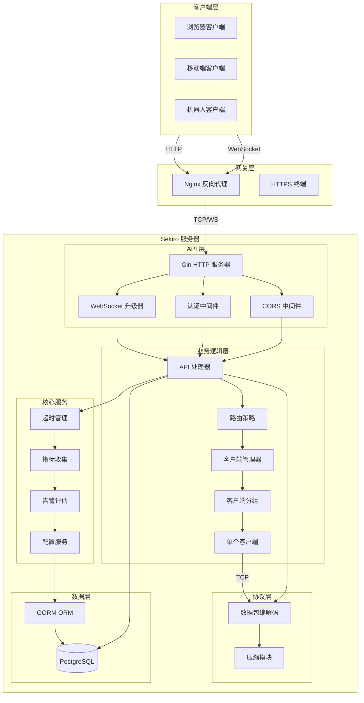
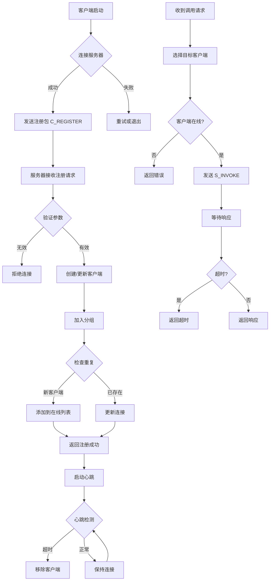

# Sekiro RPC 项目全面技术分析、架构解构与二次开发规划文档

## 1 项目整体与核心模块分析

### 1.1 项目概述

Sekiro RPC 是一个多语言、分布式、网络拓扑无关的服务发布平台，采用 Go 语言实现。该项目是 Java 版本 Sekiro 的 Go 语言移植版本，支持 WebSocket 长连接通信、HTTP API 调用、负载均衡和分组管理等核心功能。项目的技术栈选择体现了现代化服务端开发的最佳实践：使用 Gin 框架处理 HTTP 请求和中间件，采用 gorilla/websocket 实现 WebSocket 通信，通过 GORM 操作 PostgreSQL 数据库，使用 uber-go/zap 进行结构化日志记录。

项目的核心设计理念是将远程客户端设备作为服务端能力的延伸，通过统一的 RPC 调用机制实现对分布在全球各地的客户端的远程控制和数据采集。这种架构特别适合需要大规模设备管理和数据收集的场景，如浏览器自动化、爬虫调度、远程执行等。

### 1.2 核心模块结构分析

#### 1.2.1 启动引导模块（pkg/server/bootstrap.go）

启动引导模块是整个服务器的入口点，负责协调各个组件的初始化和启动过程。该模块在 `Server` 结构体中集中管理了所有核心组件，包括客户端管理器、HTTP 服务器、API 处理器、WebSocket 处理器、超时管理器、指标收集器、告警评估器和配置服务。启动流程遵循清晰的顺序：首先加载 YAML 配置文件，然后初始化日志系统，接着初始化数据库连接并执行数据库迁移，随后启动各个服务组件，最后启动 HTTP 服务器并监听指定端口。

这种集中式的启动管理方式存在一定的耦合性问题，所有的初始化逻辑都集中在一个文件中，随着功能增加，文件会变得臃肿。建议将不同的初始化逻辑拆分为独立的初始化器（Initializer）接口，由各个模块自行实现其初始化逻辑，从而实现更好的关注点分离。

#### 1.2.2 客户端管理模块（pkg/server/client/）

客户端管理模块采用了分层设计，包含三个核心结构：ClientManager 负责管理所有的分组，SekiroGroup 负责管理分组内的客户端，SekiroClient 代表单个客户端连接。ClientManager 使用读写锁（sync.RWMutex）保护分组映射表，提供了分组创建、客户端注册、注销、查询等操作。SekiroGroup 内部维护了在线客户端和离线客户端两个列表，并实现了基于轮询的客户端分配算法。

客户端管理模块采用了双重检查锁定（Double-Check Locking）模式来确保线程安全：在 getOrCreateGroup 方法中，首先使用读锁尝试获取分组，如果不存在则升级为写锁进行创建操作，这种方式在分组已存在的常见场景下避免了不必要的锁竞争。客户端的健康状态通过 MarkSuccess 和 MarkFailure 方法进行跟踪，连续失败三次的客户端会被标记为不健康，在路由选择时会被优先跳过。

#### 1.2.3 API 处理模块（pkg/server/api/handlers.go）

API 处理模块负责处理所有的 HTTP API 请求，是系统的请求入口点。该模块定义了 InvokeRequest、ExecJSRequest、GetCookieRequest 等请求结构体，并实现了相应的处理方法。HandleInvoke 方法是核心的 RPC 调用处理逻辑，其工作流程包括：参数验证、空转调用保护检查、客户端选择、请求发送、响应等待和结果返回。

值得注意的是，API 处理模块中存在明显的代码重复问题。HandleInvoke、HandleExecJS、HandleGetCookie、HandleGetHtml 四个方法的核心逻辑几乎完全相同，都遵循“选择客户端 → 构建请求 → 发送请求 → 等待响应 → 返回结果”的流程，只是请求数据的构建方式略有不同。这种重复可以通过提取公共的处理方法来改善，将相同的部分抽象为一个通用的方法，不同类型的请求只需要提供不同的请求构建逻辑即可。

#### 1.2.4 路由策略模块（pkg/server/router/strategy.go）

路由策略模块实现了三种客户端选择策略：轮询策略（RoundRobin）、指定客户端策略（SpecifiedClient）和一致性哈希策略（ConsistentHash）。Router 结构体使用一个映射来维护每个分组的轮询计数器，通过原子操作实现无锁的计数器递增。路由决策的优先级为：首先尝试指定客户端，如果没有指定则尝试一致性哈希，最后降级到轮询策略。

一致性哈希实现使用了自定义的哈希环（ConsistentHashRing），通过虚拟节点技术减少哈希碰撞。当某个客户端离线时，一致性哈希会重新映射到其他客户端，保证了请求的负载均衡。路由模块还实现了客户端健康状态过滤，在轮询时会优先选择健康的客户端，只有在没有健康客户端时才使用所有在线客户端。

#### 1.2.5 协议模块（pkg/protocol/）

协议模块定义了 Sekiro  RPC 通信协议的数据包格式和编解码逻辑。数据包采用二进制格式，包含魔数（Magic）、长度（Length）、类型（Type）、序列号（SerialNumber）、头部（Headers）和数据（Data）六个部分。协议支持多种包类型，包括心跳包（HEARTBEAT）、客户端注册（C_REGISTER）、调用响应（C_INVOKE_RESPONSE）、客户端下线（C_OFFLINE）、服务器调用（S_INVOKE）和调用端请求（I_INVOKE）。

协议模块的设计体现了良好的关注点分离：PacketType 枚举定义了所有支持的包类型，每个类型都有对应的 NewPacket 方法创建新数据包。这种设计使得添加新的包类型非常方便，只需要定义新的枚举值和对应的处理逻辑即可。

#### 1.2.6 压缩模块（pkg/compress/）

压缩模块支持三种压缩算法：无压缩（None）、Gzip 压缩和 Snappy 压缩。CompressorManager 负责管理所有的压缩器，并提供了统一的压缩和解压缩接口。压缩模块使用策略模式（Strategy Pattern）设计，不同的压缩算法实现了统一的 Compressor 接口，可以在运行时动态切换。这种设计使得添加新的压缩算法非常方便，只需要实现 Compressor 接口即可。

#### 1.2.7 告警与监控模块（pkg/server/alert/, pkg/server/metrics/）

告警模块实现了完整的告警评估和通知机制。Evaluator 是告警评估引擎的核心，定期从指标收集器读取数据，根据配置的告警规则进行评估，当触发告警条件时通过Notifier 发送通知。告警规则支持多种操作符（大于、小于、等于、不等于等），可以针对不同的指标（invoke.total、invoke.latency 等）在不同的时间窗口内进行评估。

监控指标收集器（MetricsCollector）实现了内存级别的指标聚合，支持计数器（Incr）和延迟记录（RecordLatency）两种指标类型。指标数据按分钟聚合存储，可以查询历史数据用于趋势分析和告警评估。

#### 1.2.8 中间件模块（pkg/server/middleware/）

中间件模块提供了认证、CORS、限流、日志追踪等横切关注点的实现。认证中间件（AuthMiddleware）从 Authorization header 中提取 Bearer token，查询数据库验证用户身份，并将用户信息存入 Gin context 供后续处理函数使用。CORS 中间件支持跨域请求的配置，允许指定来源的请求访问 API。追踪中间件（TraceMiddleware）生成并传播追踪 ID，方便进行分布式请求追踪。

### 1.3 模块调用关系与依赖方向

系统整体的调用关系遵循清晰的层次结构：HTTP 请求首先到达 Gin 框架，由中间件进行预处理，然后分发给相应的处理器。业务处理器（如 HandleInvoke）依赖客户端管理器选择目标客户端，通过 WebSocket 发送请求并等待响应。响应结果通过超时管理器返回给客户端。

数据库层位于最底层，所有需要持久化的数据（用户信息、系统配置、监控指标、告警规则等）都通过 GORM 进行操作。配置服务（ConfigService）提供了系统配置的动态加载和刷新机制，允许在运行时修改部分配置而无需重启服务。

### 1.4 存在的隐式耦合与边界问题

通过代码分析，我们发现了以下耦合和边界问题：首先，API 处理模块与 WebSocket 处理模块存在紧密耦合，HandleInvoke 方法直接调用 wsHandler 的 SendInvokeRequest 方法发送请求，这种直接依赖使得单元测试难以进行。其次，配置服务通过全局函数（handlers.SetConfigService）进行注入，这种方式虽然简单但不够优雅，增加了模块间的隐式依赖。再次，告警评估器直接依赖数据库进行规则查询和历史记录存储，与数据库层形成了紧耦合。最后，超时管理器（TimeoutManager）使用了内部结构体 InvokeRecord，其定义在 forwarder 包中，对外暴露的接口不够清晰。

## 2 设计模式与架构风格分析

### 2.1 创建型模式

#### 2.1.1 单例模式（Singleton）

项目中使用单例模式的地方主要包括：数据库连接（DB 全局变量）、配置服务（ConfigService 单例）、客户端管理器（在 Server 中作为单一实例）。数据库单例通过全局变量实现，虽然简单但存在线程安全隐患——在并发环境下直接访问全局 DB 变量可能导致连接泄漏或竞态条件。配置服务的单例实现较为规范，通过 NewService 工厂方法创建，在整个服务器生命周期内保持唯一实例。

#### 2.1.2 工厂模式（Factory）

协议模块中的 PacketType 枚举值实现了工厂方法模式，每个包类型都实现了 NewPacket 方法用于创建对应类型的数据包。例如，`C_REGISTER.NewPacket()` 会创建一个客户端注册请求包。这种设计使得创建数据包的过程更加直观，避免了在调用处直接接触数据包的内部结构。压缩模块中的 NewCompressorManager 工厂方法也体现了工厂模式的思想，根据配置创建相应的压缩器管理器。

### 2.2 结构型模式

#### 2.2.1 适配器模式（Adapter）

压缩模块采用了适配器模式的变体。不同的压缩算法（gzip、snappy、none）都实现了统一的压缩接口，CompressorManager 作为统一入口屏蔽了底层实现的差异。这种设计使得调用方不需要关心具体的压缩算法实现，可以透明地切换不同的压缩方式。在项目中也存在适配器的反向使用场景：API Handler 需要适配不同的请求格式（JSON 和 Query 参数），通过 ShouldBindJSON 和 c.Query 的组合使用来实现请求数据的统一获取。

#### 2.2.2 门面模式（Facade）

API Handler（api.APIHandler）作为门面封装了复杂的内部逻辑。对外提供了简洁的接口（HandleGroupList、HandleClientQueue、HandleInvoke 等），调用方只需要调用相应方法即可完成操作，无需了解内部是如何选择客户端、如何发送 WebSocket 请求、如何等待响应的。ClientManager 也扮演了类似的角色，对外提供了统一的客户端管理接口，隐藏了分组管理、客户端注册等复杂的内部实现。

### 2.3 行为型模式

#### 2.3.1 策略模式（Strategy）

路由模块是策略模式的典型应用。Router 结构体支持多种路由策略（RoundRobin、SpecifiedClient、ConsistentHash），通过 RouteParams 参数动态选择使用哪种策略。这种设计使得添加新的路由策略非常方便，只需要实现对应的路由方法即可。压缩算法的选择也体现了策略模式的思想，运行时可以根据配置选择不同的压缩策略。

#### 2.3.2 观察者模式（Observer）

事件总线（pkg/eventbus/）模块实现了观察者模式。EventBus 维护了一个事件订阅者列表，发布者可以发布事件，所有订阅了该事件的处理函数都会被调用。这种设计实现了事件发送者和接收者的解耦，使得系统更容易扩展。不过从当前代码来看，事件总线的使用场景较为有限，可以考虑进一步推广应用或移除未使用的代码。

#### 2.3.3 模板方法模式（Template Method）

Gin 框架本身使用了模板方法模式，每个 HandlerFunc 都遵循“接收请求 → 处理业务 → 返回响应”的固定流程。在项目的 API 处理模块中，HandleInvoke、HandleExecJS、HandleGetCookie、HandleGetHtml 等方法都遵循相似的处理骨架（验证参数 → 选择客户端 → 发送请求 → 等待响应 → 返回结果），这可以视为模板方法模式的应用，但也正如前文所述，这种重复代码正是需要重构的地方。

### 2.4 架构层级模式分析

项目整体采用了分层架构风格，但分层不够清晰。典型的三层架构包括表现层（Presentation Layer）、业务逻辑层（Business Logic Layer）和数据访问层（Data Access Layer），而当前项目中这三层的边界较为模糊：handlers 包既包含业务逻辑也包含数据访问，api 包混合了表现层和部分业务逻辑，database 包负责数据访问但缺乏清晰的事务边界定义。

项目也没有严格遵循 Clean Architecture 的依赖规则，即外层不能依赖内层。当前设计中，API Handler 依赖 ClientManager，ClientManager 依赖具体的客户端实现，这种直接的依赖关系使得替换实现变得困难。建议引入依赖注入（Dependency Injection）和接口抽象来解耦各层之间的依赖。

### 2.5 可以引入但尚未使用的设计模式

第一，建议引入依赖注入容器。Golang 项目中可以使用 wire 或 dig 等依赖注入框架，将各个组件的创建和依赖关系集中管理，提高代码的可测试性和可维护性。第二，可以引入装饰器模式来增强 Handler 的功能，例如添加日志装饰器、指标装饰器、缓存装饰器等，在不修改原 Handler 的情况下为其增加额外的功能。第三，可以引入资源池模式来管理数据库连接和 WebSocket 连接，避免频繁创建和销毁连接带来的性能开销。第四，建议引入配置对象模式，将配置参数封装为配置对象，通过选项模式（Options Pattern）提供灵活的配置方式。

## 3 可视化图表生成

### 3.1 系统架构图



### 3.2 核心业务流程图

```mermaid
sequenceDiagram
    participant C as 调用方
    participant S as API Handler
    participant R as Router
    participant CM as ClientManager
    participant G as SekiroGroup
    participant CL as SekiroClient
    participant WS as WebSocket
    participant TM as TimeoutManager

    C->>S: HTTP POST /business/invoke
    S->>S: 参数验证 (group, action)
    S->>S: 空转调用保护检查
    S->>R: 选择目标客户端
    R->>CM: GetGroup(group)
    CM->>G: 获取分组实例
    G->>R: 返回可用客户端列表
    R-->>S: 返回选中的客户端
    
    alt 指定客户端
        S->>CL: 直接获取指定客户端
    else 轮询/一致性哈希
        R->>G: AllocateClient()
        G->>R: 轮询选择客户端
        R-->>S: 返回选中的客户端
    end
    
    S->>TM: Add(sequence, clientId, data)
    S->>WS: SendInvokeRequest(conn, sequence)
    WS->>CL: 通过 WebSocket 发送请求
    
    CL->>CL: 处理请求并返回响应
    CL->>WS: 发送响应数据
    WS->>TM: 触发 Wait 通道
    
    TM-->>S: 返回响应结果
    S->>CL: MarkSuccess/MarkFailure
    
    alt 超时
        S->>C: 返回 504 Timeout
    alt 成功
        S->>C: 返回 200 OK + 数据
    alt 失败
        S->>C: 返回 500 Error
    end
```

### 3.3 客户端注册与调用流程图



## 4 二次开发与架构优化建议

### 4.1 建议一：提取通用请求处理逻辑，消除代码重复

**涉及的目标模块或代码区域**：pkg/server/api/handlers.go

**当前存在的问题或技术债**：HandleInvoke、HandleExecJS、HandleGetCookie、HandleGetHtml 四个方法存在大量重复代码，核心处理逻辑完全相同，只是请求数据的构建方式不同。这导致代码冗余，维护困难，新增类似接口时需要重复修改多处。

**具体实施方案**：提取一个通用的请求处理方法 `handleForwardRequest`，接收请求构建器作为参数。定义请求构建器接口 RequestBuilder，包含构建请求数据的方法。各种请求类型只需实现相应的请求构建器即可。

```go
type RequestBuilder interface {
    BuildRequestData(action string, params interface{}) (map[string]interface{}, error)
    GetTimeout() time.Duration
}
```

然后将公共的验证、选择客户端、发送请求、等待响应、超时处理、指标记录等逻辑提取到通用方法中。这种重构可以减少约 60% 的重复代码。

**预期收益**：代码可维护性大幅提升，新增请求类型只需要提供请求构建器；减少潜在 bug 的传播点；更易于编写单元测试。

**潜在风险与实施成本**：重构过程中需要仔细测试确保行为完全一致；需要处理各个方法的差异点（如空转调用保护仅在 Invoke 中需要）；预计实施时间为 2-3 小时。

### 4.2 建议二：引入依赖注入框架，实现可测试架构

**涉及的目标模块或代码区域**：全局（Server、API Handler、Middleware、Alert 等）

**当前存在的问题或技术债**：当前代码中存在大量的直接依赖和全局状态，例如 API Handler 直接创建 Router 实例，配置服务通过全局函数注入，数据库通过全局变量访问。这使得单元测试难以进行，模拟依赖需要使用复杂的 monkey patching 技术。

**具体实施方案**：引入依赖注入框架（如 wire 或 dig），定义各个组件的 Provider 和 Depends-on 关系。将数据库访问抽象为 Repository 接口，用接口替代具体实现。重构 Server 结构，接受各个组件的接口而非直接创建。在测试时可以使用 mock 对象替代真实实现。

**预期收益**：单元测试覆盖率可以显著提升；组件之间的依赖关系更加清晰；更容易实现组件的复用和替换；代码结构更加符合软件设计原则。

**潜在风险与实施成本**：引入新的依赖增加了项目复杂度；需要重构大量现有代码；需要团队学习新的框架；预计实施时间为 1-2 天。

### 4.3 建议三：实现分布式追踪与完整可观测性

**涉及的目标模块或代码区域**：pkg/server/middleware/trace.go、pkg/server/handlers/trace.go、pkg/model/trace.go

**当前存在的问题或技术债**：当前项目虽然已有基础的追踪 ID 生成和传播机制（TraceMiddleware），但缺少完整的分布式追踪系统。无法跨服务追踪请求的完整调用链，难以定位跨多个客户端的调用问题。指标系统也较为基础，缺乏多维度的分析和告警能力。

**具体实施方案**：集成 OpenTelemetry 或 Jaeger，实现完整的分布式追踪。在 WebSocket 处理、HTTP 调用、数据库操作等关键路径添加_span，支持跨进程追踪传播。将 TraceRecord 模型扩展为支持更多上下文信息（如 HTTP headers、请求参数、响应大小等）。实现追踪数据的持久化存储和分析查询界面。

**预期收益**：生产环境问题定位时间大幅缩短；可以可视化完整的请求调用链；支持多维度指标分析和根因定位；提高系统的可运维性。

**潜在风险与实施成本**：引入新的依赖和存储组件；追踪数据量可能较大，需要考虑采样策略和存储成本；需要修改多个模块的代码；预计实施时间为 2-3 天。

### 4.4 建议四：实现 API 版本管理与平滑升级

**涉及的目标模块或代码区域**：pkg/server/api/http_server.go、pkg/server/bootstrap.go

**当前存在的问题或技术债**：当前 API 没有版本管理机制，所有 API 都在同一路径下。随着功能迭代，API 变更会导致兼容性问题。无法在不影响旧版客户端的情况下升级服务端的 API。

**具体实施方案**：在 /business 路径下引入版本号（如 /business/v1/invoke、/business/v2/invoke）。实现 API 版本协商机制，支持通过 header 或 query 参数指定版本。创建版本路由映射，不同版本指向不同的 Handler 实现。保留旧版本的支持，提供版本迁移指南和过渡期。

**预期收益**：API 变更更加安全可控；支持多个客户端版本同时运行；平滑升级减少服务中断；提升用户体验和系统稳定性。

**潜在风险与实施成本**：增加了代码复杂度；需要维护多个版本的 API；旧版本的技术债务会累积；预计实施时间为 1-2 天。

## 5 项目目录结构解析

```
sekiro-go/
├── cmd/                              # 可执行程序入口
│   ├── server/main.go                 # 服务器主程序入口
│   ├── client/main.go                # 客户端示例程序
│   └── invoker/main.go                # 调用端示例程序
│
├── pkg/                              # 核心业务代码包
│   ├── client/                        # 客户端 SDK
│   │   ├── client.go                  # SekiroClient 实现
│   │   └── invoker.go                  # SekiroInvoker 调用端实现
│   │
│   ├── compress/                      # 压缩算法模块
│   │   ├── gzip.go                     # Gzip 压缩实现
│   │   ├── snappy.go                   # Snappy 压缩实现
│   │   ├── none.go                     # 无压缩实现
│   │   └── manager.go                  # 压缩管理器
│   │
│   ├── database/                      # 数据库访问层
│   │   └── database.go                # GORM 初始化和迁移
│   │
│   ├── eventbus/                      # 事件总线
│   │   ├── eventbus.go                 # 事件发布订阅实现
│   │   └── events.go                   # 事件定义
│   │
│   ├── model/                         # 数据模型定义
│   │   ├── alert.go                    # 告警规则和历史模型
│   │   ├── database.go                 # 数据库模型汇总
│   │   └── trace.go                    # 追踪记录模型
│   │
│   ├── protocol/                       # 通信协议层
│   │   ├── packet.go                   # 数据包编解码实现
│   │   └── packet_type.go              # 包类型定义
│   │
│   ├── server/                         # 服务器端核心
│   │   ├── api/                        # HTTP API 处理
│   │   │   ├── handlers.go             # 业务请求处理器
│   │   │   ├── http_server.go          # Gin 服务器封装
│   │   │   ├── websocket.go            # WebSocket 配置
│   │   │   └── *.go                    # 其他 API 相关代码
│   │   │
│   │   ├── client/                     # 客户端管理
│   │   │   ├── client.go               # 客户端连接定义
│   │   │   ├── group.go                # 分组管理
│   │   │   └── manager.go               # 客户端管理器
│   │   │
│   │   ├── alert/                      # 告警系统
│   │   │   ├── evaluator.go            # 告警评估引擎
│   │   │   └── notifier.go             # 告警通知器
│   │   │
│   │   ├── detector/                   # 协议检测
│   │   │   ├── detector.go             # 检测器主逻辑
│   │   │   ├── http_matcher.go         # HTTP 协议匹配
│   │   │   └── sekiro_matcher.go       # Sekiro 协议匹配
│   │   │
│   │   ├── flow/                       # 流量控制
│   │   │   ├── backoff.go              # 退避算法
│   │   │   └── ratelimit.go            # 限流实现
│   │   │
│   │   ├── forwarder/                  # 请求转发
│   │   │   ├── timeout.go              # 超时管理
│   │   │   └── *.go                    # 转发相关代码
│   │   │
│   │   ├── handlers/                   # Web 管理界面
│   │   │   ├── user.go                 # 用户管理
│   │   │   ├── group.go                # 分组管理
│   │   │   ├── metric.go               # 指标数据
│   │   │   ├── trace.go                # 链路追踪
│   │   │   ├── alert.go                # 告警管理
│   │   │   ├── login.go                # 登录处理
│   │   │   └── *.go                    # 其他处理器
│   │   │
│   │   ├── middleware/                 # Gin 中间件
│   │   │   ├── auth.go                 # 认证中间件
│   │   │   ├── cors.go                 # CORS 中间件
│   │   │   ├── ratelimit.go            # 限流中间件
│   │   │   ├── trace.go                # 追踪中间件
│   │   │   └── logging.go              # 日志中间件
│   │   │
│   │   ├── metrics/                    # 指标收集
│   │   │   └── collector.go            # 指标收集器
│   │   │
│   │   ├── router/                      # 路由策略
│   │   │   ├── strategy.go             # 路由策略实现
│   │   │   └── hash.go                 # 一致性哈希
│   │   │
│   │   ├── websocket/                  # WebSocket 处理
│   │   │   └── handler.go              # WebSocket 消息处理
│   │   │
│   │   ├── config/                      # 配置服务
│   │   │   └── service.go              # 配置加载和服务
│   │   │
│   │   └── bootstrap.go                # 服务器启动引导
│   │
│   └── utils/                          # 工具包
│       ├── password/                   # 密码处理
│       │   └── password.go             # 密码哈希
│       └── traceid/                    # 追踪 ID
│           └── traceid.go              # UUID 生成
│
├── internal/                          # 内部包（不对外暴露）
│   ├── config/                         # YAML 配置管理
│   │   └── config.go                   # 配置结构定义和加载
│   │
│   └── utils/                          # 内部工具
│       └── logger/                     # 日志工具
│           └── logger.go               # zap 日志封装
│
├── web/                               # React 前端
│   ├── src/
│   │   ├── pages/                      # 页面组件
│   │   │   ├── Login.jsx               # 登录页
│   │   │   ├── Dashboard.jsx           # 仪表盘
│   │   │   ├── GroupList.jsx           # 分组列表
│   │   │   ├── GroupDetail.jsx         # 分组详情
│   │   │   ├── MonitorDashboard.jsx    # 监控仪表盘
│   │   │   ├── AlertRules.jsx          # 告警规则
│   │   │   ├── AlertHistory.jsx        # 告警历史
│   │   │   ├── TraceList.jsx           # 追踪列表
│   │   │   ├── TraceDetail.jsx         # 追踪详情
│   │   │   └── *.jsx                   # 其他页面
│   │   │
│   │   ├── components/                 # 公共组件
│   │   │   ├── GroupMonitor.jsx        # 监控图表
│   │   │   ├── GroupAction.jsx        # Action 管理
│   │   │   ├── GroupDeviceList.jsx    # 设备列表
│   │   │   ├── AlertRuleForm.jsx      # 告警规则表单
│   │   │   └── *.jsx                   # 其他组件
│   │   │
│   │   ├── utils/                      # 工具函数
│   │   │   ├── api.js                  # API 调用封装
│   │   │   └── index.js                # 通用工具
│   │   │
│   │   ├── layouts/                    # 布局组件
│   │   │   └── Layout.jsx              # 主布局
│   │   │
│   │   ├── App.jsx                     # 应用入口
│   │   └── main.jsx                    # React 入口
│   │
│   ├── package.json                   # 前端依赖配置
│   └── vite.config.js                 # Vite 构建配置
│
├── deploy/                            # 部署脚本
│   └── postgres/                       # PostgreSQL 部署
│       ├── migration.sql               # 数据库迁移脚本
│       └── migration/                  # 增量迁移
│
├── sample/                            # 示例代码
│   └── demo-go/                        # Go 客户端示例
│
├── cmd/                              # 已在上文说明
│
├── config.yaml                       # 配置文件模板
├── go.mod                            # Go 模块定义
├── go.sum                            # Go 依赖校验
├── docker-compose.yaml               # Docker Compose 配置
└── README.md                         # 项目说明文档
```

### 目录角色与边界说明

**cmd/ 目录**作为应用程序的入口点，职责清晰：只负责解析命令行参数、创建配置、启动服务器，不包含任何业务逻辑。这种设计使得入口代码极其简洁，便于理解和维护。

**pkg/ 目录**包含了所有可复用的业务代码，是项目的核心。其中 client/ 是对外的客户端 SDK，protocol/ 定义了通信协议，server/ 是服务器端实现。各个子包之间遵循依赖规则：业务层可以依赖协议层和工具层，但不能反向依赖。

**internal/ 目录**包含只在项目内部使用的代码，不对外暴露。配置加载和日志工具属于基础设施，与业务逻辑无直接关系，放在 internal 中是合理的。

**web/ 目录**是 React 前端应用，使用 Vite 作为构建工具，Ant Design 作为 UI 组件库。前后端在同一个仓库中管理，便于同步开发和部署。前端通过 HTTP API 与后端通信，遵循 RESTful 设计风格。

## 6 新开发者实战入门指南

### 6.1 本地环境搭建

#### 6.1.1 所需软件与版本要求

开发 Sekiro RPC 项目需要以下软件环境。首先是 Go 语言环境，版本要求 1.25.0 或更高版本。可以通过以下命令检查当前 Go 版本：

```bash
go version
# 输出类似：go version go1.25.0 linux/amd64
```

如果没有安装或版本过低，请访问 Go 官方下载页面（https://go.dev/dl/）下载并安装。对于 Linux 系统，也可以使用包管理器进行安装，例如在 Ubuntu 上可以使用 `sudo apt-get install golang-go`。

其次需要 PostgreSQL 数据库，项目使用 PostgreSQL 12 或更高版本。可以选择安装本地数据库或使用 Docker 运行。对于本地开发，可以使用 Docker 快速启动一个 PostgreSQL 容器：

```bash
docker run -d \
  --name sekiro-postgres \
  -e POSTGRES_USER=sekiro \
  -e POSTGRES_PASSWORD=sekiro123 \
  -e POSTGRES_DB=sekiro \
  -p 5432:5432 \
  postgres:15-alpine
```

最后需要 Node.js 环境用于前端开发，版本要求 18.x 或更高。可以使用 nvm（Node Version Manager）管理多个 Node.js 版本。对于简单的后端开发，可以不安装 Node.js，除非需要修改或运行前端代码。

#### 6.1.2 环境变量与配置说明

项目的主要配置通过 config.yaml 文件管理，也可以在运行时通过命令行参数覆盖。配置文件的关键配置项包括：

```yaml
# 基础监听配置
BasicListen: ":5612"        # 服务器监听地址和端口
Host: "0.0.0.0"            # 监听主机
Port: 5612                 # 监听端口

# 超时配置
DefaultTimeOut: 30          # RPC 调用默认超时时间（秒）

# 日志配置
CloseLog: false            # 是否关闭日志
CloseWebLog: false          # 是否关闭 Web 访问日志
Mode: release              # 运行模式：debug 或 release

# CORS 配置
Cors: true                 # 是否启用跨域

# 数据库配置
Database:
  Host: "localhost"        # 数据库主机
  Port: 5432               # 数据库端口
  User: "ruoxing"          # 数据库用户名
  Password: "mrx123456"    # 数据库密码
  DBName: "sekiro"         # 数据库名称
  SSLMode: "disable"       # SSL 模式
```

对于本地开发，可以创建 config.local.yaml 覆盖默认配置：

```yaml
# config.local.yaml
Host: "0.0.0.0"
Port: 5612
Database:
  Host: "localhost"
  Port: 5432
  User: "sekiro"
  Password: "sekiro123"
  DBName: "sekiro"
  SSLMode: "disable"
Mode: debug
```

### 6.2 从 0 到运行

#### 6.2.1 克隆代码并安装依赖

首先克隆项目代码到本地：

```bash
git clone https://github.com/sekiro-go/sekiro-go.git
cd sekiro-go
```

然后安装 Go 依赖：

```bash
go mod tidy
```

这一步会自动下载项目依赖的所有 Go 包，并确保 go.mod 和 go.sum 文件保持同步。如果遇到依赖下载问题，可能需要配置 Go 模块代理：

```bash
export GOPROXY=https://goproxy.cn,direct
go mod tidy
```

#### 6.2.2 启动 PostgreSQL 数据库

如果使用 Docker 启动数据库：

```bash
# 启动 PostgreSQL 容器
docker run -d \
  --name sekiro-postgres-dev \
  -e POSTGRES_USER=sekiro \
  -e POSTGRES_PASSWORD=sekiro123 \
  -e POSTGRES_DB=sekiro \
  -p 5432:5432 \
  postgres:15-alpine

# 等待数据库启动
sleep 5
```

或者使用 docker-compose 启动整个开发环境：

```bash
docker-compose up -d
```

这将启动 PostgreSQL 数据库服务。

#### 6.2.3 启动 Sekiro 服务器

使用以下命令启动服务器：

```bash
# 方式一：使用默认配置
go run cmd/server/main.go

# 方式二：指定端口
go run cmd/server/main.go -port 5612

# 方式三：启用调试模式
go run cmd/server/main.go -debug

# 方式四：使用自定义配置文件
go run cmd/server/main.go -c config.local.yaml

# 方式五：组合使用
go run cmd/server/main.go -port 8080 -debug
```

服务器启动成功的标志是看到类似以下的输出：

```
Starting Sekiro RPC Server...
Host: 0.0.0.0, Port: 5612
INFO: Database migration completed successfully
INFO: Config service started successfully
INFO: Sekiro server starting on 0.0.0.0:5612
INFO: CORS enabled: true
INFO: Welcome to use Sekiro framework
```

#### 6.2.4 启动客户端

在另一个终端启动客户端：

```bash
# 启动客户端，连接到本地服务器
go run cmd/client/main.go \
  -server localhost:5612 \
  -group test-group \
  -client-id test-client-1
```

客户端启动成功后会显示连接到服务器的消息，并且会注册一个简单的处理函数来处理请求。

#### 6.2.5 发起 RPC 调用

使用 curl 发起 RPC 调用：

```bash
# 获取分组列表
curl http://localhost:5612/business/groupList

# 获取客户端队列
curl "http://localhost:5612/business/clientQueue?group=test-group"

# 发起 RPC 调用
curl -X POST http://localhost:5612/business/invoke \
  -H "Content-Type: application/json" \
  -d '{
    "group": "test-group",
    "action": "test",
    "params": {"message": "Hello Sekiro"}
  }'

# 或者使用 GET 请求
curl "http://localhost:5612/business/invoke?group=test-group&action=test&params=%7B%22message%22%3A%22Hello%22%7D"
```

### 6.3 最小改动示例（Hello World）

下面演示如何在 Sekiro 项目中添加一个新的简单功能：添加一个返回服务器状态的 API 端点。

#### 6.3.1 涉及的文件位置

需要修改的文件：`pkg/server/api/handlers.go`

需要添加的代码位置在 APIHandler 结构体的方法区域。

#### 6.3.2 代码修改说明

在 handlers.go 文件的末尾添加新的处理方法：

```go
// HandleServerStatus handles /business/status request
// GET /business/status
func (h *APIHandler) HandleServerStatus(c *gin.Context) {
    // 获取客户端管理器中的统计数据
    groupCount := 0
    clientCount := 0
    
    if h.clientManager != nil {
        groupCount = h.clientManager.GroupCount()
        clientCount = h.clientManager.ClientCount()
    }
    
    c.JSON(http.StatusOK, gin.H{
        "status": 0,
        "message": "success",
        "data": gin.H{
            "version": "1.0.0",
            "groups": groupCount,
            "clients": clientCount,
            "uptime": "running",
        },
    })
}
```

#### 6.3.3 注册新路由

在 bootstrap.go 的 registerRoutes 方法中，添加新路由的注册。找到业务路由注册部分：

```go
business := s.httpServer.Group("/business")
{
    business.GET("/groupList", s.apiHandler.HandleGroupList)
    business.GET("/clientQueue", s.apiHandler.HandleClientQueue)
    business.Any("/invoke", s.apiHandler.HandleInvoke)
    // ... 其他路由
    
    // 添加新的状态路由
    business.GET("/status", s.apiHandler.HandleServerStatus)
}
```

#### 6.3.4 运行并验证效果

重新编译并启动服务器：

```bash
go run cmd/server/main.go -debug
```

在另一个终端验证新功能：

```bash
curl http://localhost:5612/business/status
```

预期返回：

```json
{
  "status": 0,
  "message": "success",
  "data": {
    "version": "1.0.0",
    "groups": 1,
    "clients": 1,
    "uptime": "running"
  }
}
```

如果返回了正确的数据，说明新功能已经成功添加。

#### 6.3.5 运行测试验证

在添加新代码后，运行项目的测试确保没有破坏现有功能：

```bash
# 运行所有测试
go test ./... -v

# 只运行 API 相关的测试
go test ./pkg/server/api/... -v

# 运行特定测试
go test -run TestHandleInvoke ./pkg/server/api/...
```

测试全部通过后，说明改动是安全的。

### 6.4 进一步学习路径

对于新加入项目的开发者，建议按照以下路径深入学习：

首先，通读项目的 README.md 文档，了解项目的基本概念、功能特性和使用场景。然后，深入阅读 cmd/server/main.go 和 pkg/server/bootstrap.go，理解服务器的启动流程和组件初始化。接着，研究 pkg/server/api/handlers.go，理解核心的业务请求处理逻辑。在此基础上，学习 pkg/server/client/ 目录下的客户端管理实现，理解分组和路由的概念。最后，根据个人兴趣，深入研究协议实现、压缩算法、告警系统等特定模块。

项目采用了 Go 语言的常用实践，包括 Gin Web 框架、GORM ORM、uber-go/zap 日志库等，熟悉这些工具将有助于更快地理解代码。建议阅读相关框架的官方文档，加深对最佳实践的理解。

## 7 总结

本技术分析文档对 Sekiro RPC 项目进行了全面的架构解构，涵盖了项目概述、核心模块分析、设计模式识别、可视化图表、架构优化建议、目录结构解析和新手入门指南等六个主要方面。

通过分析，我们发现项目在架构上采用了清晰的分层设计，模块之间职责较为明确。但在代码层面存在一些可以改进的地方，如 API 处理模块的代码重复、依赖注入的缺失、可观测性功能的不足等。建议的实施计划优先级为：首先消除代码重复提高可维护性，然后引入依赖注入提升可测试性，最后完善可观测性功能支持生产运维。

项目的整体质量良好，代码结构清晰，注释充分，测试覆盖较全面。作为一个分布式 RPC 框架，Sekiro 展现了良好的设计思路和工程实践，适合作为二次开发的基础。