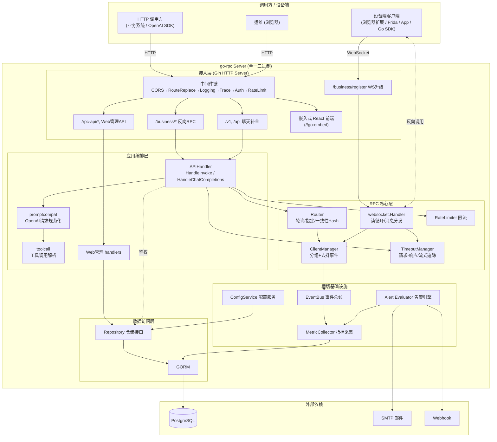
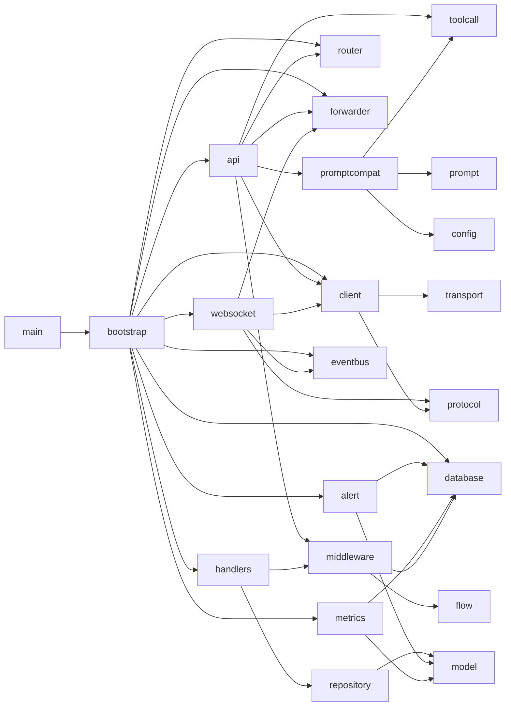
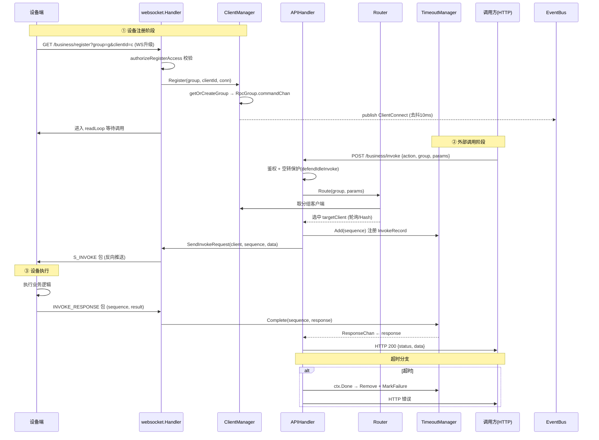
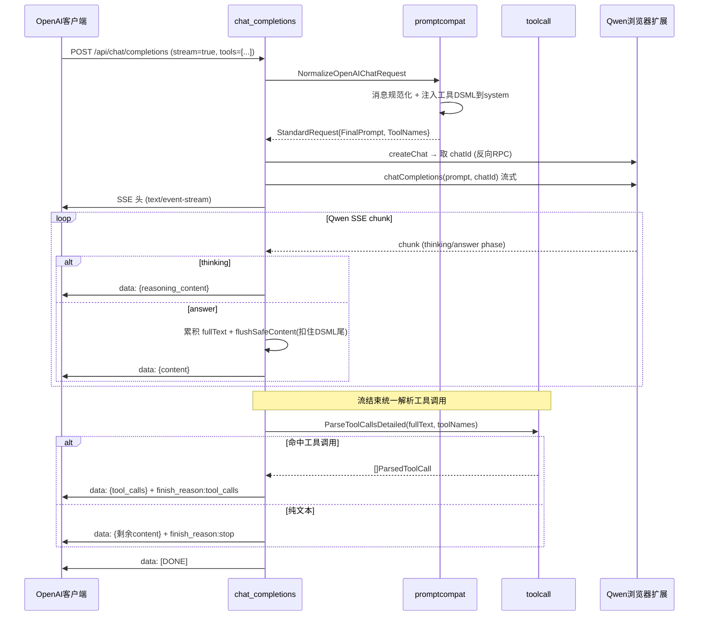

# go-rpc 项目全面技术分析

> 分析对象：`github.com/mrh30000/go-rpc`（Sekiro RPC Server 的 Go 实现 + AI/LLM 网关扩展）
> 代码规模：322 个文件、约 7800 个符号、44 个功能模块
> Go 版本：1.25.0 · Web 前端：React 18 + Vite 5 + Ant Design 5
> 本文基于源码逐文件阅读得出，标注的行号以阅读时的文件状态为准。

---

## 目录

1. [项目定位与全景](#1-项目定位与全景)
2. [目录结构与模块划分](#2-目录结构与模块划分)
3. [系统架构图](#3-系统架构图)
4. [核心模块深度分析](#4-核心模块深度分析)
5. [核心业务流程](#5-核心业务流程)
6. [设计模式与架构风格](#6-设计模式与架构风格)
7. [问题清单与优化建议](#7-问题清单与优化建议)
8. [新开发者入门指南](#8-新开发者入门指南)

---

## 1. 项目定位与全景

### 1.1 它是什么

go-rpc 本质是 **Sekiro「反向 RPC」框架的 Go 服务端重写版**，并在其上叠加了一层 **OpenAI 兼容的 AI 网关**。它有两条并存的主干业务：

| 业务线 | 解决的问题 | 入口 |
|--------|-----------|------|
| **反向 RPC（经典 Sekiro）** | 把分散在浏览器/手机/Frida hook 中的「设备端能力」反向暴露成 HTTP 接口。设备主动用 WebSocket 连上服务器并注册到分组，调用方通过 HTTP 把请求转发给某个设备执行，再把结果回传。 | `POST/GET /business/invoke` |
| **AI 网关（新增能力）** | 把浏览器扩展里的 Qwen（通义千问）网页会话，包装成标准的 OpenAI `/v1/chat/completions` 接口对外提供，并补齐工具调用（function calling）能力。 | `POST /v1/chat/completions`、`POST /api/chat/completions` |

这两条线复用了**同一套连接管理、路由、转发、超时、限流基础设施**——AI 网关只是一个特殊的「分组」（`group=qwenai`），其调用同样走 WebSocket 转发给浏览器扩展客户端。这是该项目架构上最精妙的地方：AI 能力不是另起炉灶，而是把 LLM 当成一种「反向 RPC 设备」接入。

### 1.2 反向 RPC 的核心思想

```
传统 RPC：  调用方 ──主动连接──▶ 服务提供者
反向 RPC：  服务提供者（设备）──主动连接──▶ 中转服务器 ◀──HTTP──  调用方
```

设备（爬虫脚本、App、浏览器扩展）往往处于内网/NAT 后、无公网 IP，无法被直接调用。反向 RPC 让设备**主动**用长连接挂到中转服务器上，服务器再把外部 HTTP 请求「反向」推给设备执行。这正是 JS 逆向、App 风控对抗、验证码识别等场景的常见架构。

### 1.3 技术栈总览

| 层 | 技术选型 |
|----|---------|
| HTTP 框架 | Gin v1.12 |
| WebSocket | gorilla/websocket v1.5.3 |
| ORM / DB | GORM v1.25 + PostgreSQL（pgx 驱动） |
| 日志 | uber-go/zap |
| 配置 | yaml.v3（服务端配置）+ JSON（AI 凭证配置 config_v2） |
| 压缩 | gzip（标准库）/ snappy（golang/snappy） |
| JSON | goccy/go-json（高性能） |
| 限流 | golang.org/x/time/rate（令牌桶） |
| 并发原语 | golang.org/x/sync（singleflight） |
| Token 计数 | hupe1980/go-tiktoken |
| 前端 | React 18 + React Router 6 + Ant Design 5 + ECharts 6 + ahooks + Axios |
| 构建/嵌入 | Vite 5 构建 → Go `//go:embed` 打包进单一二进制 |

---

## 2. 目录结构与模块划分

```
go-rpc/
├── main.go                      # 入口：解析 flag → 构造 Config → server.NewServer().Start()
├── config.yaml                  # 服务端运行配置
├── go.mod
│
├── internal/                    # 不对外暴露的内部包
│   ├── config/                  # ★ 双配置体系
│   │   ├── config.go            #   ServerConfig：YAML 服务端配置（端口/DB/告警/Provider）
│   │   ├── config_v2.go         #   Config：AI 凭证配置（API Keys/账号/代理/模型别名）
│   │   ├── store*.go            #   配置存储、索引、环境变量回写
│   │   ├── credentials.go, account.go, models.go, mobile.go ...
│   │   └── ...
│   ├── prompt/                  # ★ Prompt 组装（messages.go / tool_calls.go）
│   ├── promptcompat/            # ★ OpenAI 请求规范化层
│   │   ├── request_normalize.go #   ChatRequest → StandardRequest 总入口
│   │   ├── message_normalize.go #   消息角色/内容规范化（assistant/tool/developer）
│   │   ├── prompt_build.go      #   组装最终 prompt 字符串
│   │   ├── tool_prompt.go       #   把工具定义注入 system prompt
│   │   └── standard_request.go  #   StandardRequest 中间表示
│   ├── toolcall/                # ★ 工具调用解析引擎（17 个文件）
│   │   ├── toolcalls_parse.go   #   解析主管线
│   │   ├── toolcalls_dsml.go    #   DSML 标记格式
│   │   ├── toolcalls_xml.go     #   XML 格式
│   │   ├── toolcalls_json_repair.go  # 残缺 JSON 修复
│   │   ├── toolcalls_scan.go    #   候选探测（跳过注释/CDATA/代码块）
│   │   ├── toolcalls_schema_normalize.go # 按 schema 强制类型
│   │   └── ...
│   └── util/                    # thinking.go（思考模式）/ helpers.go
│
├── pkg/                         # 可复用包
│   ├── protocol/                # ★ Sekiro 二进制协议编解码（packet.go）
│   ├── compress/                # ★ 压缩策略（gzip/snappy/none + manager）
│   ├── client/                  # ★ 客户端 SDK（client.go 设备端 / invoker.go 调用端）
│   ├── eventbus/                # ★ 进程内事件总线（发布-订阅）
│   ├── model/                   # ★ 数据模型（database.go / trace.go / alert.go）
│   ├── database/                # GORM 连接 + AutoMigrate + repository/（仓储层）
│   └── server/                  # ★ 服务端核心
│       ├── bootstrap.go         #   Server 生命周期编排（NewServer/Start/Shutdown）
│       ├── api/                 #   HTTP handler（handlers.go / chat_completions.go / qwen.go）
│       ├── handlers/            #   Web 管理后台 handler（login/group/user/alert/trace...）
│       ├── client/              #   ClientManager / RpcGroup / RpcClient（连接管理）
│       ├── router/              #   路由策略（strategy.go 轮询/Hash / hash.go 一致性Hash）
│       ├── forwarder/           #   TimeoutManager（请求-响应/流式超时追踪）
│       ├── flow/                #   RateLimiter（限流）+ DelayBackoff（退避）
│       ├── transport/           #   Connection 抽象（tcp_conn / ws_conn）
│       ├── websocket/           #   WebSocket 连接处理（handler.go 读循环）
│       ├── middleware/          #   认证/限流/追踪/日志/CORS 中间件
│       ├── metrics/             #   指标采集器（collector.go）
│       ├── alert/               #   告警评估引擎 + 通知器
│       ├── config/              #   配置服务（SysConfig 缓存）
│       └── detector/            #   多协议检测器（HTTP vs Sekiro 二进制，当前未挂载）
│
├── web/                         # ★ React 管理前端
│   ├── embed.go                 #   //go:embed dist —— 把前端打进二进制
│   └── src/{pages,components,layouts,utils}/
│
├── deploy/                      # SQL 迁移脚本（postgres / mysql）
├── sample/                      # 各语言客户端示例（go/java/python/frida/web 扩展/xposed）
└── docs/                        # 设计文档
```

★ 标记的是核心模块。

### 模块内聚度（来自 GitNexus 聚类，cohesion 越高越独立）

| 模块 | 符号数 | 内聚度 | 评价 |
|------|--------|--------|------|
| Flow（限流/退避） | 24 | 96% | 边界清晰、自包含 |
| Python（示例客户端） | 56 | 94% | 独立 |
| Repository（仓储层） | 76 | 91% | 接口隔离良好 |
| Protocol（协议层） | 45 | 89% | 纯编解码、无外部耦合 |
| Config | 211 | 86% | 体量大但内聚 |
| Toolcall（工具解析） | 261 | 79% | 体量最大、可拆分 |
| Middleware | 26 | 68% | **内聚最低**，职责交叉需关注 |

---

## 3. 系统架构图

### 3.1 分层架构



### 3.2 模块依赖方向（自顶向下，无环）



依赖整体保持**自顶向下单向**：`api/handlers → 核心服务 → repository → model`，底层 `protocol / model / eventbus` 不反向依赖上层。`internal/toolcall` 完全自包含（零项目内依赖），是质量最高的孤立子系统。

---

## 4. 核心模块深度分析

### 4.1 服务器生命周期（`pkg/server/bootstrap.go`）

`Server` 结构体是整个进程的「装配根」（Composition Root），聚合了所有子系统。

**启动序列（`Start()` 行 126-262）：**
1. `loadYAMLConfig()` + `applyYAMLConfig()`：加载 `config.yaml`，命令行 flag 优先级高于 YAML。
2. `logger.InitLogger`：初始化 zap。
3. 条件初始化数据库：`DisableDatabase=true` 时进入 **DB-less 模式**（AI 网关可无数据库运行）。
4. `database.AutoMigrate()`：GORM 自动建表 + 写入默认 admin 用户和系统配置。
5. `configService.Refresh()`：加载系统配置进内存缓存。
6. 构造 `websocket.Handler`、`metricsCollector`、`apiHandler`。
7. **事件订阅**：客户端连接/断开 → 更新在线数 Gauge；健康降级 → 写告警日志。
8. 条件启动 `alertEvaluator`（注入 SMTP 配置）。
9. 构造 Gin HTTP Server，挂载中间件链。
10. `registerRoutes()`：注册所有路由。
11. `net.Listen` + `Serve`（独立 goroutine）。
12. `waitForShutdown()`：阻塞等待 SIGINT/SIGTERM。

**优雅关闭（`Shutdown()` 行 466-497）：** 关闭 shutdown channel → `wsCancel()` 取消所有 WS goroutine → 依次关闭 HTTP/WS/告警/指标 → 清理 ClientManager。各步骤都有 nil 检查，关闭逻辑对「禁用的子系统」是安全的。

**特性开关设计**：`DisableDatabase / DisableMetrics / DisableAlert / DisableWebAdmin` 四个开关让同一份二进制能以不同形态运行——从「全功能管理平台」到「纯 AI 网关」。这是很好的可裁剪设计。

**路由分组一览：**

| 前缀 | 鉴权 | 用途 |
|------|------|------|
| `/business/invoke` | OptionalAuth | 反向 RPC 调用 |
| `/business/register` | 自定义授权 | 设备 WebSocket 注册 |
| `/v1/chat/completions` | OptionalAuth | OpenAI 兼容补全 |
| `/api/chat/completions` | OptionalAuth | Qwen 浏览器扩展补全 |
| `/rpc-api/user-info/*` | - | 登录/注册/用户信息 |
| `/rpc-api/frontend/*` | - | 前端兼容接口 |
| Web 管理 API | 管理鉴权 | 分组/用户/告警/追踪 CRUD |

### 4.2 连接管理三层模型（`pkg/server/client/`）

这是整个 RPC 框架的并发核心，采用 **三级 Actor 模型**：

```
ClientManager  (全局, 1个)
   ├── map[groupName]*RpcGroup   (受 RWMutex 保护, 懒创建/空则自动删除)
   │
RpcGroup       (每分组1个, 单 goroutine + commandChan)
   ├── map[clientID]*RpcClient   (仅 runLoop 单线程访问, 无需锁)
   │
RpcClient      (每连接1个)
   └── transport.Connection      (WS/TCP, Send 受 writeMu 串行化)
```

**`RpcGroup` 的 Actor 模型（`group.go`）是最值得学习的设计**：每个分组用一个独立 goroutine 串行处理所有命令（注册/注销/分配客户端），分组内的 `clients map` 因此**完全无锁**。命令通过 `commandChan` 投递，调用方通过 callback channel 拿结果。关闭时 `drainCommands()` 会回填残留命令的 callback，避免调用方永久阻塞——这是个容易被忽略但很关键的健壮性细节。

**`RpcClient` 健康检查（`client.go`）**：`MarkSuccess/MarkFailure`，连续 3 次失败标记为不健康并触发 `OnHealthDegraded` 回调（经 EventBus 发布）。客户端分配时优先选「健康+在线」，降级选「在线」，兜底选「任意」。

**`ClientManager` 事件去抖（`manager.go`）**：用 `time.AfterFunc` 实现 10ms trailing 去抖，避免设备频繁上下线时产生事件风暴。

**并发安全总结：**

| 组件 | 保护机制 |
|------|---------|
| ClientManager.groups | `sync.RWMutex` + 双重检查锁 |
| RpcGroup.clients | 单 goroutine 串行（无锁） |
| RpcClient 写连接 | `writeMu`（gorilla/websocket 要求写串行） |
| RpcClient 状态 | `sync.RWMutex` |
| TimeoutManager.records | `sync.Mutex` |
| RateLimiter.limiters | 双重检查锁 |

### 4.3 路由策略（`pkg/server/router/`）

**优先级（`strategy.go` 的 `Route`）**：
1. 指定了 `ClientID` → 精确返回（不降级）
2. 有 `HashKey` → 一致性 Hash（失败降级轮询）
3. `ConstantInvoke=true` → 自动用 `Action+Params` 构建 HashKey → 一致性 Hash（实现「同参数同设备」的会话保持）
4. 默认 → 轮询（`atomic.AddUint64` 无锁计数器）

**一致性 Hash（`hash.go`）**：MurmurHash64（与 Java 版兼容）+ 默认 5 个虚拟节点。`strategy.go` 用 `cachedRing` 缓存 Hash 环，以**客户端列表指纹（SHA256）**判断是否需要重建，避免每次请求重建。

### 4.4 请求转发与超时（`pkg/server/forwarder/timeout.go`）

`TimeoutManager` 同时管理两类请求：

- **`InvokeRecord`（一次性）**：`ResponseChan`（buffer=1），`Complete()` 先从 map 删除再发送 channel，配合 buffer=1 避免阻塞。
- **`StreamRecord`（流式）**：`ChunkChan` 传递多个 chunk，`Push` 带 5s 超时防止消费者卡死生产者，`Done`/`Error` 时关闭 channel。

后台 `cleanupLoop` 每 10s 扫描清理过期记录，防内存泄漏。

### 4.5 协议层（`pkg/protocol/packet.go`）

**Sekiro 二进制帧格式：**

```
+----------+----------+------+------------+-------------+----------+------+
| Magic(8) | Length(4)| Type | SerialNum  | HeaderCount | Headers  | Data |
|  int64   |  int32   | byte |  int32(4)  |   byte(1)   | 变长     | 变长 |
+----------+----------+------+------------+-------------+----------+------+
        大端序          └─────────── Body (Length 计入) ───────────┘

Header 项: [KeyLen:1][Key][ValueLen:1][Value]
Magic = 0x73656b69726f0000 = "sekiro\0\0"
```

**包类型枚举（`packet_type.go`）**，按方向前缀分类：

| 范围 | 方向 | 类型 |
|------|------|------|
| 0 | 双向 | Heartbeat |
| 16-20 | 客户端→服务器 | Register, InvokeResponse, Offline, CmdResponse, InvokeStreamClose |
| 32-36 | 服务器→客户端 | SInvoke, SCmd, SOfflineResponse, SInvokeResponse, SInvokeConnected |
| 48-49 | 调用端→服务器 | IConnect, IInvoke |

`BufWriter`（`bufwriter.go`）通过持有 `*[]byte` 指针实现零拷贝写入，复用外部 buffer 减少 GC。

### 4.6 压缩层（`pkg/compress/`）

策略模式 + 注册表：`CompressorManager` 注册 `gzip/snappy/none` 三种。仅对**响应包**压缩，通过包 Header `compress_method` 选择算法。`NoneCompressor` 是空对象模式，避免 nil 判断。

### 4.7 AI/LLM 层（`internal/promptcompat` + `internal/toolcall`）★

这是项目最复杂、也最有技术含量的部分，目标是：**让不支持原生 function calling 的网页版 Qwen，能对外提供完整的 OpenAI 工具调用能力**。

**请求方向（promptcompat）**：

```
OpenAI ChatRequest (JSON, 含 tools/tool_calls)
  → NormalizeOpenAIChatRequest          解析模型别名
  → NormalizeOpenAIMessagesForPrompt     角色规范化(assistant/tool/developer→system)
  → injectToolPrompt                     把工具定义+调用格式注入 system prompt
  → StandardRequest{FinalPrompt, ToolNames, ToolChoice...}
  → 单一 prompt 字符串 → 发给 Qwen
```

工具定义被转写成 **DSML 标记格式**注入 prompt，并附带动态生成的示例（用真实工具名）：

```
<|DSML|tool_calls>
  <|DSML|invoke name="Read">
    <|DSML|parameter name="file_path"><![CDATA[/path]]></|DSML|parameter>
  </|DSML|invoke>
</|DSML|tool_calls>
```

用 `<|DSML|` 前缀和 `<![CDATA[...]]>` 包裹值，避免与普通 XML 冲突、规避引号转义问题。

**响应方向（toolcall）—— 多级容错解析管线**：

```
模型文本输出
  → stripFencedCodeBlocks          去 Markdown 代码块(处理未闭合 fence)
  → normalizeDSMLToolCallMarkup    统一 DSML/XML/tool_calls 变体
  → parseXMLToolCalls              XML 解析
  → 参数值解析责任链:
       CDATA → XML片段 → JSON字面量 → 松散JSON数组 → 原始字符串
  → NormalizeParsedToolCallsForSchemas  按工具 schema 强制类型(123→"123")
  → FormatOpenAIToolCalls          转回 OpenAI tool_calls 格式
```

**健壮性亮点**：
- JSON 三级降级修复：标准 → 修复非法反斜杠 → 修复无引号键/缺失数组括号（应对 DeepSeek「列表幻觉」）。
- 全角字符规范化（`〈〉""` → `<>""`）。
- 路径字段控制字符转义。
- 流式场景下，`flushSafeContent` 会**扣住末尾 `len(dsmlOpener)` 字节**不输出，直到确认不是工具调用开头才 flush——避免把半截 DSML 标记吐给客户端。

### 4.8 数据模型与持久化（`pkg/model/` + `deploy/postgres/migration.sql`）

**核心表清单：**

| 表 | 模型 | 关键字段 | 索引 |
|----|------|---------|------|
| `user_info` | UserInfo | api_token, is_admin, quota_qps | 部分唯一索引 `api_token<>''` |
| `group_config` | GroupConfig | group_name, user_name, quota_qps_group/per_device | - |
| `group_actions` | GroupAction | group_name+action_name | 唯一 |
| `group_device` | GroupDevice | group_name+device_id, last_active_time | 唯一 |
| `sys_config` | SysConfig | config_key, config_value | comment+key 唯一 |
| `server_node` | ServerNode | server_id, ip, port | server_id 唯一 |
| `metric_minute/hour/day` | Metric* | name, tags_md5, time_key, tag1-5, type, value | (name,tags_md5,time_key) 唯一 + 查询/删除索引 |
| `trace_record` | TraceRecord | trace_id, span_id, parent_span_id, duration_ms, status | trace_id/group/start_time/status/api |
| `alert_rule` | AlertRule | metric_name, operator, threshold, window | group/enabled/metric |
| `alert_history` | AlertHistory | rule_id, current_value, level, notified | rule_id/group/triggered_at/level |

**默认数据**：admin 用户（密码 bcrypt 哈希）+ 12 条系统配置（注册开关、匿名访问、QPS 限制、空转保护等）。

**两个值得注意的点**：
1. **AutoMigrate 与 SQL 迁移并存**：`database.go:AutoMigrate()` 用 GORM 建表 + 写默认数据，`deploy/postgres/migration.sql` 是另一套手写脚本。两者默认 admin 密码不同（GORM 版 `admin123` vs SQL 版预置 bcrypt），是潜在的**双真相源**问题。
2. **指标三级表（分/时/天）**已建表，但 `collector.go` 当前只写 `metric_minute`，小时/天级聚合尚未实现。

### 4.9 监控与告警（`pkg/server/metrics/` + `pkg/server/alert/`）

**指标采集器（`collector.go`）**：内存 bucket 聚合（按 `name:tagsMD5:type` 聚合），后台每 1 分钟 `flush` 批量写库（`CreateInBatches` 100 条/批）。支持 Counter/Gauge/Histogram/Latency 四类，延迟自动算 P50/P90/P99。`Shutdown` 时尽力落盘剩余数据。

**告警引擎（`evaluator.go`）**：每 1 分钟从库加载启用规则 → 查询窗口内指标 → 按 operator 比阈值 → 触发则写 `alert_history` 并通知。带 **5 分钟去抖**（查最近是否已触发）。级别按超阈值倍数划分（>2x Critical，>1.5x Warning）。通知支持 SMTP 邮件 + Webhook。

### 4.10 认证体系（`pkg/server/middleware/`）

**Token 提取优先级**：`Authorization: Bearer` > `sekiro-token` header > `sekiro_token` query > form。

**性能优化（`auth_cache.go`）**：`FindUserByToken` 用 **TTL 缓存 + singleflight** ——命中缓存直接返回；未命中时 singleflight 合并并发查询，正缓存 30s、负缓存 5s（防 token 穷举打库）。Group 配置查询同理。改密/刷新 token/删用户时主动失效缓存。每 5 分钟 GC 过期条目，超 1 万条立即清理。

**中间件执行顺序**：`CORS → RouteReplace → Logging → Trace → Auth → (Anonymous) → RateLimit → Handler 层授权`。

### 4.11 Web 前端（`web/`）

React 18 SPA，13 个页面，统一用 AuthGuard（HOC）保护需登录路由。三个 Axios 实例（business/admin/api）共享请求拦截器（注入 `Bearer token`）和响应拦截器（自动解包 data、401 跳登录、403 提示）。通过 `//go:embed dist` 把构建产物打进 Go 二进制，`ServePathOrIndex` 实现 SPA 前端路由回退。开发期用 Vite proxy 转发 `/business` `/api` `/rpc-api` 到 `:5613` 避免 CORS。

---

## 5. 核心业务流程

### 5.1 反向 RPC 完整生命周期



### 5.2 OpenAI 兼容补全流程（流式）



---

## 6. 设计模式与架构风格

### 6.1 架构风格

- **分层架构**：接入层（Gin）→ 应用编排层（handler/promptcompat）→ 核心服务层（client/router/forwarder）→ 数据访问层（repository）→ 模型层。依赖单向向下。
- **六边形思想的雏形**：`transport.Connection`、`MetricCollector`、`MetricsReader`、`Notifier`、`Repository` 等接口把核心逻辑与具体实现（WS/TCP、GORM、SMTP）解耦。
- **事件驱动**：EventBus 解耦连接状态变化与指标/告警的副作用。
- **可裁剪单体**：四个 Disable 开关让同一二进制适配多种部署形态。

### 6.2 设计模式清单

| 模式 | 位置 | 动机 | 评价 |
|------|------|------|------|
| **策略模式** | `router`（路由策略）、`compress`（压缩算法）、`transport`（连接类型）、`toolcall`（参数解析） | 运行时选择算法 | 用得很到位 |
| **Actor 模型** | `RpcGroup`（单 goroutine + commandChan） | 消除分组内锁竞争 | ★ 全项目最佳实践 |
| **责任链** | `toolcall` 参数值解析（CDATA→XML→JSON→松散→原始）；中间件链 | 逐级降级提高解析成功率 | 优秀 |
| **建造者** | `RpcPacket`（链式 SetType/AddHeader）、`InvokeBuilder` | 分步构造复杂对象 | 良好 |
| **工厂方法** | `RpcPacketType.NewPacket()`、各 `NewXxx` 构造函数 | 封装创建 | 良好 |
| **注册表** | `CompressorManager`、handler 路由注册 | 插件化扩展 | 良好 |
| **观察者/发布订阅** | `EventBus` + ClientManager | 解耦状态变更副作用 | 良好 |
| **仓储模式** | `pkg/database/repository`（接口+实现） | 数据访问隔离、可 mock 测试 | ★ 内聚 91% |
| **享元** | `RateLimiter.limiters`（按 key 复用限流器） | 减少内存 | 良好 |
| **空对象** | `NoneCompressor`、`ginCorsMiddleware(false)` 空 handler | 消除 nil 判断 | 良好 |
| **装饰器** | Gin 中间件链 | 横切关注点 | 良好 |
| **适配器** | promptcompat（OpenAI↔Qwen）、`prependConn` | 协议/格式转换 | ★ AI 网关核心 |
| **模板方法** | `toolcalls_parse` 解析主流程 | 固定流程可替换步骤 | 良好 |
| **去抖** | `ClientManager.publishDebounced` | 抑制事件风暴 | 良好 |
| **依赖注入** | `handlers.Deps` 结构体注入仓储 | 可测试 | 良好 |
| **HOC / 拦截器** | 前端 `AuthGuard`、Axios 拦截器 | 路由守卫、统一请求处理 | 良好 |

---

## 7. 问题清单与优化建议

### 7.1 已识别的问题（按严重度）

**架构/正确性级：**

1. **双配置真相源**：GORM `AutoMigrate` 的默认数据与 `deploy/postgres/migration.sql` 默认 admin 密码不一致（`admin123` vs 预置 bcrypt 串），且系统配置项数量也不同。新部署到底以哪个为准取决于启动路径，容易踩坑。
   - 建议：以 SQL 迁移为唯一真相源，GORM 仅做 schema 校验；或统一默认数据生成逻辑。

2. **`transport.Connection` 抽象泄漏**：`TCPConnection.Receive` 返回完整协议帧，`WSConnection.Receive` 只返回消息体，上层需按连接类型分别解析，违背抽象初衷。协议解析逻辑硬编码在 TCP 连接里，应下沉到 `protocol` 包。

**并发/资源级：**

4. **一致性 Hash 缓存失效靠手动**：`InvalidateRingCache` 需在注册/注销时显式调用，遗漏会导致路由到已下线设备。建议在 `RpcGroup` 增删客户端时自动触发。

5. **轮询计数器 / 限流器只增不减**：`router.roundRobinCounter`（`map[string]*uint64`）和 `RateLimiter.limiters` 在分组删除后不清理，长期运行存在内存缓慢增长。建议随分组生命周期清理或加 LRU/TTL。

6. **`Gzip` 每次新建 Writer**：`gzip.NewWriter` 未复用，高频压缩有 GC 压力。建议 `sync.Pool`。压缩还缺最小阈值（小包压缩无收益）。

**功能完整性级：**

7. **指标小时/天级表未填充**：`metric_hour`/`metric_day` 已建表建索引，但 collector 只写分钟级，长周期查询无数据。需补聚合任务（minute→hour→day rollup）+ 过期清理。

8. **告警 `DefaultMetricsReader` tag 维度硬编码**：`QueryMetrics` 写死 `tag1=group, tag2=api`，与 collector 写入时的 tag 顺序耦合，新增维度易错位。建议用 `metric_tag` 定义表做 tag 名↔列映射。

9. **`detector` 多协议检测器未挂载**：`pkg/server/detector` 实现了 HTTP/Sekiro 二进制协议自动识别，但 bootstrap 日志明确写「Legacy detector path is not wired」。这是一块**已实现但未启用**的代码，需明确取舍：要么接入单端口多协议，要么标记废弃。

**安全级：**

10. **CORS 全开**：`ginCorsMiddleware` 启用时 `Access-Control-Allow-Origin: *` 且允许携带各类 token header。若部署在公网且开启 Web 管理后台，建议改为白名单 Origin。

11. **解压失败静默继续**：`compress.HandleDecompress` 失败仅记日志、继续处理损坏数据，可能引发后续解析错误。建议失败即丢包/返回错误。

### 7.2 可执行的二次开发/优化建议（精选 5 条）

> **建议 1：补齐指标 Rollup 与 TTL，让监控真正可用（高价值，中等工作量）**
> 新增一个后台 job：每小时把 `metric_minute` 聚合进 `metric_hour`、每天进 `metric_day`，并按保留策略删除过期分钟级数据（`idx_metric_minute_delete` 索引已为此预留）。同时把告警 `MetricsReader` 改成读取与窗口匹配的粒度表。这能让 MonitorDashboard 的长周期视图和告警窗口（window 可达数小时）正确工作。

> **建议 2：把连接抽象做干净，下沉协议解析（架构债，中等工作量）**
> 让 `transport.Connection.Receive()` 统一返回**应用层消息**（已解帧），把 Sekiro 帧解析从 `TCPConnection` 移到 `protocol` 包的 `Decode`。这样 WS/TCP 行为一致，上层不再分支判断，也为接入 detector 单端口多协议扫清障碍。

> **建议 3：为客户端 SDK 内建重连 + 心跳（生产可用性，小工作量）**
> 在 `pkg/client/client.go` 的 `readLoop` 退出后加指数退避重连（复用 `flow/backoff.go` 的 `DelayBackoff`），并按协议 `PacketTypeHeartbeat` 定期发心跳。配套在 `RpcInvoker` 把轮询改为只在健康节点间轮询、`serialCounter` 用 `uint32` 防溢出。

> **建议 4：抽出独立的 `DebouncedEventBus`，解耦去抖与连接管理（可测试性，小工作量）**
> 当前去抖逻辑嵌在 `ClientManager` 里。把它抽成独立组件，`ClientManager` 仅依赖 `EventBus` 接口。这样去抖可单测、可复用，`ClientManager` 职责更单一。

> **建议 5：新增「Provider 适配器」接口，让 AI 网关支持多模型（扩展性，中等工作量）**
> 目前 `/api/chat/completions` 写死 `group=qwenai` + createChat/chatCompletions 两段式。抽象一个 `ChatProvider` 接口（`PrepareSession`/`Invoke`/`ParseStream`），把 Qwen 实现作为第一个适配器。后续接入其他网页版模型（豆包、Kimi 等）只需新增适配器 + 注册，复用 promptcompat/toolcall 整条管线。这与项目「LLM 即反向 RPC 设备」的核心思想天然契合。

### 7.3 测试与工程化

项目测试覆盖良好（`*_test.go` 遍布核心包，含 benchmark 与 edge case 测试），符合 Go 表驱动测试规范。建议补充：
- CI 中强制 `go test -race ./...`（连接管理并发密集）。
- 引入 `gosec` 扫描（CORS、token 处理）。
- 对 AI 网关链路加端到端集成测试（mock Qwen SSE 流）。

---

## 8. 新开发者入门指南

### 8.1 环境准备

| 依赖 | 版本 | 说明 |
|------|------|------|
| Go | ≥ 1.25.0 | `go.mod` 要求 |
| PostgreSQL | 12+ | 全功能模式需要；纯 AI 网关可免 |
| Node.js | 18+ | 仅改前端时需要 |
| Docker | 可选 | `docker-compose.yaml` 一键起 PG |

### 8.2 从零到运行（全功能模式）

```bash
# 1. 克隆并拉依赖
git clone <repo> && cd go-rpc
go mod download

# 2. 起数据库（用项目自带 compose）
docker-compose up -d        # 起 PostgreSQL，库名 sekiro

# 3. 准备配置（参考 config.yaml，关键项）
#    Host/Port、Database.*、可选 Alert.SMTP、Provider.Qwen*

# 4. 运行（首次会 AutoMigrate 建表 + 建 admin 用户）
go run . -c config.yaml -debug
# 或指定端口： go run . -port 5612 -host 0.0.0.0

# 5. 访问
#    管理后台:  http://localhost:5612/        (admin / admin123)
#    健康检查:  http://localhost:5612/health
```

### 8.3 纯 AI 网关模式（无数据库，最快上手）

在 `config.yaml` 设置：
```yaml
DisableDatabase: true
DisableWebAdmin: true
DisableMetrics: true
DisableAlert: true
```
然后让浏览器扩展（`sample/web/`）以 `group=qwenai` 注册，即可通过 `POST /api/chat/completions` 用 OpenAI 协议调用 Qwen。

### 8.4 前端开发

```bash
cd web
npm install
npm run dev          # localhost:3000，自动代理到后端 :5613
# 改后端端口时同步改 vite.config.js 的 proxy target
npm run build        # 产物进 web/dist/，会被 Go embed
```
注意：改完前端必须 `npm run build` 后重新编译 Go，前端才会随二进制更新。

### 8.5 代码导航：从一个请求开始读

理解整个项目最快的路径——跟着一次 `/business/invoke` 调用读源码：

1. `pkg/server/bootstrap.go:registerRoutes` —— 路由如何挂载
2. `pkg/server/api/handlers.go:HandleInvoke` → `handleForwardRequest` —— 请求编排
3. `pkg/server/router/strategy.go:Route` —— 选哪个设备
4. `pkg/server/websocket/handler.go:SendInvokeRequest` —— 反向推送
5. `pkg/server/forwarder/timeout.go:Add/Wait/Complete` —— 等响应
6. 设备回包 → `websocket.Handler` 读循环 → `TimeoutManager.Complete` —— 闭环

想理解 AI 网关，则读 `pkg/server/api/chat_completions.go` + `internal/promptcompat/request_normalize.go` + `internal/toolcall/toolcalls_parse.go`。

### 8.6 最小改动示例：新增一个系统配置项

体会项目的配置流转，最小练手：

1. **加默认值**：`pkg/database/database.go:createDefaultSysConfigs` 的 slice 里加一行，同时同步到 `deploy/postgres/migration.sql`。
2. **读取**：通过 `configService`（`pkg/server/config/service.go`）按 key 读取，它带内存缓存。
3. **生效**：改配置后调用 `configService.Refresh()` 刷新缓存。

更典型的练手任务：给 `/health` 端点增加返回当前在线客户端总数——只需在 `bootstrap.go:registerRoutes` 的 health handler 里调用 `s.clientManager` 的统计方法，是熟悉「Server 如何持有各子系统」的好切入点。

### 8.7 常用命令速查

```bash
go build -o go-rpc .              # 编译单一二进制（含前端）
go test ./...                     # 全量测试
go test -race ./pkg/server/...    # 并发竞态检测（强烈建议）
go test -cover ./...              # 覆盖率
gofmt -w . && goimports -w .      # 格式化（项目强制）
go vet ./...                      # 静态检查
```

---

## 附：一句话总结

go-rpc 是一个**工程素养相当高的反向 RPC 中转服务**：用 Actor 模型驯服了连接管理的并发复杂度，用清晰的分层和接口隔离保持了可测试性，并通过「把 LLM 当作一种反向 RPC 设备」的巧思，复用同一套基础设施低成本地长出了 OpenAI 兼容 AI 网关能力。当前主要的技术债集中在**抽象泄漏（连接层）、配置双真相源、监控功能未闭环（rollup 缺失）、以及若干未挂载/未清理的边角代码**——这些都是明确、可逐项偿还的，不影响其作为生产框架的整体质量。
