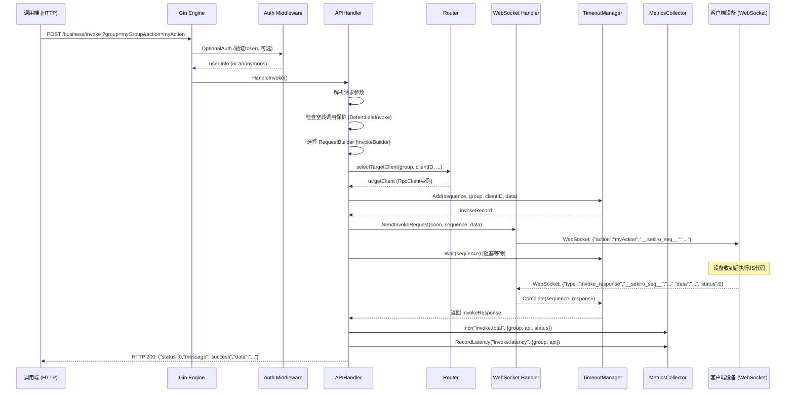
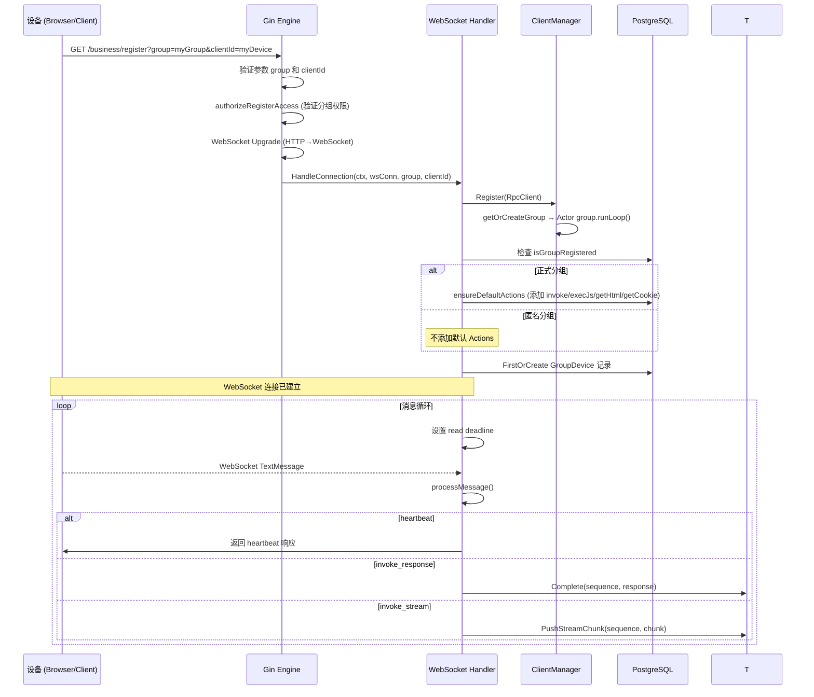

# Rpc RPC (Go-rpc) 项目技术分析报告

> 分析日期: 2026-05-14
> 项目: github.com/mrh30000/go-rpc
> Go 版本: 1.25

---

## 目录

1. [项目整体与核心模块分析](#1-项目整体与核心模块分析)
2. [设计模式与架构风格分析](#2-设计模式与架构风格分析)
3. [可视化图表](#3-可视化图表)
4. [二次开发与架构优化建议](#4-二次开发与架构优化建议)
5. [项目目录结构解析](#5-项目目录结构解析)
6. [新开发者实战入门指南](#6-新开发者实战入门指南)

---

## 1. 项目整体与核心模块分析

### 1.1 架构总览

本项目是 Java 版 `sekiro`（丝滑 RPC）框架的 Go 语言实现。核心定位是一个多语言、分布式、网络拓扑无关的服务发布平台，支持通过 WebSocket 长连接将各类设备（浏览器、移动端、IoT等）注册到服务器，并通过 HTTP API 或 TCP 协议进行远程调用。

**总体架构风格**: 分层单体架构（Monolithic with Layered Architecture），核心依赖 PostgreSQL 做持久化，Gin 做 HTTP 框架，gorilla/websocket 做长连接管理。

### 1.2 核心模块分解

#### 1.2.1 启动与配置模块 (`cmd/server/`, `main.go`, `internal/config/`, `pkg/server/bootstrap.go`)

| 职责 | 实现 |
|------|------|
| 命令行参数解析 | `main.go` - flag 包解析 -port/-host/-debug/-c 等 |
| YAML 配置加载 | `internal/config/config.go` - `Load()` / `LoadWithFallback()` |
| 服务器组装 | `bootstrap.go` - `Server.Start()` 编排所有模块初始化 |
| 优雅关闭 | `waitForShutdown()` → signal.Notify → `Shutdown()` |

**核心流程**: `main.go` → flag.Parse → `server.NewServer(config)` → `srv.Start()` → 加载 YAML 配置 → 初始化数据库 → 初始化各个管理器（ClientManager、TimeoutManager、ConfigService、WebSocket Handler、MetricsCollector、AlertEvaluator）→ 注册路由 → TCP Listen → Serve。

**依赖方向**: 启动模块依赖于 `pkg/server/*` 下的所有子模块（client、api、websocket、forwarder、metrics、alert、handlers、middleware），这是典型的 **引导者模式**。

**问题**:
- `internal/config` 和 `pkg/server/bootstrap.go` 都定义了 Config 结构体，职责重叠，增加了认知负担
- `applyYAMLConfig()` 中的配置覆盖逻辑需要更清晰的优先级规则

#### 1.2.2 用户认证与权限控制 (`pkg/server/middleware/auth.go`, `pkg/server/handlers/login.go`)

| 职责 | 实现 |
|------|------|
| Token 认证 | `AuthMiddleware.Authenticate()` - 从 Authorization header 提取 Bearer token |
| 可选认证 | `OptionalAuth()` - 对 /business/* 路由开放 |
| 管理员权限 | `RequireAdmin()` - 拦截非管理员请求 |
| 用户登录 | `handlers.HandleLogin()` - 密码验证 + 返回 apiToken/loginToken |
| 匿名访问控制 | `AnonymousAccessMiddleware()` - 根据系统配置控制匿名访问 |

**Token 机制**: 使用 bcrypt 加密密码，用户登录后生成 uuid 作为 apiToken 和 loginToken，存储在 `user_info` 表的 `api_token` 和 `login_token` 字段。后续所有请求通过 `Authorization: Bearer <apiToken>` 传递。

**多 Token 来源**: `ExtractAuthTokenFromRequest()` 支持四种传递方式:
1. `Authorization: Bearer <token>` header
2. `sekiro-token` header
3. `sekiro_token` query 参数
4. `sekiro_token` form 参数

**问题**:
- 单表 Token 存储不支持 Token 过期/刷新机制（虽然有 RefreshToken 接口，但旧 token 不失效）
- 无 OAuth2/第三方登录支持
- 密码字段 `size:64` 可能不足（bcrypt 哈希通常 60 字节，但有 metadata 时可能更长）

#### 1.2.3 客户端管理与分组 (`pkg/server/client/`)

**ClientManager**: 全局客户端注册中心，维护 `map[string]*RpcGroup`

**RpcGroup**: 单个分组的客户端管理，使用 **Actor 模式**（goroutine + channel）处理所有操作:
- `commandChan chan groupCommand` - 串行化所有对 `clients` map 的访问
- 支持 Register、Unregister、GetClient、GetAllClients、Allocate、Close 六种操作
- `order []string` 维护客户端注册顺序，用于轮询

**RpcClient**: 表示一个已连接的客户端设备:
- `Connection interface{}` - 存储 WebSocket 连接
- 健康检查: `IsHealthy` + `FailCount` + `MarkSuccess()/MarkFailure()`
- 连续 3 次失败后标记为不健康
- `writeMu sync.Mutex` - 防止 WebSocket 并发写入

**依赖方向**: client/manager.go ← client/group.go ← client/client.go（自顶向下依赖）

**特点**:
- RpcGroup 的 Actor 模式是亮点，避免了显式锁竞争
- 客户端健康检查机制可以防"死客户端"
- `getOrCreateGroup()` 使用双重检查锁定（Double-Check Locking）模式

#### 1.2.4 WebSocket 通信层 (`pkg/server/websocket/handler.go`)

| 职责 | 实现 |
|------|------|
| WebSocket 连接管理 | `HandleConnection()` - 消息循环，心跳检测 |
| 消息类型 | heartbeat / invoke / invoke_response / invoke_stream |
| 心跳机制 | 每 `heartbeatTimeout/2` 检查一次，60s 超时 |
| 客户端兼容 | `RpcMessage` 兼容 JavaScript 客户端的 `__sekiro_seq__` 字段 |
| 自适应 JSON 解析 | 处理 Java/JS 客户端多种响应格式差异 |

**消息处理流程**:
1. `HandleConnection()` 创建 RpcClient → 注册到 ClientManager → 进入消息循环
2. `ReadMessage()` 阻塞读取（带 read deadline）→ `processMessage()` 分发
3. invoke_response 匹配 sequence → `timeoutManager.Complete()` 唤醒等待的调用端

**Protocol 解码层 (`pkg/protocol/`)**: 定义了 TCP 层的二进制协议格式:
```
[Magic:int64][Length:int32][Type:byte][SerialNumber:int32][Headers][Data]
```
- Magic: `8315170387645116465`（"sekiro\0\0" 的 big-endian）
- 包类型: HEARTBEAT(0), C_REGISTER(16), C_INVOKE_RESPONSE(17), S_INVOKE(32), I_INVOKE(49) 等

**问题**:
- WebSocket 层和 TCP 协议层并存，代码路径存在冗余
- `sendMessage()` 中的 nil client 警告提示并发写入风险
- `HandleConnection` 关闭 flag 通过闭包共享，可能被多个 goroutine 同时访问

#### 1.2.5 路由策略 (`pkg/server/router/`)

三种路由策略:

| 策略 | 触发条件 | 实现 |
|------|----------|------|
| **SpecifiedClient** | `clientId` 非空 | 直接 `group.GetClient(clientID)` |
| **ConsistentHash** | `constantInvoke=true` | `ConsistentHashRing` + MurmurHash |
| **RoundRobin** | 默认 | 每 group 一个 atomic counter + `filterEligibleClients()` |

**一致性哈希**: 使用 MurmurHash 实现哈希环，支持虚拟节点。每次路由时动态构建环（基于当前在线客户端列表），仅当客户端列表稳定时保持一致性。

**客户端过滤**: `filterEligibleClients()` 按优先级降级:
1. 健康且在线的客户端
2. 所有在线客户端（含不健康）
3. 所有客户端（含离线）

**依赖方向**: router/strategy.go ← router/hash.go

**问题**:
- 一致性哈希每次路由都重建哈希环，客户端较多时性能开销大
- `roundRobinCounter` 不在 `Router.Route()` 的并发控制范围内（但 atomic 操作安全）

#### 1.2.6 请求转发与超时管理 (`pkg/server/forwarder/timeout.go`)

| 职责 | 实现 |
|------|------|
| 转发请求管理 | `TimeoutManager` 维护 `map[string]*InvokeRecord` |
| 超时检测 | 后台 `cleanupLoop()` (10s 间隔) 清理过期记录 |
| 同步等待 | `Wait()` 使用 channel + `time.After` 实现超时等待 |
| 流式支持 | `StreamRecord` + `ChunkChan` 支持分块响应 |

**完整调用流程**:
1. `handleForwardRequest()` 构建请求 → `timeoutManager.Add()` 创建记录
2. `wsHandler.SendInvokeRequest()` 通过 WebSocket 发送
3. `timeoutManager.Wait()` 阻塞等待响应 channel
4. 客户端返回 → `handleInvokeResponse()` → `timeoutManager.Complete()`

**依赖方向**: forwarder/timeout.go ← api/handlers.go（调用关系）

**特点**:
- channel-based 设计清晰，超时控制完善
- 流式响应支持反压（backpressure timeout: 5s）
- 标准的超时错误类型体系（`ErrTimeout`、`ErrRecordNotFound`、`ErrChannelClosed`）

#### 1.2.7 API 接口层

##### 核心业务 API (`pkg/server/api/handlers.go`)

| Endpoint | 方法 | 处理函数 | 说明 |
|----------|------|----------|------|
| `/business/groupList` | GET | `HandleGroupList` | 列出分组（带权限过滤） |
| `/business/clientQueue` | GET | `HandleClientQueue` | 获取分组客户端列表 |
| `/business/invoke` | POST/GET | `HandleInvoke` | RPC 调用核心入口 |
| `/business/execjs` | POST/GET | `HandleExecJS` | 执行 JavaScript |
| `/business/cookie` | POST/GET | `HandleGetCookie` | 获取 Cookie |
| `/business/html` | GET | `HandleGetHtml` | 获取页面 HTML |
| `/v1/chat/completions` | POST | `HandleChatCompletions` | LLM Chat API 兼容接口 |

**Request Builder 模式**: 使用策略模式封装不同的请求处理逻辑:

```
RequestBuilder (interface)
  ├── InvokeBuilder    - 标准 RPC 调用
  ├── ExecJSBuilder    - 执行 JS
  ├── GetCookieBuilder - 获取 Cookie
  └── GetHTMLBuilder   - 获取 HTML
```

`handleForwardRequest()` 是泛化处理入口，接收 `RequestBuilder` 接口，统一处理鉴权、路由、发送、等待、指标记录。

**业务 /business API**: 使用 `OptionalAuth()` + 内置 Token 验证（`sekiro_token`）

##### Web 管理 API (`pkg/server/handlers/`)

| Handler 文件 | 路由前缀 | 功能 |
|-------------|----------|------|
| user.go | `/api/users` | 用户 CRUD、QPS 管理 |
| group.go | `/api/groups` | 分组 CRUD、设备管理、Action 管理 |
| anonymous.go | `/api/anonymous-groups` | 匿名分组管理 |
| metric.go | `/api/metrics` | 监控指标查询 |
| trace.go | `/api/traces` | 链路追踪查询 |
| alert.go | `/api/alerts/rules`, `/api/alerts/history` | 告警规则与历史 |
| sysconfig.go | `/api/sysconfig` | 系统配置管理 |
| login.go | `/rpc-api/user-info/*` | 登录/注册/用户信息 |

**前端兼容 API**: `/rpc-api/*` 前缀由前端（React SPA）调用，与 `/api/*` 并行存在。

##### HTTP 服务器封装 (`pkg/server/api/http_server.go`)

`HTTPServer` 结构体封装了 `gin.Engine` + `http.Server` + `websocket.Upgrader`:
- 提供 Shutdown、Route Registration、Middleware 等便捷方法
- WebSocket Upgrader 的 `CheckOrigin: return true`（允许任意来源）

#### 1.2.8 数据持久化层 (`pkg/database/`, `pkg/model/`)

| 组件 | 实现 |
|------|------|
| ORM | GORM v2 + PostgreSQL 驱动 |
| 连接管理 | `database.InitFromConfig()` → 全局 `DB` 变量 |
| 自动迁移 | `AutoMigrate()` 创建所有表 + 默认数据 |
| DB-less 模式 | `DisableDatabase: true` 可跳过数据库初始化 |

**数据模型** (15 张表):

| 表 | 用途 |
|---|------|
| `user_info` | 用户账户 |
| `sys_config` | 系统配置（K/V 结构） |
| `sys_log` | 审计日志 |
| `server_node` | 服务器节点发现 |
| `group_config` | 分组配置（含 QPS 限制） |
| `group_actions` | 分组允许的 Action |
| `group_device` | 注册到分组的设备 |
| `metric_minute/hour/day` | 监控指标（时间分片） |
| `metric_tag` | 指标标签定义 |
| `trace_record` | 调用链路追踪 |
| `alert_rule` | 告警规则 |
| `alert_history` | 告警历史 |

**问题**:
- 全局 `DB` 变量 (`database.DB`) 是典型的隐式依赖，不利于测试
- `AutoMigrate()` 中创建默认管理员和系统配置，与数据迁移职责边界不清
- `metric_minute/hour/day` 三表结构几乎完全相同，存在大量重复

#### 1.2.9 监控指标采集 (`pkg/server/metrics/collector.go`)

`MetricCollector` 接口提供四种指标类型:

| 类型 | 方法 | 说明 |
|------|------|------|
| Counter | `Incr()` | 累加计数（如调用总数） |
| Gauge | `Set()` | 瞬时值（如在线客户端数） |
| Histogram | `Observe()` | 分布统计（如延迟） |
| Latency | `RecordLatency()` | 延迟百分位（P50/P90/P99） |

**实现**:
1. 内存桶（bucket）缓存指标数据
2. 每个 group + api 组合一个 bucket
3. 定时 `flushLoop()` (默认 1分钟) → 计算百分位数 → 批量写入 `metric_minute` 表
4. 标签使用 MD5 去重，原始标签映射到 Tag1~Tag5 字段

**问题**:
- 仅支持分钟级聚合，缺少实时指标查询能力
- 标签系统只预定义了 Tag1~Tag5 字段，扩展性有限
- 内存桶在 flush 间隔内可能无限增长

#### 1.2.10 告警评估引擎 (`pkg/server/alert/`)

| 组件 | 说明 |
|------|------|
| `Evaluator` | 定时评估告警规则（默认 1 分钟） |
| `Notifier` | 通知发送（Webhook + Email） |
| `MetricsReader` | 从 `metric_minute` 表读取指标数据 |

**评估流程**:
1. `evaluateAll()` 遍历所有已启用规则
2. 对每条规则: 查询指标 → 比较阈值 → 触发条件成立 → 防抖检查（5分钟窗口）
3. 触发告警 → 确定级别（INFO/WARNING/CRITICAL）→ 发送通知 → 写入 `alert_history`

**防抖机制**: 5 分钟内同一规则不重复触发告警。

**通知**: 支持 Webhook POST + SMTP 邮件（HTML 模板）。

#### 1.2.11 事件总线 (`pkg/eventbus/`)

简单的事件发布-订阅系统，定义了以下事件类型:
- `ClientConnectEvent` / `ClientDisconnectEvent` / `ClientDestroyEvent` / `ClientOnlineEvent`
- `InvokerConnectEvent` / `InvokerDisconnectEvent` / `InvokerDestroyEvent`

**当前状态**: 事件类型已定义，但 `OnEvent()` 方法体为空，没有实际注册和分发逻辑。属于 **预留扩展点**。

#### 1.2.12 配置服务 (`pkg/server/config/service.go`)

运行时配置管理，从 `sys_config` 表加载 K/V 配置:
- 首次启动时 `Refresh()` 从数据库加载全部配置
- 使用 `sync.Map` 做内存缓存
- 通过 FNV 哈希检测配置变更，避免无效更新
- 支持动态配置（注册开关、QPS 限制、空转调用保护等）

#### 1.2.13 流量控制 (`pkg/server/flow/`)

| 组件 | 说明 |
|------|------|
| `RateLimiter` | 基于 `golang.org/x/time/rate` 的令牌桶算法 |
| `DelayBackoff` | 空队列退避，指数增长（1s → 2s → 4s → ... → 20s） |

**RateLimiter 维度**:
- 用户级 QPS 限制 (`user_info.quota_qps`)
- 分组级 QPS 限制 (`group_config.quota_qps_group`)
- 设备级 QPS 限制

#### 1.2.14 压缩模块 (`pkg/compress/`)

策略模式实现: 接口 `Compressor` + 三种实现:
- `GzipCompressor` - 高压缩比
- `SnappyCompressor` - 高速压缩
- `NoneCompressor` - 不压缩

`CompressorManager` 根据 RPC 包头的 `compress_method` 字段自动选择压缩器。

#### 1.2.15 客户端 SDK (`pkg/client/`)

| 组件 | 说明 |
|------|------|
| `RpcClient` | WebSocket 客户端，用于注册到 RPC 服务器 |
| `RpcInvoker` | TCP 调用端，通过二进制协议发送调用请求 |

**RpcInvoker** 特点:
- 支持多服务器列表（启动时随机打乱做简单负载均衡）
- 请求级别轮询
- 掉线自动跳过（alive 标记）
- 基于 `serialNumber` 匹配请求-响应

**问题**:
- `RpcInvoker.Invoke()` 的 `getNextClient()` 在无可用服务器时直接返回 nil，没有重试等待机制
- `parseInvokeResponse()` 是占位实现，未使用 encoding/json 解析

---

## 2. 设计模式与架构风格分析

### 2.1 已使用的设计模式

#### 2.1.1 策略模式 (Strategy)

**位置**: `pkg/server/router/strategy.go`
**参与方**: `Router.Route()` + `RouteParams` + 三种路由实现
**用途**: 根据调用参数（`clientId`、`constantInvoke`）动态选择路由策略

```go
// 策略选择逻辑
if params.ClientID != ""       → SpecifiedClient
if params.HashKey != ""         → ConsistentHash → fallback RoundRobin
default                         → RoundRobin
```

**评估**: 实现清晰，但一致性哈希每次重建环的性能问题需要考虑。`Router` 和 `APIHandler.selectTargetClient()` 之间存在策略选择的职责重叠。

#### 2.1.2 Request Builder 模式 (Builder/Strategy hybrid)

**位置**: `pkg/server/api/handlers.go`
**参与方**: `RequestBuilder` 接口 + `InvokeBuilder`/`ExecJSBuilder`/`GetCookieBuilder`/`GetHTMLBuilder`
**用途**: 统一处理不同请求类型的参数构建、超时配置和指标记录

**评估**: 这是本项目中 **最优秀的设计模式应用**。通过 `RequestBuilder` 接口将不同请求的差异封装起来，`handleForwardRequest()` 作为模板方法处理公共逻辑（鉴权、路由、发送、等待）。新类型请求只需实现 `RequestBuilder` 接口即可。

#### 2.1.3 Actor 模式 (Actor)

**位置**: `pkg/server/client/group.go`
**参与方**: `RpcGroup` + `commandChan` + `runLoop()`
**用途**: 通过 goroutine + channel 串行化处理所有对分组客户端数据的并发访问

```go
type RpcGroup struct {
    commandChan chan groupCommand  // 命令队列
    runLoop()                      // 单 goroutine 串行处理
}
```

**评估**: Go 中实现 Actor 模式的典型范例。避免了 map 的显式锁竞争，但命令调用（如 `GetAllClients()`）需要通过 callback channel 等待，有阻塞风险。

#### 2.1.4 双重检查锁定 (Double-Check Locking)

**位置**: 
- `pkg/server/client/manager.go` - `getOrCreateGroup()`
- `pkg/server/flow/backoff.go` - `GetState()`
- `pkg/server/flow/ratelimit.go` - `getLimiter()`

**评估**: 标准实现，Go 中由于内存模型保证，这种模式安全有效。

#### 2.1.5 模板方法模式 (Template Method)

**位置**: `pkg/server/api/handlers.go`
**参与方**: `handleForwardRequest()` (模板) + `RequestBuilder` (可扩展步骤)
**用途**: 定义请求处理的骨架，将可变部分委托给 `RequestBuilder` 的实现

```
handleForwardRequest: 模板骨架
  ├── 参数验证 (固定)
  ├── 鉴权 (固定)
  ├── 空转保护检查 (半固定)
  ├── BuildRequestData (可变 → Builder)
  ├── selectTargetClient (固定)
  ├── 发送请求 (固定)
  ├── 等待响应 (固定)
  ├── 记录指标 (半固定 → Builder.ShouldRecordMetrics)
  └── 返回结果 (固定)
```

#### 2.1.6 观察者模式 (Observer) — 预留

**位置**: `pkg/eventbus/`
**状态**: 接口已定义但未实现。预留的事件总线，当前没有订阅者和实际事件分发。

#### 2.1.7 外观模式 (Facade)

**位置**: `pkg/server/bootstrap.go` 中的 `Server` 结构体
**用途**: `Server` 作为整个系统的外观，隐藏了 `ClientManager`、`WebSocket Handler`、`TimeoutManager`、`MetricsCollector`、`AlertEvaluator` 等子系统的复杂性。外部只调用 `NewServer()` → `Start()` → 等待信号 → `Shutdown()`。

#### 2.1.8 工厂方法 (Factory Method)

**位置**: `NewAPIHandler()`、`NewRouter()`、`NewHandler()` (websocket)、`NewCollector()`
**评估**: Go 的标准构造器模式，在每个包中使用 `NewXxx()` 函数创建实例。

### 2.2 可以引入但尚未使用的设计模式

#### 2.2.1 装饰器模式 (Decorator)

**适用场景**: Gin 中间件本质上可以用装饰器模式，但当前中间件绑定在路由组级别。可以考虑使用装饰器对特定 handler 增加额外能力（如缓存、重试、熔断）。

#### 2.2.2 责任链模式 (Chain of Responsibility)

**适用场景**: WebSocket 消息处理。当前 `processMessage()` 使用 `switch` 语句分发，可以改为责任链，每个处理器决定是否处理或传递给下一个。

#### 2.2.3 适配器模式 (Adapter)

**适用场景**: 协议转换。当前存在两个协议层 — WebSocket (JSON) 和 TCP (Binary)。适配器模式可以统一两种协议的客户端接入方式。

#### 2.2.4 仓储模式 (Repository)

**适用场景**: 数据库操作。当前 `handlers/` 中的代码直接使用 `database.GetDB()` 调用 GORM，业务逻辑与数据访问耦合。引入 Repository 层可以将数据查询逻辑集中管理。

#### 2.2.5 断路器模式 (Circuit Breaker)

**适用场景**: `RpcInvoker` 调用远程服务器时，当某服务器连续失败，应当快速断开（不继续尝试），定期尝试恢复。当前只是标记 `alive=false`，没有自动恢复机制。

### 2.3 架构风格分析

| 维度 | 评估 |
|------|------|
| 分层 | 近似 **Layered Architecture**: API 层 → 业务逻辑层 → 数据访问层 |
| 单体 vs 微服务 | **单体应用**。所有模块编译为单个二进制文件 |
| 模块化 | 中等。`pkg/` 按功能分包，但存在循环依赖风险（当前无循环依赖） |
| 依赖注入 | 最低限度。通过构造函数手动注入（`NewAPIHandler(manager, wsHandler, ...)`） |
| 测试性 | 一般。全局变量（`database.DB`、`logger.globalLogger`）增加了测试难度 |

---

## 3. 可视化图表

### 3.1 系统架构图

```mermaid
graph TB
    subgraph 外部客户端
        A[浏览器/JS客户端] -->|WebSocket| WS[WebSocket Handler]
        B[Go SDK RpcClient] -->|TCP Binary Protocol| TCP[Protocol Decoder]
        C[Go SDK RpcInvoker] -->|TCP Binary Protocol| TCP
        D[curl/HTTP客户端] -->|HTTP| GIN[Gin Engine]
    end

    subgraph Gin HTTP 层
        GIN --> CORS[CORS Middleware]
        GIN --> LOG[Logging Middleware]
        GIN --> TRC[Trace Middleware]
        GIN --> AUTH[Auth Middleware]
        GIN --> RATE[Rate Limit Middleware]
        GIN --> ANON[Anonymous Access Middleware]
    end

    subgraph 路由分发
        GIN --> BIZ[/business/* 业务API]
        GIN --> API[/api/* 管理API]
        GIN --> RPCA[/rpc-api/* 前端兼容API]
        GIN --> V1[/v1/* 扩展API]
        GIN --> WEB[SPA 静态文件服务]
    end

    subgraph 业务核心
        BIZ --> APIHandler[APIHandler]
        APIHandler --> RB[RequestBuilder 策略集]
        APIHandler --> ROUTER[Router 路由策略]
        APIHandler --> WS
        APIHandler --> TM[TimeoutManager]
        APIHandler --> MC[MetricsCollector]
    end

    subgraph 客户端管理
        CM[ClientManager] --> GROUPS[RpcGroup Actor]
        GROUPS --> CLIENTS[RpcClient 实例]
        CLIENTS --> HC[Health Check]
    end

    subgraph 管理功能
        API --> UH[UserHandler]
        API --> GH[GroupHandler]
        API --> SH[SysConfigHandler]
        API --> MH[MetricHandler]
        API --> TH[TraceHandler]
        API --> AH[AlertHandler]
    end

    subgraph 系统服务
        WS --> CM
        WS --> TM
        EVAL[AlertEvaluator] --> DB[(PostgreSQL)]
        MC --> DB
        TRC --> DB
        CFG[ConfigService] --> DB
    end

    subgraph 数据层
        DB --> MODEL[GORM Models]
        MODEL --> U[user_info]
        MODEL --> G[group_config/actions/devices]
        MODEL --> M[metric_minute/hour/day]
        MODEL --> T[trace_record]
        MODEL --> A[alert_rule/history]
        MODEL --> S[sys_config/log]
    end

    subgraph 外部通知
        EVAL --> NOTIFY[Notifier]
        NOTIFY --> WEBHOOK[Webhook]
        NOTIFY --> SMTP[Email]
    end
```

### 3.2 核心业务流程

#### 一次完整调用请求的生命周期



#### 客户端注册流程



#### 告警评估流程

```mermaid
flowchart TD
    A[AlertEvaluator.Start] --> B[loadRules 从DB加载已启用规则]
    B --> C{定时 tick (1分钟)}
    C --> D[遍历所有规则]
    D --> E[查询 metric_minute 表]
    E --> F[计算窗口内指标值]
    F --> G{检查阈值条件}
    G -->|触发| H{防抖检查 5分钟窗口}
    G -->|未触发| C
    H -->|已有记录| C
    H -->|无记录| I[确定告警级别]
    I --> J[发送通知 Webhook/Email]
    J --> K[写入 alert_history]
    K --> C
```

---

## 4. 二次开发与架构优化建议

### 建议 1: 引入仓储层 (Repository Pattern) 解耦数据访问

**目标模块**: `pkg/server/handlers/`、`pkg/database/`

**当前问题**:
- 所有 handler 直接调用 `database.GetDB()` 获取 GORM 实例，业务逻辑与 ORM 紧耦合
- 全局 `DB` 变量导致单元测试困难（需要 mock 整个数据库）
- 相同的查询逻辑在多个 handler 中重复（如分组设备统计的 JOIN 查询在 `group.go` 和 `login.go` 中出现两次）

**实施方案**:

1. 为每个聚合根定义 Repository 接口:
   ```go
   type UserRepository interface {
       FindByID(id int64) (*model.UserInfo, error)
       FindByToken(token string) (*model.UserInfo, error)
       FindByUserName(name string) (*model.UserInfo, error)
       Create(user *model.UserInfo) error
       Update(user *model.UserInfo) error
       Delete(id int64) error
       List() ([]*model.UserInfo, error)
   }
   ```

2. 使用 GORM 实现 Repository 接口，注入到 Handler:
   ```go
   type UserHandler struct {
       repo UserRepository
   }
   func NewUserHandler(repo UserRepository) *UserHandler {
       return &UserHandler{repo: repo}
   }
   ```

3. 测试时使用 mock 实现替换:
   ```go
   type mockUserRepo struct{}
   func (m *mockUserRepo) FindByToken(token string) (*model.UserInfo, error) {
       return &model.UserInfo{UserName: "test"}, nil
   }
   ```

**预期收益**:
- 可测试性大幅提升（无需数据库）
- 查询逻辑集中管理，消除重复
- 业务层与 ORM 解耦，方便切换存储实现

**风险与成本**:
- 中等改造成本，涉及 `handlers/` 下所有文件的构造函数变更
- 短期会增加代码量

---

### 建议 2: 重构协议层，统一 WebSocket/TCP 通信抽象

**目标模块**: `pkg/server/websocket/`、`pkg/protocol/`、`pkg/server/detector/`

**当前问题**:
- 存在两套并行的通信协议: WebSocket (JSON) 用于浏览器客户端，TCP (Binary/Protocol Buffers) 用于 Go SDK
- `detector/` 目录下的 `RpcHandler` 实现了完整的 TCP 包处理，但 `bootstrap.go` 中没有启用（日志标注 "Legacy detector path is not wired"）
- 两套代码在连接管理、心跳检测、消息分发等方面有大量重叠
- `client/client.go` (SDK 端) 和 `server/detector/sekiro_handler.go` 中都实现了相同的 `bufWriter`

**实施方案**:

1. 定义一个统一的 `Connection` 抽象接口:
   ```go
   type Connection interface {
       Send(msg *Message) error
       Receive() (*Message, error)
       Close() error
       RemoteAddr() string
   }
   ```

2. 分别实现 WebSocket 和 TCP 适配器:
   ```go
   type WebSocketConnection struct {
       conn *websocket.Conn
       mu   sync.Mutex
   }
   type TCPConnection struct {
       conn    net.Conn
       reader  *bufio.Reader
       cm      *compress.CompressorManager
   }
   ```

3. 统一消息处理循环使用 `Connection` 接口

**预期收益**:
- 消除代码重复（`bufWriter` 等重复实现）
- 降低新协议支持成本（只需实现 Connection 接口）
- TCP 路径可正式启用，增加更多 SDK 接入选项

**风险与成本**:
- 中高改造成本，涉及 `websocket/handler.go` 核心消息循环
- 需要完善的回归测试

---

### 建议 3: 引入事件驱动架构，激活 EventBus

**目标模块**: `pkg/eventbus/`、`pkg/server/client/`、`pkg/server/websocket/`

**当前问题**:
- `EventBus` 已实现但未使用，是一个"死代码"
- 客户端连接/断开的事件无法被其他模块监听（如 metrics 统计在线数、alert 判断设备异常等）
- `metrics/` 和 `alert/` 当前靠定时轮询获取数据，被动而非事件驱动

**实施方案**:

1. 激活 EventBus，在关键操作点发布事件:
   - `client.Register()` → 发布 `ClientConnectEvent`
   - `client.Unregister()` → 发布 `ClientDisconnectEvent`
   - `client.MarkFailure()` 连续失败 → 发布 `ClientHealthDegradedEvent`

2. 让现有模块订阅事件:
   - `MetricsCollector` 订阅连接事件 → 更新在线客户端数 Gauge
   - `AlertEvaluator` 订阅健康降级事件 → 触发设备告警

3. 将 `EventBus` 实例注入 `Server` 并传递到各组件

**预期收益**:
- 消除死代码，激活预留的扩展点
- 变轮询为事件驱动，减少数据库查询
- 降低模块间耦合（Publisher 不需要知道 Subscriber）

**风险与成本**:
- 低风险，EventBus 实现已经完成，只需注册事件
- 需要设计事件类型和事件的 payload

---

### 建议 4: 提取通用 HTTP 响应格式 (标准 API 信封)

**目标模块**: `pkg/server/handlers/`

**当前问题**:
- 响应格式不统一: `/api/*` 使用 `{"code": 0, "message": "success", ...}` 格式
- `/business/*` 使用 `{"status": 0, "message": "success", ...}` 格式
- `/rpc-api/*` 使用混合格式
- 每个 handler 中都重复书写 `c.JSON(200, gin.H{...})` 模式

**实施方案**:
```go
// 统一响应工具函数
func Success(c *gin.Context, data interface{}) {
    c.JSON(200, Response{Code: 0, Message: "success", Data: data})
}
func Error(c *gin.Context, code int, message string) {
    c.JSON(http.StatusOK, Response{Code: code, Message: message})
}
```

**预期收益**: 消除格式不一致，减少重复代码

**风险**: 低。但要兼容前端已有 API 调用格式，不能随意修改 JSON 字段名

---

### 建议 5: 改进一致性哈希实现

**目标模块**: `pkg/server/router/hash.go`

**当前问题**:
- 每次路由都重建哈希环 `NewConsistentHashRing()` + `Add()` + 排序，O(n log n)
- 没有虚拟节点（当客户端数量少时哈希分布不均匀）
- `Router` 和 `APIHandler.selectTargetClient()` 中策略选择逻辑有重叠

**实施方案**:
- 缓存哈希环，当客户端列表变更时失效重建
- 引入虚拟节点（每个物理节点 3~5 个虚拟节点）
- 将策略选择逻辑集中到 `Router.Route()`，消除 APIHandler 中的重复条件判断

---

## 5. 项目目录结构解析

```
sekiro-go/
├── main.go                          # 程序入口: flag 解析 → server.NewServer → Start
├── go.mod                           # Go module 定义
├── go.sum                           # 依赖校验和
├── config.yaml                      # 默认配置文件
├── config.yaml.example              # 配置示例
├── config.yaml.docker               # Docker 部署配置
├── Dockerfile                       # 容器化构建
├── docker-compose.yaml              # Docker Compose (server + postgres)
├── README.md                        # 项目说明
│
├── cmd/                             # 启动器
│   ├── server/main.go               # 服务端启动 (仅调用 main.go 中的 server package)
│   ├── client/main.go               # 客户端示例
│   └── invoker/main.go              # 调用端示例
│
├── internal/                        # 内部包 (不对外暴露)
│   ├── config/
│   │   └── config.go                # YAML 配置加载/保存 (Config 结构体)
│   └── utils/
│       └── logger/
│           └── logger.go            # zap 日志封装 (全局 SugaredLogger)
│
├── pkg/                             # 公共包
│   ├── client/                      # 客户端 SDK
│   │   ├── client.go                # RpcClient - WebSocket 注册客户端
│   │   └── invoker.go               # RpcInvoker - TCP 调用端
│   ├── compress/                    # 压缩算法策略
│   │   ├── manager.go               # CompressorManager
│   │   ├── gzip.go / snappy.go / none.go  # 三种压缩实现
│   ├── database/
│   │   └── database.go              # GORM 数据库初始化 + AutoMigrate
│   ├── eventbus/
│   │   ├── eventbus.go              # 事件发布-订阅系统
│   │   └── events.go                # 事件类型定义 (预留)
│   ├── model/                       # GORM 数据模型 (15 张表)
│   │   ├── database.go              # user_info / sys_config / sys_log / server_node / group_config / group_actions / group_device / metric_minute/hour/day / metric_tag
│   │   ├── trace.go                 # TraceRecord
│   │   └── alert.go                 # AlertRule / AlertHistory
│   ├── protocol/                    # TCP 二进制协议
│   │   ├── packet.go                # RpcPacket 编解码 (Magic/Length/Type/SerialNumber/Headers/Data)
│   │   └── packet_type.go           # 包类型常量 (0~49)
│   └── server/                      # 服务器核心
│       ├── bootstrap.go             # Server 外观 + 启动编排
│       ├── alert/                   # 告警引擎
│       │   ├── evaluator.go         # Evaluator (规则评估 + 阈值检查)
│       │   └── notifier.go          # Notifier (Webhook + SMTP Email)
│       ├── api/                     # HTTP API
│       │   ├── http_server.go       # HTTPServer (Gin 封装)
│       │   ├── handlers.go          # 业务 API (invoke/execjs/cookie/html)
│       │   ├── chat_completions.go  # LLM Chat API
│       │   ├── websocket.go         # WebSocket 升级配置
│       │   └── *_test.go            # 测试文件
│       ├── client/                  # 客户端运行时管理
│       │   ├── manager.go           # ClientManager (全局注册中心)
│       │   ├── group.go             # RpcGroup (Actor 模式)
│       │   └── client.go            # RpcClient (连接状态 + 健康检查)
│       ├── config/
│       │   └── service.go           # 运行时配置服务 (ConfigService)
│       ├── detector/                # TCP 协议检测器 (当前未启用)
│       │   ├── detector.go          # Detector
│       │   ├── http_matcher.go      # HTTP 匹配器
│       │   ├── sekiro_handler.go    # Rpc TCP 协议处理器
│       │   └── sekiro_matcher.go    # Rpc 协议匹配器
│       ├── flow/                    # 流量控制
│       │   ├── backoff.go           # 空队列退避 (指数增长)
│       │   └── ratelimit.go         # QPS 限流 (令牌桶)
│       ├── forwarder/               # 请求转发
│       │   └── timeout.go           # TimeoutManager (channel-based 响应等待 + 超时清理)
│       ├── handlers/                # Web 管理 API Handler
│       │   ├── routes.go            # 路由注册 (SetupWebRoutes)
│       │   ├── login.go             # 登录 / 注册 / 用户信息
│       │   ├── user.go              # 用户 CRUD
│       │   ├── group.go             # 分组 CRUD / 设备 / Action
│       │   ├── anonymous.go         # 匿名分组管理
│       │   ├── metric.go            # 监控指标查询
│       │   ├── trace.go             # 链路追踪
│       │   ├── alert.go             # 告警规则/历史
│       │   ├── sysconfig.go         # 系统配置
│       │   ├── audit.go             # 审计日志
│       │   ├── authz.go             # 授权辅助
│       │   ├── constants.go         # 常量
│       │   └── response.go          # 响应工具
│       ├── metrics/
│       │   └── collector.go         # 指标采集器 (Counter/Gauge/Histogram/Latency)
│       ├── middleware/              # Gin 中间件
│       │   ├── auth.go              # Token 认证 + 管理员权限
│       │   ├── cors.go              # CORS
│       │   ├── logging.go           # 结构日志
│       │   ├── ratelimit.go         # QPS 限流
│       │   └── trace.go             # 链路追踪
│       ├── router/                  # 路由策略
│       │   ├── strategy.go          # Router (轮询 / 指定客户端 / 一致性哈希)
│       │   └── hash.go              # 一致性哈希 (MurmurHash + 环)
│       └── websocket/               # WebSocket 消息处理
│           └── handler.go           # Handler (连接管理 + 消息分发)
│
├── sample/                          # 示例代码
│   └── go/sekio/                    # Go 客户端示例
│
├── utils/                           # 工具代码 (code.go, file.go)
├── web/                             # React 前端
│   ├── embed.go                     # embed.FS 嵌入静态文件
│   ├── src/                         # React 源码
│   └── dist/                        # 构建产物 (被 embed)
│
├── deploy/                          # 部署脚本
│   └── postgres/migration.sql       # 数据库迁移 SQL
│
└── docker/                          # Docker 相关
```

### 关键目录说明

| 目录 | 架构角色 | 边界 |
|------|----------|------|
| `cmd/` | 启动器 | 只依赖 `pkg/server` 和配置 |
| `internal/` | 内部实现 | 不对外暴露，包含配置和工具 |
| `pkg/` | 公共库 | 可被外部项目引用 |
| `pkg/server/` | 服务器核心 | 所有子模块的装配点 |
| `pkg/client/` | SDK | 独立可用的客户端库 |
| `web/` | 前端 | 通过 embed 嵌入 Go 二进制 |

### 测试覆盖

- 共 32 个测试文件
- 测试分布在 `protocol/`、`server/client/`、`server/api/`、`server/router/`、`server/flow/`、`server/forwarder/`、`server/middleware/`、`server/websocket/`、`server/bootstrap/`、`compress/`、`eventbus/` 等包
- **缺少**: `handlers/` 的测试覆盖率低，`alert/` 的测试文件较少，`model/` 无测试

---

## 6. 新开发者实战入门指南

### 6.1 本地环境搭建

**所需软件**:

| 软件 | 版本要求 | 用途 |
|------|----------|------|
| Go | >= 1.25 | 编译运行 |
| PostgreSQL | >= 14 | 数据库 |
| Node.js | >= 18 | 前端构建 (可选) |

**安装依赖**:

```bash
# 克隆代码
git clone <repo-url> sekiro-go
cd sekiro-go

# 安装 Go 依赖
go mod tidy

# 安装前端依赖 (可选，不影响后端运行)
cd web
npm install
cd ..
```

### 6.2 配置数据库

```bash
# 启动 PostgreSQL (Docker)
docker run -d --name sekiro-pg \
  -e POSTGRES_USER=postgres \
  -e POSTGRES_PASSWORD=postgres \
  -e POSTGRES_DB=sekiro \
  -p 5432:5432 \
  postgres:16

# 或手动创建数据库
psql -h localhost -U postgres -c "CREATE DATABASE sekiro;"
```

### 6.3 配置与启动

```bash
# 1. 配置 (默认 config.yaml 已包含默认值，可直接使用)
# 如需自定义，复制并编辑:
cp config.yaml.example config.yaml

# 2. 启动服务器 (数据库自动迁移)
go run main.go -port 5612

# 3. 验证启动
curl http://localhost:5612/health
# 返回: {"status":"healthy","timestamp":"...","version":"1.0.0"}
```

### 6.4 快速体验: 客户端注册 + 调用

**终端 1 — 启动服务器**:
```bash
go run main.go -port 5612 -debug
```

**终端 2 — 启动客户端 (WebSocket 连接)**:
```bash
# 使用 Go 客户端 SDK 注册
go run cmd/client/main.go -server localhost:5612 -group demo -client-id device-1
```

**终端 3 — 发送调用请求**:
```bash
curl "http://localhost:5612/business/invoke?group=demo&action=hello&params=world"
```

### 6.5 最小改动示例: 添加一个自定义 API

**目标**: 新增一个 `/api/healthz` 端点，返回服务器运行时间和客户端数量。

**涉及的修改**:

1. 修改 `pkg/server/bootstrap.go`，在 `registerRoutes()` 中添加新路由:

```go
// 在 registerRoutes() 方法末尾添加:
s.httpServer.Engine().GET("/api/healthz", func(c *gin.Context) {
    c.JSON(200, gin.H{
        "uptime":        time.Now().Format(time.RFC3339),
        "groupCount":    s.clientManager.GroupCount(),
        "clientCount":   s.clientManager.ClientCount(),
        "goroutines":    runtime.NumGoroutine(),
    })
})
```

2. 修改 `pkg/server/bootstrap.go`，添加 `runtime` 导入:

```go
import (
    // ... 已有导入
    "runtime"
    "time"
)
```

3. 运行并验证:

```bash
go run main.go -port 5612
curl http://localhost:5612/api/healthz
# 期望返回: {"uptime":"...","groupCount":0,"clientCount":0,"goroutines":...}
```

### 6.6 常见开发任务速查

| 任务 | 命令 |
|------|------|
| 运行所有测试 | `go test ./...` |
| 带 race 检测测试 | `go test -race ./...` |
| 运行特定测试 | `go test -run TestRouter ./pkg/server/router/...` |
| 构建二进制 | `go build -o sekiro-server .` |
| 前端开发模式 | `cd web && npm run dev` |
| 构建前端 | `cd web && npm run build` |
| 代码格式化 | `go fmt ./...` |
| 分析工具 | `go vet ./...` |
| 查看依赖图 | `go mod graph` |

### 6.7 项目约定速查

| 约定 | 说明 |
|------|------|
| 模块路径 | `github.com/mrh30000/go-rpc` |
| 日志 | 使用 `internal/utils/logger` 的全局函数 `Infof/Errorf/Debugf` |
| 错误处理 | `fmt.Errorf("context: %w", err)` |
| JSON 标签 | `json:"field_name"` |
| GORM 标签 | `gorm:"column:field_name"` |
| 构造器命名 | `NewXxx()` |
| 接口命名 | 小接口 (1-3 方法) |

### 6.8 代码评审检查点

- [ ] 是否运行了 `go vet` 和测试
- [ ] 是否引入了新的全局变量（避免）
- [ ] 是否直接调用了 `database.GetDB()`（考虑通过 Repository 注入）
- [ ] 响应格式是否与现有 API 一致（`code`/`status` 字段选择）
- [ ] WebSocket 写入是否有 mutex 保护
- [ ] 是否添加了必要的指标和追踪记录
- [ ] 路由是否在正确的中间件组中

---

## 附录

### A. 依赖清单

| 依赖 | 用途 |
|------|------|
| github.com/gin-gonic/gin v1.12.0 | HTTP 框架 |
| github.com/gorilla/websocket v1.5.3 | WebSocket |
| gorm.io/gorm v1.25.12 + gorm.io/driver/postgres v1.6.0 | ORM + PostgreSQL |
| go.uber.org/zap v1.26.0 | 结构化日志 |
| golang.org/x/crypto | bcrypt 密码 |
| golang.org/x/time | rate 限流 |
| gopkg.in/yaml.v3 | YAML 解析 |
| github.com/golang/snappy v0.0.4 | Snappy 压缩 |

### B. 关键接口定义速查

```go
// RequestBuilder - 请求构建策略接口
type RequestBuilder interface {
    BuildRequestData() (action string, params interface{}, err error)
    GetTimeout() time.Duration
    GetSequence(group string) string
    ShouldRecordMetrics() bool
    GetMetricAPI(action string) string
    GetGroup() string
    GetClientID() string
    GetConstantInvoke() string
    GetAccessToken() string
}

// MetricCollector - 指标采集器接口
type MetricCollector interface {
    Incr(name string, tags map[string]string, value float64)
    Set(name string, tags map[string]string, value float64)
    Observe(name string, tags map[string]string, value float64)
    RecordLatency(name string, tags map[string]string, durationMs float64)
    Shutdown()
}

// Compressor - 压缩算法接口
type Compressor interface {
    Compress(data []byte) ([]byte, error)
    Decompress(data []byte) ([]byte, error)
    Method() string
}

// Service - 运行时配置服务接口
type Service interface {
    GetConfig(key string) string
    GetConfigBool(key string, defaultVal bool) bool
    GetConfigFloat(key string, defaultVal float64) float64
    GetConfigInt(key string, defaultVal int) int
    GetAllConfigs() map[string]string
    Refresh() error
}
```

### C. 路由对照表 (完整)

| 路由前缀 | 中间件 | 处理器包 | 功能 |
|-----------|--------|----------|------|
| `/business/*` | OptionalAuth | `api/handlers.go` | 核心业务 API |
| `/api/*` | Authenticate + RequireAdmin | `handlers/*` | Web 管理 API |
| `/rpc-api/*` | 自定义 | `handlers/*` | 前端兼容 API |
| `/v1/*` | OptionalAuth | `api/chat_completions.go` | 扩展 API |
| `/` | 无 | `webui` | SPA 静态文件 |
| `/health` | 无 | built-in | 健康检查 |

---

*本文档基于 go-rpc 项目源码 v1.0 (commit 26c4ffd) 自动分析生成*
