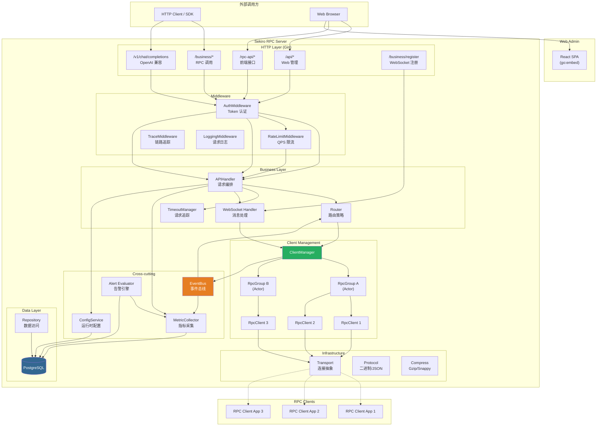
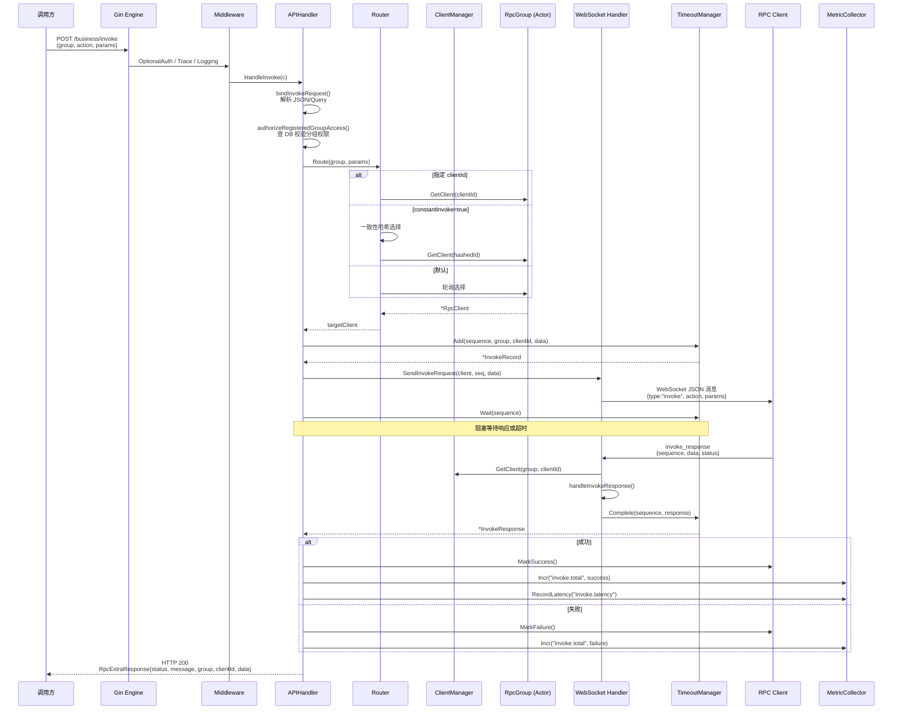
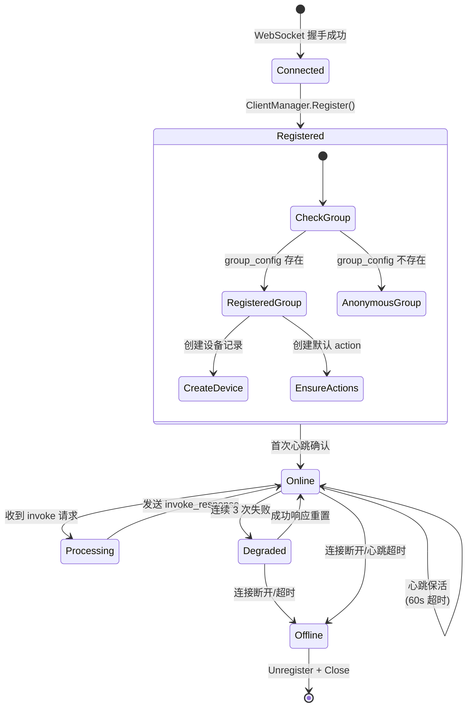

# Sekiro RPC Server — 全面技术分析与架构解构

> 分析基准：当前 `refactor` 分支代码实现（2026-06-11）  
> 模块路径：`github.com/mrh30000/go-rpc`  
> Go 版本：1.25.0 | 前端：React 18 + Vite + Ant Design

---

## 目录

1. [项目整体与核心模块分析](#1-项目整体与核心模块分析)
2. [设计模式与架构风格分析](#2-设计模式与架构风格分析)
3. [可视化图表](#3-可视化图表)
4. [二次开发与架构优化建议](#4-二次开发与架构优化建议)
5. [项目目录结构解析](#5-项目目录结构解析)
6. [新开发者实战入门指南](#6-新开发者实战入门指南)

---

## 1. 项目整体与核心模块分析

### 1.1 项目定位

Sekiro RPC Server 是一个 **反向 RPC 网关**：服务端主动将请求转发给通过 WebSocket 长连接的客户端执行，客户端返回结果后服务端响应给调用方。同时内嵌了 Web 管理后台（React SPA）、OpenAI 兼容的 Chat Completions 代理、指标采集与告警引擎。

**核心场景**：调用方 → HTTP API → Sekiro Server → WebSocket → RPC Client（业务端） → 响应回传。

### 1.2 模块拆解

#### 1.2.1 服务启动与编排层 (`main.go`)

| 维度 | 说明 |
|------|------|
| **职责** | 组合根（Composition Root），负责所有组件的创建、装配、生命周期管理 |
| **核心类型** | `Config`（CLI 参数）、`Server`（持有全部组件引用） |
| **关键流程** | `NewServer()` → `Start()` → YAML 加载 → 日志初始化 → DB 连接 → 迁移 → 配置服务 → WebSocket Handler → 指标采集 → 告警引擎 → Gin 引擎 → 路由注册 → `net.Listen` → 等待关停信号 |
| **依赖方向** | 向下依赖所有 `pkg/` 子包，是唯一知道全部组件的"粘合层" |

**关键设计**：
- `Server.registerRoutes()` 是唯一的路由注册入口，根据 `DisableWebAdmin` / `DisableDatabase` 等开关裁剪路由。
- 三组 API 路由：`/business/*`（核心 RPC 调用）、`/api/*`（Web 管理）、`/rpc-api/*`（前端外部接口）。
- 优雅关停：`waitForShutdown()` 监听 `SIGINT/SIGTERM` → `Shutdown()` 级联取消 WS 协程、HTTP 服务器、告警引擎、指标采集器、客户端管理器。

#### 1.2.2 客户端管理 (`pkg/client/`)

| 维度 | 说明 |
|------|------|
| **职责** | 管理所有 RPC 客户端的连接、状态、分组和生命周期 |
| **核心类型** | `RpcClient`（单连接）、`RpcGroup`（Actor 模型分组）、`ClientManager`（全局管理） |

**RpcClient** (`client.go`):
- 持有 `transport.Connection` 抽象、健康状态（`IsHealthy`、`FailCount`）、`OnHealthDegraded` 回调。
- 3 次连续失败 → 标记不健康，触发 EventBus 发布 `EventClientHealthDegraded`。

**RpcGroup** (`group.go`):
- **Actor 模型**：所有操作（Register/Unregister/GetClient/Allocate）通过 `commandChan` 发送到单一 goroutine（`runLoop`），彻底消除并发竞争。
- 关停模型：`done` channel 关闭 → `runLoop` 自然退出 → `drainCommands` 回填零值 → `closeAllClients`。
- `allocate()` 优先级：健康在线 → 在线 → 任意。

**ClientManager** (`manager.go`):
- `sync.RWMutex` 保护 groups map，懒创建 `RpcGroup`。
- **事件去抖**：客户端上下线事件在 `(group, clientID, eventType)` 维度做 10ms trailing-only 去抖，压制高频抖动的通知噪音。

#### 1.2.3 WebSocket 消息处理 (`pkg/websocket/`)

| 维度 | 说明 |
|------|------|
| **职责** | 处理客户端 WebSocket 连接的全生命周期：注册、心跳、消息分发、invoke 请求发送 |
| **核心类型** | `Handler`、`RpcMessage`（JSON 协议消息） |

**消息类型**：
- `heartbeat` — 心跳保活 + 设备活跃时间更新
- `invoke` — 服务端向客户端发送 RPC 调用
- `invoke_response` — 客户端返回调用结果
- `invoke_stream` — 客户端返回流式响应分片
- `bind` — 客户端上报 action 列表，同步到 DB

**HandleConnection 流程**：
1. 创建 `transport.WSConnection` 包装
2. 创建 `RpcClient`，设置健康降级回调
3. 检查分组是否已注册（DB），创建/更新设备记录
4. 注册到 `ClientManager`
5. 进入读循环：读消息 → 解析 JSON → 分发到对应 handler

#### 1.2.4 请求转发 (`pkg/forwarder/`)

| 维度 | 说明 |
|------|------|
| **职责** | 追踪 in-flight 的 RPC 调用，管理超时与流式响应 |
| **核心类型** | `TimeoutManager`、`InvokeRecord`、`StreamRecord` |

**InvokeRecord**：每个 unary 请求对应一个 record，持有 `ResponseChan`。客户端响应到达时通过 `Complete()` 将结果推入 channel，`Wait()` 阻塞等待。

**StreamRecord**：每个 stream 请求对应一个 record，持有 `ChunkChan`（buffer=16）。客户端通过 `PushStreamChunk` 推入数据分片，`Close()` 关闭 channel 通知消费端。Push 有 5 秒背压超时防止客户端卡死服务端。

**TimeoutManager**：定期 `cleanupExpired()` 清理超时记录。

#### 1.2.5 HTTP 处理器 (`pkg/handler/`)

| 维度 | 说明 |
|------|------|
| **职责** | 统一的 HTTP API 入口：RPC 调用、Chat Completions、Web 管理 |
| **核心类型** | `APIHandler`（invoke/chat/qwen）、各 Web handler（user/group/metric/trace/alert/sysconfig） |

**RequestBuilder 接口**：将 invoke 和 chat 请求统一抽象为 `BuildRequestData()` / `GetTimeout()` / `IsStream()` 等方法，`handleForwardRequest()` 作为统一编排入口。

**三种响应类型**：
- `ApiResponse` — `/api/*` 管理接口，`code=0` 表示成功
- `RpcResponse` — `/rpc-api/*` 和 `/business/*`，`status=0` 表示成功
- `RpcExtraResponse` — invoke 响应，额外携带 `group` / `clientId` 路由元数据

#### 1.2.6 路由策略 (`pkg/router/`)

| 维度 | 说明 |
|------|------|
| **职责** | 客户端选择策略：轮询、指定、一致性哈希 |
| **核心类型** | `Router`、`ConsistentHashRing`、`RouteParams` |

**策略优先级**：`SpecifiedClient`（指定 clientId） > `ConsistentHash`（constantInvoke=true） > `RoundRobin`（默认）。

**哈希环缓存**：`ringCache` 按 group 缓存一致性哈希环，通过 client 列表指纹检测变更。客户端上下线时通过 EventBus → `InvalidateRingCache` 主动失效。

#### 1.2.7 中间件 (`pkg/middleware/`)

| 中间件 | 说明 |
|--------|------|
| `AuthMiddleware.Authenticate()` | 必选认证：Bearer token → DB 查询 → 写入 context |
| `AuthMiddleware.OptionalAuth()` | 可选认证：有 token 就解析，没有也放行 |
| `AuthMiddleware.RequireAdmin()` | 管理员权限校验 |
| `LoggingMiddleware` | 请求日志 |
| `TraceMiddleware` | 链路追踪（traceId 注入） |
| `RateLimitMiddleware` | QPS 限流（令牌桶） |
| `AnonymousAccessMiddleware` | 匿名访问控制 |

**Token 缓存**：`FindUserByToken` 使用 singleflight + 内存缓存（含负缓存），避免并发穿透和 DB 抖动放大。

#### 1.2.8 协议层 (`pkg/protocol/`)

| 维度 | 说明 |
|------|------|
| **职责** | 二进制协议编解码（TCP 传输层使用） |
| **包格式** | `[Magic:int64][Length:int32][Type:byte][SerialNumber:int32][Headers][Data]` |
| **Magic** | `0x73656b69726f0000`（"sekiro\0\0"） |

**注意**：当前 WebSocket 通道使用 JSON 协议（`RpcMessage`），TCP 通道使用二进制协议（`RpcPacket`）。WebSocket 是当前主力通道。

#### 1.2.9 传输层 (`pkg/transport/`)

| 维度 | 说明 |
|------|------|
| **职责** | 连接抽象，统一 WebSocket 和 TCP 的发送接口 |
| **接口** | `Connection`：`Send(data []byte) error` / `Close() error` / `RemoteAddr() string` |
| **实现** | `WSConnection`（gorilla/websocket）、`TCPConnection` |

#### 1.2.10 压缩层 (`pkg/compress/`)

| 维度 | 说明 |
|------|------|
| **职责** | 数据压缩/解压，支持 Gzip、Snappy、None 三种策略 |
| **模式** | Strategy 模式，`CompressManager` 按名称选择具体实现 |

#### 1.2.11 事件总线 (`pkg/eventbus/`)

| 维度 | 说明 |
|------|------|
| **职责** | 进程内发布-订阅，解耦客户端生命周期事件与业务响应 |
| **事件类型** | `EventClientConnect`、`EventClientDisconnect`、`EventClientHealthDegraded` |
| **特点** | 同步分发（handler 内不要做耗时操作），支持 Unsubscribe |

#### 1.2.12 指标采集 (`pkg/metrics/`)

| 维度 | 说明 |
|------|------|
| **职责** | 采集 RPC 调用计数、延迟、Gauge 等指标，定期刷盘到 PostgreSQL |
| **架构** | 内存 bucket → 1 分钟 flush → `metric_minute` → 1 小时 rollup → `metric_hour` → 每天 rollup → `metric_day` |
| **类型** | Counter（计数求和）、Gauge（瞬时值）、Histogram（含 P50/P90/P99） |

#### 1.2.13 告警引擎 (`pkg/alert/`)

| 维度 | 说明 |
|------|------|
| **职责** | 定期评估告警规则，超阈值时发送通知（SMTP/Webhook） |
| **流程** | 加载 DB 规则 → 1 分钟轮询 → 查指标窗口数据 → 阈值判断 → 5 分钟防抖 → 发送通知 → 记录 history |
| **告警级别** | Info（1x 阈值）→ Warning（1.5x）→ Critical（2x） |

#### 1.2.14 限流器 (`pkg/flow/`)

| 维度 | 说明 |
|------|------|
| **职责** | QPS 令牌桶限流 |
| **特点** | `golang.org/x/time/rate` 实现，per-key limiter 带 TTL 自动清理 |

#### 1.2.15 数据持久化 (`pkg/database/` + `pkg/model/`)

| 维度 | 说明 |
|------|------|
| **ORM** | GORM + PostgreSQL |
| **全局单例** | `database.DB` 包级变量，通过 `GetDB()` 访问 |
| **Repository 模式** | `repository/` 定义接口（UserRepository、GroupRepository 等），handler 层通过接口注入依赖 |

**数据模型**：

| 模型 | 表名 | 说明 |
|------|------|------|
| `UserInfo` | `user_info` | 用户（含 api_token、is_admin、quota_qps） |
| `GroupConfig` | `group_config` | 分组配置（归属用户、QPS 配额） |
| `GroupAction` | `group_actions` | 分组可用的 RPC action 列表 |
| `GroupDevice` | `group_device` | 分组下的设备（客户端）记录 |
| `SysConfig` | `sys_config` | 系统键值配置 |
| `SysLog` | `sys_log` | 审计日志 |
| `ServerNode` | `server_node` | 服务器节点注册 |
| `TraceRecord` | `trace_record` | 调用链路追踪 |
| `AlertRule` / `AlertHistory` | `alert_rule` / `alert_history` | 告警规则与历史 |
| `MetricMinute/Hour/Day` | `metric_minute/hour/day` | 多粒度指标聚合 |
| `MetricTag` | `metric_tag` | 指标标签映射 |

#### 1.2.16 运行时配置 (`pkg/config/`)

| 维度 | 说明 |
|------|------|
| **职责** | 从 DB `sys_config` 表加载键值配置，提供类型安全的访问方法 |
| **缓存** | `sync.Map` 内存缓存，`Refresh()` 时计算 FNV-1a 哈希检测变化 |

#### 1.2.17 前端 (`web/`)

| 维度 | 说明 |
|------|------|
| **技术栈** | React 18 + React Router v6 + Ant Design + Axios + Vite |
| **嵌入方式** | `web/embed.go` 使用 `//go:embed dist` 将构建产物嵌入 Go 二进制 |
| **页面** | Dashboard、分组管理、匿名分组、监控大盘、用户管理、系统面板、链路追踪、告警规则/历史 |
| **鉴权** | `AuthGuard` 组件 + `localStorage` 存储 `api_token` |

### 1.3 模块间调用关系

```
main.go (组合根)
 ├── pkg/handler (HTTP 处理器)
 │    ├── pkg/client (客户端管理)
 │    ├── pkg/websocket (WS 消息处理)
 │    ├── pkg/forwarder (请求追踪)
 │    ├── pkg/router (路由策略)
 │    ├── pkg/metrics (指标采集)
 │    ├── pkg/config (配置服务)
 │    ├── pkg/middleware (鉴权/限流)
 │    └── pkg/model (数据模型)
 ├── pkg/websocket
 │    ├── pkg/client
 │    ├── pkg/forwarder
 │    ├── pkg/transport
 │    ├── pkg/eventbus
 │    └── pkg/database + pkg/model
 ├── pkg/client
 │    ├── pkg/transport
 │    └── pkg/eventbus
 ├── pkg/alert
 │    ├── pkg/metrics (读取指标)
 │    └── pkg/database + pkg/model
 ├── pkg/metrics
 │    └── pkg/database + pkg/model
 └── pkg/database
      └── pkg/model
```

### 1.4 隐式耦合与边界问题

| 问题 | 位置 | 说明 |
|------|------|------|
| **全局 DB 单例** | `pkg/database/database.go` | `database.DB` 包级变量，所有需要 DB 的包直接引用，无法注入替代 |
| **Handler 直接依赖 database.GetDB()** | `pkg/handler/invoke.go`、`pkg/websocket/handler.go` | 绕过 Repository 接口，直接 GORM 查询 |
| **ConfigService 通过 context 传递** | `main.go` 路由注册 | `/rpc-api/*` 路由通过 `c.Set("configService", ...)` 注入，类型不安全 |
| **响应类型分裂** | `pkg/handler/response.go` | 三种响应格式（ApiResponse/RpcResponse/RpcExtraResponse）增加了前端适配复杂度 |
| **internal/config 与 pkg/config 并存** | 两个 config 包 | `internal/config` 负责 YAML 配置解析，`pkg/config` 负责 DB 运行时配置，命名容易混淆 |

---

## 2. 设计模式与架构风格分析

### 2.1 已使用的设计模式

#### 2.1.1 Actor 模型（并发控制）

- **位置**：`pkg/client/group.go` — `RpcGroup`
- **解决的问题**：分组内客户端注册/注销/分配等操作的并发安全
- **实现方式**：单一 goroutine（`runLoop`）通过 `commandChan` 串行处理所有命令，外部通过 channel callback 同步获取结果
- **优点**：完全消除锁竞争，关停模型优雅（done channel + drain）
- **评价**：实现规范，符合 Actor 模式意图

#### 2.1.2 Strategy 模式（路由策略）

- **位置**：`pkg/router/strategy.go` — `Router.Route()`
- **解决的问题**：支持多种客户端选择策略（轮询/指定/一致性哈希）
- **实现方式**：`Router` 内部按优先级选择策略方法，各策略是独立函数
- **潜在缺陷**：策略选择硬编码在 `Route()` 中，未抽象为接口。如需新增策略（如加权轮询），需修改 `Route()` 方法
- **优化建议**：抽取 `RoutingStrategy` 接口，通过配置或参数动态选择

#### 2.1.3 Builder 模式（请求构建）

- **位置**：`pkg/handler/invoke.go` — `RequestBuilder` 接口 + `InvokeBuilder`、`ChatCompletionRequest`
- **解决的问题**：统一 invoke 和 chat 两种请求类型的处理流程
- **实现方式**：`handleForwardRequest` 只依赖 `RequestBuilder` 接口，不同请求类型实现各自的 `BuildRequestData()` / `GetTimeout()` / `IsStream()` 等方法
- **优点**：模板方法 + 策略的组合，新请求类型只需实现接口

#### 2.1.4 Observer 模式（事件总线）

- **位置**：`pkg/eventbus/eventbus.go` — `EventBus`
- **解决的问题**：客户端生命周期事件（连接/断开/健康降级）需要通知多个关注方
- **实现方式**：同步发布，handler 列表在发布时 copy-on-read
- **优点**：解耦事件源（ClientManager）和事件处理方（Router 缓存失效、Metrics Gauge 更新）
- **潜在缺陷**：同步分发，handler 中的耗时操作会阻塞调用方

#### 2.1.5 Repository 模式（数据访问）

- **位置**：`pkg/database/repository/interfaces.go` + 各 repo 实现
- **解决的问题**：数据访问层抽象，支持 mock 测试
- **实现方式**：接口定义 + GORM 实现，handler 通过 `Deps` 结构体注入
- **优点**：handler 不直接依赖 GORM，便于单元测试
- **潜在缺陷**：部分 handler（`invoke.go`、`websocket/handler.go`）仍直接调用 `database.GetDB()`，未完全收敛到 Repository

#### 2.1.6 Facade 模式（APIHandler）

- **位置**：`pkg/handler/invoke.go` — `APIHandler`
- **解决的问题**：将复杂的 RPC 转发流程封装为简单的 HTTP handler
- **实现方式**：`HandleInvoke` → `handleForwardRequest` → 编排鉴权/路由/发送/等待/响应
- **优点**：HTTP 层不感知 RPC 内部细节

#### 2.1.7 Singleton 模式

- **位置**：
  - `pkg/database/database.go` — `DB *gorm.DB` 全局单例
  - `pkg/middleware/auth_cache.go` — `defaultTokenCache` 全局缓存
- **评价**：DB 单例在小项目中合理，但限制了多实例测试和未来分库扩展

#### 2.1.8 Adapter 模式（传输层抽象）

- **位置**：`pkg/transport/connection.go` — `Connection` 接口
- **解决的问题**：统一 WebSocket 和 TCP 两种传输协议的接口
- **实现方式**：`WSConnection` 和 `TCPConnection` 各自实现 `Connection` 接口
- **优点**：`RpcClient` 不感知底层传输细节

#### 2.1.9 Proxy/Gateway 模式（OpenAI 兼容层）

- **位置**：`pkg/handler/chat.go` — `HandleChatCompletions`
- **解决的问题**：将 Sekiro RPC 协议适配为标准 OpenAI Chat Completions API
- **实现方式**：接收 OpenAI 请求 → promptcompat 规范化 → 通过 RPC invoke 转发 → 响应格式化为 OpenAI 标准

### 2.2 架构风格

#### 分层架构（Layered Architecture）

```
HTTP Layer     → pkg/handler (Gin handlers)
Business Layer → pkg/client + pkg/websocket + pkg/forwarder + pkg/router
Data Layer     → pkg/database + pkg/model + pkg/database/repository
Infra Layer    → pkg/transport + pkg/protocol + pkg/compress
Cross-cutting  → pkg/middleware + pkg/eventbus + pkg/metrics + pkg/alert + pkg/config + pkg/flow
```

**特点**：
- 自上而下的依赖方向，`main.go` 作为组合根装配所有层
- 非严格的分层：handler 层可直接访问 database（绕过 repository），存在层间泄露
- `pkg/handler` 是最"厚"的层，承担了 HTTP 解析、业务编排、响应格式化等多重职责

### 2.3 可引入但未使用的设计模式

| 模式 | 建议位置 | 解决的问题 |
|------|----------|------------|
| **Circuit Breaker** | `pkg/client/` 或 `pkg/forwarder/` | 客户端持续失败时快速失败，避免雪崩。当前只有 3 次失败标记不健康，无熔断恢复机制 |
| **Chain of Responsibility** | `pkg/middleware/` | 当前中间件通过 Gin `Use()` 链式调用，但自定义中间件（CORS、路由替换）在 `main.go` 中以函数形式存在，可统一为中间件链 |
| **Factory Method** | `pkg/router/` | 路由策略创建可抽象为工厂，支持运行时切换策略 |
| **Template Method** | `pkg/handler/invoke.go` | `handleForwardRequest` 实际已是隐式模板方法，但使用接口组合而非继承，可进一步提炼流程步骤 |

---

## 3. 可视化图表

### 3.1 系统架构图



### 3.2 核心业务流程图 — RPC Invoke 请求生命周期



### 3.3 WebSocket 客户端连接生命周期



---

## 4. 二次开发与架构优化建议

### 建议 1：消除 Handler 层对 `database.GetDB()` 的直接依赖

**目标模块**：`pkg/handler/invoke.go`、`pkg/websocket/handler.go`、`main.go`

**当前问题**：
- `invoke.go` 中的 `authorizeRegisteredGroupAccess()` 直接调用 `database.GetDB().Where(...)` 查询 `group_config`
- `websocket/handler.go` 中的 `ensureDefaultActions()`、`isGroupRegistered()`、`HandleConnection()` 直接操作 DB
- 这些操作绕过了 Repository 接口，违反了分层原则

**实施方案**：
1. 在 `GroupRepository` 接口中新增 `IsGroupRegistered(name string) (bool, error)` 和 `EnsureDefaultActions(groupName string)` 方法
2. 将 `GroupRepository` 注入到 `APIHandler` 和 `websocket.Handler` 中
3. 移除所有 `database.GetDB()` 的直接调用（`pkg/database` 只被 `repository` 和 `main.go` 引用）

**预期收益**：
- 可维护性：数据访问收敛到 Repository 层，变更 SQL 逻辑只需改一处
- 可测试性：Handler 单元测试可 mock Repository，无需真实 DB
- 安全性：减少 SQL 注入风险面

**风险与成本**：低风险，改动集中在 3-4 个文件，接口新增方法不影响现有实现。约 2-3 小时工作量。

### 建议 2：引入 Circuit Breaker 增强客户端容错

**目标模块**：`pkg/client/client.go`、`pkg/forwarder/timeout.go`

**当前问题**：
- 客户端 3 次失败标记不健康后，Router 优先跳过该客户端，但没有恢复机制
- 不健康的客户端只能通过心跳中的 `MarkSuccess()` 恢复，缺乏半开状态探测
- 当所有客户端都不健康时，请求仍会被路由到不健康客户端（fallback），但没有快速失败机制

**实施方案**：
1. 为 `RpcClient` 引入三态熔断器：Closed（正常） → Open（熔断） → Half-Open（探测）
2. Open 状态下直接跳过该客户端，不参与路由选择
3. 定时（如 30 秒后）从 Open 转入 Half-Open，允许一个探测请求
4. 探测成功 → Closed；探测失败 → 回到 Open 并重置计时器

**预期收益**：
- 可用性：故障客户端自动隔离，恢复后自动重新接入
- 性能：避免持续向已知故障客户端发送请求
- 可观测性：熔断状态变化可发布到 EventBus，触发告警或 Dashboard 更新

**风险与成本**：中等风险，需要修改 Router 的健康检查逻辑。约 4-6 小时工作量。

### 建议 3：将 `main.go` 中的自定义中间件迁移到 `pkg/middleware/`

**目标模块**：`main.go`、`pkg/middleware/`

**当前问题**：
- `ginCorsMiddleware()` 和 `ginRouteReplaceMiddleware()` 定义在 `main.go` 中，作为函数级中间件存在
- 这些中间件无法被其他模块复用或独立测试
- `main.go` 承载了过多职责（644 行），包含中间件实现、路由注册、关停逻辑

**实施方案**：
1. 将 `ginCorsMiddleware` 迁移到 `pkg/middleware/cors.go`，改为 `CORSMiddleware(enabled bool, whitelist []string) gin.HandlerFunc`
2. 将 `ginRouteReplaceMiddleware` 迁移到 `pkg/middleware/route_replace.go`
3. `main.go` 中改为调用 `middleware.CORSMiddleware(...)` 和 `middleware.RouteReplaceMiddleware(...)`
4. 考虑将 `registerRoutes()` 和 `handleRegister()` 等方法拆分到独立的 bootstrap 文件

**预期收益**：
- 可维护性：`main.go` 精简到纯编排逻辑，中间件可独立测试
- 可扩展性：新中间件统一在 `pkg/middleware/` 管理

**风险与成本**：低风险，纯重构，不改行为。约 1-2 小时工作量。

### 建议 4：统一响应格式与错误码体系

**目标模块**：`pkg/handler/response.go`、前端 `web/src/utils/api.js`

**当前问题**：
- 三套响应格式（`ApiResponse` / `RpcResponse` / `RpcExtraResponse`），字段语义不同（`code` vs `status`）
- 前端需要适配多种响应格式，`Login.jsx` 依赖 `status === 0` 判断成功
- 错误码无统一文档，`-1` 被泛用为"任意错误"

**实施方案**：
1. 设计统一的基础响应信封：`{code: int, message: string, data: T, trace_id: string}`
2. `RpcExtraResponse` 的路由元数据放入 `data` 对象中而非顶层
3. 定义错误码枚举：`0`=成功，`1xxx`=参数错误，`2xxx`=认证/授权错误，`3xxx`=业务错误，`5xxx`=服务端错误
4. 前端统一拦截器只检查 `code === 0`

**预期收益**：
- 可维护性：前后端对接更简单，新开发者上手更快
- 可扩展性：错误码有明确语义，便于定位问题

**风险与成本**：中等风险，需要同步修改前端和已有的 SDK 消费方。约 4-6 小时工作量。

### 建议 5：引入依赖注入容器替代手动装配

**目标模块**：`main.go`

**当前问题**：
- `NewServer()` 手动创建和装配 12+ 个组件，依赖关系靠代码顺序隐式表达
- 新增组件需要修改 `Server` 结构体和 `Start()` 方法
- 测试需要构建完整的 `Server` 或手动 mock 部分组件

**实施方案**：
1. 使用 `go.uber.org/fx` 或 `google/wire` 引入轻量 DI 容器
2. 将组件创建改为 Provider 函数，声明依赖关系
3. `main.go` 简化为 `fx.New(providers...).Run()`

**预期收益**：
- 可维护性：依赖关系显式声明，组件顺序不再重要
- 可测试性：测试时只替换特定 Provider
- 可扩展性：新组件只需添加 Provider，无需改 `main.go`

**风险与成本**：较高成本，需要学习 DI 框架。建议在小范围试点（如 handler 层）。约 8-12 小时工作量。

---

## 5. 项目目录结构解析

```
go-rpc/
├── main.go                    # 服务组合根：Config、Server、NewServer、Start、Shutdown
├── main_test.go               # 集成测试：路由注册和 HTTP 配置
├── go.mod                     # Go 模块定义 (github.com/mrh30000/go-rpc)
├── go.sum                     # 依赖校验
├── config.yaml                # 运行时配置（YAML）
├── config.yaml.example        # 配置模板
├── config.yaml.docker         # Docker 专用配置
├── Dockerfile                 # 多阶段构建（golang:1.25-alpine → alpine:3.19）
├── docker-compose.yaml        # Docker Compose 编排
├── .env.example               # 环境变量模板
├── .dockerignore              # Docker 构建排除
├── .gitignore                 # Git 排除
├── AGENTS.md                  # AI 编码助手指令
├── CLAUDE.md                  # Claude 编码指令
├── README.md                  # 项目说明
├── prd.md                     # 产品需求文档
│
├── internal/                  # 私有包（不可被外部 import）
│   ├── config/                # YAML 配置解析（ServerConfig、LogConfig、DatabaseConfig）
│   │   ├── config.go          # 配置结构体定义和加载
│   │   ├── config_v2.go       # V2 配置格式
│   │   ├── dotenv.go          # .env 文件加载
│   │   ├── models.go          # 模型别名配置
│   │   ├── paths.go           # 路径解析
│   │   ├── store.go           # 配置存储
│   │   └── validation.go      # 配置校验
│   ├── prompt/                # 提示词消息处理
│   ├── promptcompat/          # OpenAI prompt 兼容性处理
│   ├── toolcall/              # 工具调用解析（DSML 格式）
│   ├── util/                  # 内部工具函数
│   └── utils/
│       └── logger/            # 日志封装（zap.SugaredLogger + lumberjack）
│
├── pkg/                       # 公共包（可被外部 import）
│   ├── alert/                 # 告警引擎
│   │   ├── evaluator.go       # 规则评估（1 分钟轮询）
│   │   ├── notifier.go        # 通知发送（SMTP/Webhook）
│   │   └── notifier_test.go
│   │
│   ├── client/                # 服务端客户端管理
│   │   ├── client.go          # RpcClient（连接、健康状态）
│   │   ├── group.go           # RpcGroup（Actor 模型）
│   │   ├── group_test.go
│   │   ├── manager.go         # ClientManager（全局管理、事件去抖）
│   │   ├── manager_test.go
│   │   └── sdk/               # SDK（供外部消费者使用）
│   │       ├── client.go      # SDK 客户端
│   │       └── invoker.go     # SDK 调用器
│   │
│   ├── compress/              # 压缩策略
│   │   ├── gzip.go            # Gzip 实现
│   │   ├── snappy.go          # Snappy 实现
│   │   ├── none.go            # 无压缩
│   │   └── manager.go         # 压缩管理器（Strategy 选择）
│   │
│   ├── config/                # 运行时配置服务（DB 键值）
│   │   └── service.go         # Service 接口 + sync.Map 缓存
│   │
│   ├── database/              # 数据库
│   │   ├── database.go        # GORM 初始化、AutoMigrate
│   │   └── repository/        # Repository 模式
│   │       ├── interfaces.go  # 接口定义（User/Group/SysConfig/...）
│   │       ├── user_repo.go
│   │       ├── group_repo.go
│   │       ├── alert_repo.go
│   │       ├── metric_repo.go
│   │       ├── sysconfig_repo.go
│   │       ├── trace_repo.go
│   │       └── db_helper.go
│   │
│   ├── eventbus/              # 事件总线（发布-订阅）
│   │   ├── eventbus.go        # EventBus 核心
│   │   ├── events.go          # 事件类型定义
│   │   └── helper.go          # 函数比较工具
│   │
│   ├── flow/                  # 流量控制
│   │   ├── ratelimit.go       # QPS 令牌桶限流
│   │   └── backoff.go         # 空队列退避
│   │
│   ├── forwarder/             # 请求转发追踪
│   │   ├── timeout.go         # TimeoutManager（InvokeRecord + StreamRecord）
│   │   ├── streamframe.go     # 流式帧处理
│   │   └── *_test.go
│   │
│   ├── handler/               # HTTP 处理器
│   │   ├── invoke.go          # RPC invoke 核心（APIHandler + RequestBuilder）
│   │   ├── chat.go            # OpenAI Chat Completions 代理
│   │   ├── qwen.go            # 通义千问专用路由
│   │   ├── stream.go          # SSE 流式响应
│   │   ├── routes.go          # Web 管理路由注册
│   │   ├── http_server.go     # HTTPServer 封装
│   │   ├── response.go        # 响应类型（ApiResponse/RpcResponse/RpcExtraResponse）
│   │   ├── websocket.go       # WebSocket 相关 handler
│   │   ├── user.go            # 用户管理 handler
│   │   ├── group.go           # 分组管理 handler
│   │   ├── metric.go          # 指标查询 handler
│   │   ├── trace.go           # 链路追踪 handler
│   │   ├── alert.go           # 告警管理 handler
│   │   ├── sysconfig.go       # 系统配置 handler
│   │   ├── anonymous.go       # 匿名分组 handler
│   │   ├── login.go           # 登录/注册 handler
│   │   ├── authz.go           # 权限校验
│   │   ├── audit.go           # 审计日志
│   │   └── constants.go       # 常量定义
│   │
│   ├── metrics/               # 指标采集
│   │   └── collector.go       # MetricCollector（分钟刷盘 + 小时/天聚合）
│   │
│   ├── middleware/             # Gin 中间件
│   │   ├── auth.go            # 认证（Bearer token + sekiro-token）
│   │   ├── auth_cache.go      # Token 缓存（singleflight + 负缓存）
│   │   ├── logging.go         # 请求日志
│   │   ├── ratelimit.go       # QPS 限流中间件
│   │   └── trace.go           # 链路追踪（traceId 注入）
│   │
│   ├── model/                 # 数据模型（GORM）
│   │   ├── database.go        # UserInfo/SysConfig/GroupConfig/GroupDevice/...
│   │   ├── alert.go           # AlertRule/AlertHistory
│   │   ├── trace.go           # TraceRecord
│   │   ├── group.go           # DefaultGroupActions 常量
│   │   └── openai.go          # ChatCompletionRequest（OpenAI 请求模型）
│   │
│   ├── protocol/              # 二进制协议
│   │   ├── packet.go          # RpcPacket 编解码
│   │   ├── packet_type.go     # 包类型常量
│   │   └── bufwriter.go       # 缓冲写入器
│   │
│   ├── router/                # 路由策略
│   │   ├── strategy.go        # Router（RoundRobin/Specified/ConsistentHash）
│   │   └── hash.go            # ConsistentHashRing 实现
│   │
│   ├── transport/             # 传输层抽象
│   │   ├── connection.go      # Connection 接口
│   │   ├── ws_conn.go         # WebSocket 实现
│   │   └── tcp_conn.go        # TCP 实现
│   │
│   ├── utils/                 # 工具函数
│   │   ├── code.go            # 代码辅助
│   │   ├── file.go            # 文件操作
│   │   ├── password/          # 密码哈希
│   │   └── traceid/           # TraceID 生成
│   │
│   └── websocket/             # WebSocket 消息处理
│       └── handler.go         # Handler（连接管理、消息分发、invoke 发送）
│
├── web/                       # 前端 SPA
│   ├── embed.go               # go:embed 嵌入
│   ├── embed_test.go          # 嵌入测试
│   ├── index.html             # HTML 入口
│   ├── package.json           # 前端依赖
│   ├── vite.config.js         # Vite 构建配置（dev proxy → :5613）
│   ├── src/
│   │   ├── main.jsx           # React 入口
│   │   ├── App.jsx            # 路由定义
│   │   ├── App.css
│   │   ├── index.css
│   │   ├── components/        # 通用组件
│   │   │   ├── AuthGuard.jsx  # 认证守卫
│   │   │   ├── Logo.jsx       # Logo 组件
│   │   │   ├── GroupAction.jsx
│   │   │   ├── GroupDeviceList.jsx
│   │   │   └── GroupMonitor.jsx
│   │   ├── layouts/
│   │   │   └── Layout.jsx     # 页面布局
│   │   ├── pages/             # 页面组件
│   │   │   ├── Login.jsx
│   │   │   ├── Register.jsx
│   │   │   ├── Dashboard.jsx
│   │   │   ├── GroupList.jsx
│   │   │   ├── GroupDetail.jsx
│   │   │   ├── AnonymousGroup.jsx
│   │   │   ├── MonitorDashboard.jsx
│   │   │   ├── UserList.jsx
│   │   │   ├── SystemPanel.jsx
│   │   │   ├── TraceList.jsx
│   │   │   ├── TraceDetail.jsx
│   │   │   ├── AlertRules.jsx
│   │   │   └── AlertHistory.jsx
│   │   └── utils/
│   │       ├── api.js         # Axios 实例 + API 封装
│   │       └── index.js       # 工具函数
│   └── dist/                  # 构建产物（go:embed 需要）
│
├── sample/                    # 示例代码
│   ├── go/                    # Go SDK 示例（独立 go.mod）
│   ├── java/                  # Java 客户端示例
│   ├── dotnet-core/           # .NET 客户端示例
│   └── frida/                 # Frida 脚本示例
│
├── deploy/                    # 部署脚本
│   └── postgres/
│       ├── migration.sql      # PostgreSQL 全量建表
│       ├── insert_default_configs.sql
│       └── migration/         # 增量迁移
│           ├── 002_add_trace_record.sql
│           └── 003_add_alert_tables.sql
│
└── docs/                      # 文档
    └── *.md
```

### 关键目录角色说明

| 目录 | 角色 | 边界 |
|------|------|------|
| `internal/` | 私有基础设施 | 不可被外部模块 import，仅服务自身使用 |
| `pkg/client/` | 核心客户端管理 | 被 handler、websocket、router 依赖 |
| `pkg/handler/` | HTTP 入口层 | 最"厚"的层，连接 HTTP 和业务逻辑 |
| `pkg/websocket/` | 消息通道 | 客户端通信的唯一入口 |
| `pkg/forwarder/` | 请求追踪 | invoke 请求的生命周期管理 |
| `pkg/database/` | 数据持久化 | 全局 DB 单例 + Repository 模式 |
| `web/` | 前端 SPA | 构建产物嵌入 Go 二进制，无独立部署 |

---

## 6. 新开发者实战入门指南

### 6.1 本地环境搭建

#### 所需软件

| 软件 | 版本要求 | 用途 |
|------|----------|------|
| Go | >= 1.25.0 | 后端编译运行 |
| Node.js | >= 18 | 前端构建 |
| PostgreSQL | >= 15 | 数据库 |
| Git | >= 2.x | 版本控制 |

#### 环境变量

```bash
# Go 代理（国内加速）
export GOPROXY=https://goproxy.cn,direct

# 数据库连接（或使用 config.yaml）
export PG_HOST=localhost
export PG_PORT=5432
export PG_USER=postgres
export PG_PASSWORD=postgres
export PG_DBNAME=sekiro
```

### 6.2 从 0 到运行

```bash
# 1. 克隆代码
git clone https://github.com/mrh30000/go-rpc.git
cd go-rpc

# 2. 初始化数据库
#    创建 PostgreSQL 数据库并执行建表脚本
psql -U postgres -d sekiro -f deploy/postgres/migration.sql
psql -U postgres -d sekiro -f deploy/postgres/insert_default_configs.sql

# 3. 配置
cp config.yaml.example config.yaml
# 编辑 config.yaml，修改 Database 连接信息

# 4. 构建前端（生成 web/dist/）
cd web
npm install
npm run build    # 输出到 web/dist/
cd ..

# 5. 构建后端
go build -o rpc-server ./main.go

# 6. 启动服务
./rpc-server -c config.yaml

# 或者直接运行
go run main.go -c config.yaml

# 服务启动后访问：
# - Web 管理后台：http://localhost:5612/
# - 默认管理员：admin / admin123
# - 健康检查：http://localhost:5612/health
```

#### 前端开发模式

```bash
cd web
npm install
npm run dev    # Vite dev server，端口 3000
# 自动代理 /business|/api|/rpc-api → localhost:5613
```

> **注意**：Vite 代理目标是 `:5613`，如果后端运行在 `:5612`，需要修改 `web/vite.config.js` 或用 `-port 5613` 启动后端。

### 6.3 最小改动示例 — 添加一个自定义 Health Check 端点

**目标**：新增一个 `/health/detail` 端点，返回更详细的服务器状态信息。

**涉及文件**：`main.go`

**步骤 1**：在 `registerRoutes()` 方法中，找到现有的 `/health` 路由注册（约第 331 行）：

```go
s.httpServer.Engine().GET("/health", func(c *gin.Context) {
    c.JSON(200, gin.H{
        "status":    "healthy",
        "timestamp": time.Now().Format(time.RFC3339),
        "version":   "1.0.0",
    })
})
```

**步骤 2**：在其下方添加新端点：

```go
s.httpServer.Engine().GET("/health/detail", func(c *gin.Context) {
    c.JSON(200, gin.H{
        "status":        "healthy",
        "timestamp":     time.Now().Format(time.RFC3339),
        "version":       "1.0.0",
        "total_groups":  s.clientManager.GroupCount(),
        "total_clients": s.clientManager.ClientCount(),
        "all_groups":    s.clientManager.GetAllGroups(),
        "pending_invokes": s.timeoutManager.Count(),
        "pending_streams": s.timeoutManager.StreamCount(),
    })
})
```

**步骤 3**：构建并运行：

```bash
go build -o rpc-server ./main.go
./rpc-server -c config.yaml
```

**步骤 4**：验证：

```bash
curl http://localhost:5612/health/detail
```

预期返回：

```json
{
  "status": "healthy",
  "timestamp": "2026-06-11T10:30:00+08:00",
  "version": "1.0.0",
  "total_groups": 2,
  "total_clients": 5,
  "all_groups": ["group-a", "group-b"],
  "pending_invokes": 0,
  "pending_streams": 0
}
```

### 6.4 测试命令速查

```bash
# 全量测试
go test ./...

# 单包测试
go test ./pkg/client/...
go test ./pkg/protocol/...
go test ./pkg/compress/...
go test ./pkg/handler/...
go test ./pkg/websocket/...

# 单个测试
go test -run TestRpcPacket ./pkg/protocol/...
go test -run TestGzipCompress ./pkg/compress/...
go test -run TestClientManager ./pkg/client/...

# 带覆盖率
go test -cover ./...

# 前端测试
cd web && npm run build   # 确保 web/dist/ 存在
go test ./web/...         # 测试嵌入
```

### 6.5 常见踩坑点

| 问题 | 原因 | 解决 |
|------|------|------|
| `go build` 报 `web/dist/` 不存在 | `//go:embed dist` 需要目录存在 | 先执行 `cd web && npm run build` |
| 前端 dev 代理不通 | Vite 代理目标是 `:5613` | 改 `vite.config.js` 或 `-port 5613` 启动后端 |
| `sample/go/` 编译失败 | 有独立的 `go.mod`，不属于主模块 | 在 `sample/go/` 目录下单独编译 |
| 数据库连接失败 | `config.yaml` 中 Database 配置不对 | 检查 PostgreSQL 是否运行且连接信息正确 |
| 登录 401 | 默认用户未创建 | 确保 `migration.sql` 已执行，默认 admin/admin123 |
| `DisableDatabase: true` 后部分功能不可用 | DB 相关路由被跳过 | 正常行为，此模式下无用户管理/指标/告警 |

---

## 附录：技术栈清单

| 类别 | 技术 |
|------|------|
| 语言 | Go 1.25 |
| Web 框架 | Gin 1.12 |
| WebSocket | gorilla/websocket 1.5 |
| ORM | GORM 1.25 + postgres driver |
| 日志 | zap 1.26 + lumberjack 2.2 |
| 限流 | golang.org/x/time (rate.Limiter) |
| JSON | goccy/go-json（高性能替代 encoding/json） |
| 压缩 | golang/snappy |
| ID 生成 | google/uuid |
| 配置 | gopkg.in/yaml.v3 |
| 前端 | React 18 + Vite + Ant Design + Axios |
| 构建 | 多阶段 Docker（golang:1.25-alpine → alpine:3.19） |
| 数据库 | PostgreSQL 15+ |
