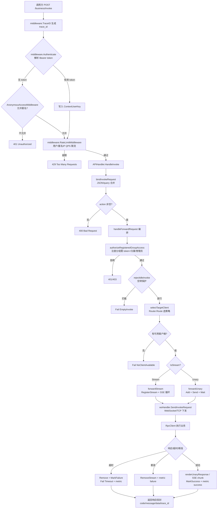
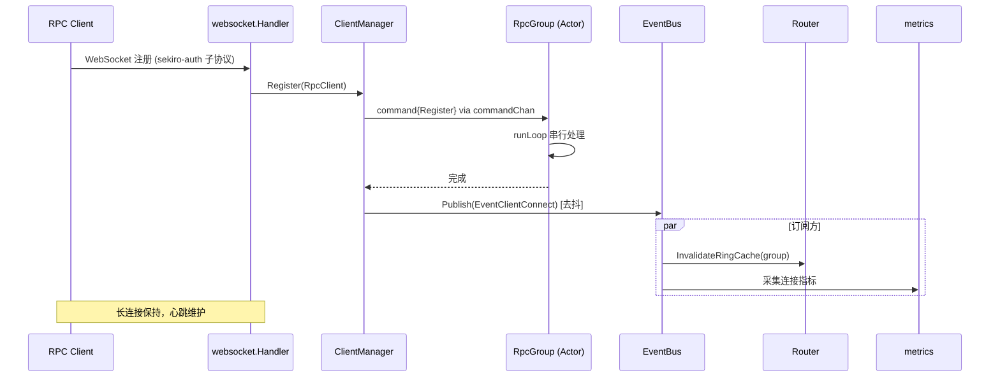

# Rpc RPC Server — 全面技术分析与架构解构

> 分析基准：当前 `main` 分支代码实现（截至 2026-06-28，commit `45a0e16`）  
> 模块路径：`github.com/mrh30000/go-rpc`  
> Go 版本：1.25.0 | 前端：React 18 + Vite 5 + Ant Design 5  
> 文档目标：作为技术交接与二次开发依据，所有结论以**当前代码实现**为准

---

## 目录

1. [项目整体与核心模块分析](#1-项目整体与核心模块分析)
2. [设计模式与架构风格分析](#2-设计模式与架构风格分析)
3. [可视化图表](#3-可视化图表)
4. [二次开发与架构优化建议](#4-二次开发与架构优化建议)
5. [项目目录结构解析](#5-项目目录结构解析)
6. [新开发者实战入门指南](#6-新开发者实战入门指南)

---

## 1. 项目整体与核心模块分析

### 1.1 项目定位

Rpc RPC Server 是一个 **反向 RPC 网关**：服务端主动将调用方请求转发给通过 WebSocket / TCP 长连接的客户端执行，客户端返回结果后服务端响应给调用方。同时内嵌：

- **Web 管理后台**（React SPA，由 Gin 静态托管）
- **OpenAI 兼容的 Chat Completions 代理**（`/business/chat`、`/business/qwen`），把 LLM 流式响应桥接到 RPC 客户端
- **指标采集与告警引擎**（counter / gauge / latency，分钟-小时-天三级聚合）
- **调用链路追踪**（TraceID 串联一次调用的所有 span）

**核心场景**：调用方 → HTTP API → Rpc Server → WebSocket/TCP → RPC Client（业务端）→ 响应回传。

### 1.2 模块拆解总览

| 层级 | 包路径 | 职责 |
|------|--------|------|
| 编排层 | `main.go` | 组合根，装配与生命周期 |
| 依赖容器 | `pkg/deps` | `AppDependencies` 聚合共享依赖 |
| 协议层 | `pkg/protocol` | 数据包编解码 `[Magic][Len][Type][Serial][Headers][Data]` |
| 传输层 | `pkg/transport` | `Connection` 抽象（WS / TCP 两实现） |
| 客户端管理 | `pkg/client` | 分组、Actor 模型、健康检查、熔断 |
| 路由层 | `pkg/router` | 轮询 / 指定 / 一致性 Hash |
| 转发层 | `pkg/forwarder` | 超时管理、流式帧 |
| WebSocket | `pkg/websocket` | WS 消息处理、客户端注册 |
| HTTP 处理 | `pkg/handler` | 业务 API + Web 管理 + LLM 代理 |
| 中间件 | `pkg/middleware` | 鉴权、限流、CORS、日志、追踪、路由替换 |
| 配置 | `pkg/config` + `internal/config` | 运行期配置服务（DB-backed） |
| 持久化 | `pkg/database` + `repository` | GORM + PostgreSQL，Repository 模式 |
| 模型 | `pkg/model` | GORM 实体 |
| 指标 | `pkg/metrics` | 采集、聚合、落库 |
| 告警 | `pkg/alert` | 规则评估、通知 |
| 事件 | `pkg/eventbus` | 发布-订阅，解耦客户端生命周期 |
| 压缩 | `pkg/compress` | Gzip / Snappy / None（策略模式） |
| 工具 | `pkg/utils` | 密码哈希、traceID、文件、错误码 |

---

### 1.3 核心模块详解

#### 1.3.1 服务启动与编排层 (`main.go`)

| 维度 | 说明 |
|------|------|
| **职责** | 组合根（Composition Root），负责所有组件创建、装配、生命周期管理 |
| **核心类型** | `Config`（CLI flag）、`Server`（持有全部组件引用） |
| **关键流程** | `NewServer()` → `Start()`：YAML 加载 → 日志初始化 → DB 连接 + AutoMigrate → `configService` → `EventBus` → `ClientManager` → `TimeoutManager` → `metrics.Collector` → `alert.Evaluator` → `WebSocket Handler` → `APIHandler` → `gin.Engine` → `registerRoutes()` → `net.Listen` → 等待关停信号 |

**关键设计**：

- **统一依赖注入**：构造 `deps.AppDependencies{DB, UserRepo, GroupRepo, ConfigService, EventBus}` 一次性传入所有模块，替代早期散落的包级全局变量。`main.go` 是唯一知道全部组件的"粘合层"。
- **路由裁剪开关**：`DisableWebAdmin` / `DisableDatabase` 控制 `/api/*`、`/rpc-api/*` 是否注册，支持极简部署。
- **三组 API 路由**：
  - `/business/*` — 核心 RPC 调用（`invoke` / `groupList` / `clientQueue` / `kick` / `chat` / `qwen` / `execjs` / `cookie` / `html`）
  - `/api/*` — Web 管理后台接口（认证 + 限流）
  - `/rpc-api/*` — 前端外部兼容接口（登录、用户、分组、追踪、告警）
- **优雅关停**：`waitForShutdown()` 监听 `SIGINT/SIGTERM` → `Shutdown()` 级联关闭：WS 协程 → HTTP Server → 告警引擎 → 指标采集器 → 客户端管理器 → `ShutdownCaches()` 停止鉴权缓存 GC → 关闭 DB 连接池。

**调用关系**：`main.go` →（向下依赖）→ 所有 `pkg/*` 子包；`pkg/*` 之间通过接口与 EventBus 解耦，互不反向依赖 `main`。

---

#### 1.3.2 依赖容器 (`pkg/deps`)

```go
type AppDependencies struct {
    DB            *gorm.DB
    UserRepo      repository.UserRepository
    GroupRepo     repository.GroupRepository
    ConfigService config.Service
    EventBus      *eventbus.EventBus
}
```

**职责**：聚合"被多个模块共享"的依赖，避免每个 handler 各自重复声明。`handler.Deps` 进一步扩展为各 handler 专属仓库集合。这是从"包级全局 `database.DB`"向"显式注入"迁移的过渡形态——`database.DB` 仍保留但已标记 `// Deprecated`。

---

#### 1.3.3 客户端管理 (`pkg/client/`)

| 文件 | 核心类型 | 说明 |
|------|----------|------|
| `client.go` | `RpcClient` | 单连接，持有 `transport.Connection`、健康状态、`OnHealthDegraded` 回调 |
| `group.go` | `RpcGroup` | **Actor 模型**分组，所有操作经 `commandChan` 串行化 |
| `manager.go` | `ClientManager` | 全局分组管理 + 生命周期事件去抖 |
| `circuit_breaker.go` | `CircuitBreaker` | 客户端级熔断器 |

**RpcClient 健康机制**：

- `MarkSuccess()` 重置失败计数；`MarkFailure()` 累加。
- 连续 3 次失败 → `IsHealthy=false`，触发 `OnHealthDegraded` → EventBus 发布 `EventClientHealthDegraded`。
- 路由优先选健康客户端（见 `router.filterEligibleClients`）。

**RpcGroup Actor 模型**：

- 所有操作（`Register`/`Unregister`/`GetClient`/`Allocate`/`GetAllClients`）封装为 command，通过 `commandChan` 投递到单一 `runLoop` goroutine，**彻底消除并发竞争**。
- 关停：`done` channel 关闭 → `runLoop` 退出 → `drainCommands` 回填零值 → `closeAllClients`。

**ClientManager 事件去抖**：

- 高频上下线场景，`(group, clientID, eventType)` 三元组在 `defaultDebounceDuration=10ms` 窗口内合并，只发布最后一次，避免下游（指标、路由缓存失效）被风暴冲垮。

**调用关系**：`ClientManager` → `RpcGroup` → `RpcClient` → `transport.Connection`；通过 `EventBus` 发布事件，`metrics`/`router`/`alert` 订阅。

---

#### 1.3.4 路由层 (`pkg/router/`)

三种策略（`RoutingStrategy` 枚举）：

| 策略 | 触发条件 | 实现 |
|------|----------|------|
| `SpecifiedClient` | `ClientID != ""` | `group.GetClient(id)`；`Fuzzy=true` 时走 `FindClientByFuzzy` 子串匹配 |
| `ConsistentHash` | `ConstantInvoke` truthy 或显式 `HashKey` | `ConsistentHashRing.Get(key)`，key 由 `group:action:payload` 自动构建 |
| `RoundRobin` | 默认 | `atomic.AddUint64` 计数取模 |

**一致性 Hash 优化**：

- `ringCache` 按 group 缓存 hash 环，附带 `fingerprint`（客户端 ID 排序后的 sha256 前 8 字节）。
- 客户端增删 → EventBus `EventClientConnect/Disconnect` → `Router.InvalidateRingCache(group)` 失效缓存，避免脏路由。
- `Route()` 优先级：`SpecifiedClient > ConsistentHash > RoundRobin`；一致性 Hash 无可用客户端时回退轮询。

**健康过滤**：`filterEligibleClients` 两级回退——优先健康在线 → 在线 → 全部。

---

#### 1.3.5 转发与超时层 (`pkg/forwarder/`)

| 文件 | 职责 |
|------|------|
| `timeout.go` | `TimeoutManager` 管理 invoke 记录（`Add`/`Wait`/`Remove`）与流式记录（`RegisterStream`/`RemoveStream`） |
| `streamframe.go` | 流式帧 `StreamRecord`，`ChunkChan` 传递分片 |

**Unary 流程**：`Add(sequence,...)` → 发送 WS invoke → `Wait(sequence)` 阻塞 → 响应或 `ctx.Done()` 超时 → `Remove`。

**Stream 流程**：`RegisterStream` → 发送 → 循环消费 `ChunkChan` → SSE `text/event-stream` 输出；客户端断连或超时主动 `RemoveStream`，触发 `ChunkChan close` 终止读流。

**并发安全**：`TimeoutManager.Shutdown` 用 `sync.Once` 防重复关闭。

---

#### 1.3.6 HTTP 处理层 (`pkg/handler/`)

这是最大的包，按职责细分：

| 文件 | 模块 | 职责 |
|------|------|------|
| `routes.go` | 路由注册 | `SetupWebRoutes` 装配 `/api/*`，handler 实例化 + DI |
| `invoke.go` | RPC 调用 | `APIHandler` 核心转发，`RequestBuilder` 接口抽象 |
| `chat.go` / `qwen.go` | LLM 代理 | OpenAI 兼容 Chat Completions，流式桥接 |
| `stream.go` | 流式输出 | SSE 通用工具 |
| `login.go` | 登录 | `LoginHandler` 结构体 + DI（保留 legacy wrapper 兼容） |
| `user.go` / `group.go` / `sysconfig.go` | Web 管理 | CRUD |
| `metric.go` / `trace.go` / `alert.go` | 可观测性 | 指标/追踪/告警查询 |
| `anonymous.go` | 匿名分组 | 列表、转换 |
| `authz.go` | 鉴权辅助 | `authorizeGroupAccess`、`getAuthenticatedUser` |
| `audit.go` | 审计 | 操作日志记录 |
| `websocket.go` | WS 升级 | 升级配置 |
| `http_server.go` | HTTP 封装 | Gin 引擎包装 |
| `response.go` / `errorcode/` | 响应信封 | 统一 `Response{code,message,data,group,clientId,trace_id}` 与错误码常量 |
| `constants.go` | 常量 | 共享常量 |

**`APIHandler` 核心转发流程**（`handleForwardRequest`）：

1. `BuildRequestData()` 构建 action/params
2. 参数校验（group 非空）
3. `authorizeRegisteredGroupAccess` 鉴权（注册分组需 token + 归属/管理员）
4. `rejectIdleInvoke` 空转保护（`ConfigKeyDefendIdleInvoke` 开启时拒绝 `constantInvoke=true`）
5. `selectTargetClient` 路由选客户端
6. JSON 序列化 → `forwardStream` / `forwardUnary`

**`RequestBuilder` 接口**（策略模式）：抽象 invoke / chat / qwen 等不同请求的构建差异，`handleForwardRequest` 只做编排，不感知具体类型。

**鉴权收敛**：原版本允许在 body/query 传 `sekiro_token`，现已删除——鉴权统一由 `middleware.Authenticate`/`OptionalAuth` 从 `Authorization` / `token` header 解析，业务层用 `middleware.GetCurrentUser(c)` 取用户。

---

#### 1.3.7 中间件层 (`pkg/middleware/`)

| 文件 | 中间件 | 说明 |
|------|--------|------|
| `auth.go` | `Authenticate` / `OptionalAuth` / `RequireAdmin` | Bearer token 鉴权，写入 `ContextUserKey` |
| `auth_cache.go` | （内部） | 通用 `cache[T]`：TTL + singleflight + 正负缓存 + GC 协程 |
| `ratelimit.go` | `RateLimitMiddleware` / `AnonymousAccessMiddleware` | 用户 QPS / 匿名 IP QPS 限流 |
| `login_ratelimit.go` | `LoginRateLimitMiddleware` | 登录端点限流（防爆破） |
| `cors.go` | CORS | 跨域 |
| `logging.go` | 请求日志 | 访问日志 |
| `trace.go` | TraceID | 生成/传播 trace_id |
| `route_replace.go` | 路由替换 | 反向代理前缀剥离 |
| `response.go` | `abortJSON` | 统一错误响应 |

**鉴权缓存设计**（`auth_cache.go`，亮点）：

- `cache[T]` 泛型结构，`sync.RWMutex` + `singleflight.Group` 合并并发穿透。
- **正缓存** 30s（命中用户）、**负缓存** 5s（token 不存在）——负缓存避免无效 token 反复打 DB。
- **DB 错误不缓存**，避免短暂故障被放大成持续错误窗口。
- `cacheSoftCap=10000` 触发即时清理，`gcLoop` 每 5 分钟定期清理。
- `InvalidateToken` / `InvalidateGroup` 供改密、刷 token、删用户等场景显式失效。
- `AuthMiddleware` 结构体版本（`NewAuthMiddleware`）支持完整 DI，与包级 `FindUserByToken`/`LookupGroupConfig` 共存（过渡期）。

**隐蔽鉴权**：`ExtractTokenFromSubprotocol` 从 `Sec-WebSocket-Protocol: sekiro-auth.<token>` 解析 token，URL 与访问日志不暴露，用于 WS 客户端。

**IP 白名单**（全局化迁移）：`IPInList` / `ValidateIPList` 支持逗号分隔的 IP/CIDR 白名单，回环地址自动放行。**最近重构**（commit `45a0e16`）将分组级 IP 白名单迁移到全局 `sys_config` 配置，统一管理。

---

#### 1.3.8 持久化层 (`pkg/database/` + `repository/`)

**Repository 模式**，接口定义在 `repository/interfaces.go`：

| 仓库 | 接口 | 实体 |
|------|------|------|
| `user_repo.go` | `UserRepository` | `UserInfo` |
| `group_repo.go` | `GroupRepository` | `GroupConfig` / `GroupAction` / `GroupDevice` |
| `sysconfig_repo.go` | `SysConfigRepository` / `ServerNodeRepository` / `SysLogRepository` | `SysConfig` / `ServerNode` / `SysLog` |
| `metric_repo.go` / `metric_store.go` | `MetricRepository` / `MetricStore` | `MetricMinute/Hour/Day` / `MetricTag` |
| `trace_repo.go` | `TraceRepository` | `TraceRecord` |
| `alert_repo.go` | `AlertRepository` | `AlertRule` / `AlertHistory` |
| `db_helper.go` | — | 通用分页/查询辅助 |

**设计**：handler 依赖接口而非 `*gorm.DB`，便于测试与切换存储。`database.go` 暴露 `InitFromConfig` 与全局 `DB`（已 Deprecated，新代码走 `deps.AppDependencies.DB`）。

---

#### 1.3.9 配置服务 (`pkg/config/`)

`config.Service` 是 **DB-backed 运行期配置**：

- `GetConfigBool/Float/String(key, default)` 按 key 查 `sys_config` 表。
- 配置 key 常量集中定义（如 `ConfigKeyDefendIdleInvoke`、`ConfigKeyAllowAnonymousAccess`、`ConfigKeyAnonymousRateLimit`、IP 白名单 key 等）。
- 支持热更新（无需重启），`Refresh` 机制由 `SysConfigHandler` 触发。

---

#### 1.3.10 指标采集 (`pkg/metrics/`)

`MetricCollector` 接口（`Incr`/`Set`/`Observe`/`RecordLatency`/`Shutdown`）：

- **内存聚合**：`metricBucket` 按 `(name, timeKey, tags)` 聚合，`timeKey` 用 `200601021504`（分钟）格式。
- **三级落库**：minute → hour → day，定时 flush 到 `MetricStore`。
- **MD5 tag 签名**：tags 排序后 MD5 作为唯一标识，避免 map 比对。
- `Shutdown()` 用 `sync.Once` + `WaitGroup` 优雅停止。

**调用关系**：`APIHandler.recordInvokeMetric` → `collector.Incr("invoke.total",...)` + `RecordLatency("invoke.latency",...)`。

---

#### 1.3.11 告警引擎 (`pkg/alert/`)

| 文件 | 职责 |
|------|------|
| `evaluator.go` | `Evaluator` 周期性评估 `AlertRule`，对比指标与阈值 |
| `notifier.go` | Webhook / 邮件通知，写 `AlertHistory` |

支持操作符 `>, <, >=, <=, ==, !=`，时间窗口（分钟），按 group/api 维度。有专门的 evaluator 单元测试（commit `bff7e3e`）。

---

#### 1.3.12 事件总线 (`pkg/eventbus/`)

简单可靠的发布-订阅：

- `Subscribe`/`Unsubscribe`/`Publish`，`Publish` 同步遍历 handler（拷贝切片避免遍历期间变更）。
- 事件类型常量集中（`events.go`）：客户端连接/断开/销毁/上线/健康降级/熔断/踢除、调用端连接/断开/销毁。
- `ClientManager` 发布 → `metrics`、`router`（失效缓存）、`alert` 订阅。

---

#### 1.3.13 协议与传输层

**协议层** (`pkg/protocol/`)：

```
[Magic:int64][Length:int32][Type:byte][SerialNumber:int32][Headers][Data]
```

| 包类型 | 值 | 说明 |
|--------|----|------|
| HEARTBEAT | 0 | 心跳 |
| C_REGISTER | 16 | 客户端注册 |
| C_INVOKE_RESPONSE | 17 | 调用响应 |
| C_OFFLINE | 18 | 客户端下线 |
| S_INVOKE | 32 | 服务器调用 |
| I_INVOKE | 49 | 调用端请求 |

`bufwriter.go` 提供缓冲写入。

**传输层** (`pkg/transport/`)：`Connection` 接口 + `ws_conn.go`（WebSocket）/ `tcp_conn.go`（TCP）两实现，`RpcClient` 依赖抽象而非具体，支持多传输协议。

---

#### 1.3.14 压缩层 (`pkg/compress/`)

策略模式：`Compressor` 接口 + `Gzip` / `Snappy` / `None` 三实现，`manager.go` 按名称分发。用于协议数据压缩。

---

### 1.4 模块间隐式耦合与技术债

| 问题 | 位置 | 说明 |
|------|------|------|
| **包级全局过渡** | `middleware.auth_cache.go` 的 `defaultTokenCache`/`defaultGroupCache`、`database.DB` | DI 改造未完成，`AuthMiddleware` 结构体与包级函数共存，新代码需注意用哪个 |
| **`tokenUserRepoPtr` 全局** | `middleware/auth.go` | `atomic.Pointer` 注入，仍是包级状态，测试隔离性差 |
| **`handler.Deps` 与 `deps.AppDependencies` 重复** | 两处 | 字段重叠（UserRepo/GroupRepo），应合并或让前者嵌入后者 |
| **`APIHandler` 仍直持 `*gorm.DB` 路径** | `sysConfigHandler` 经 `deps.DB` 做 `Refresh` | 部分 handler 绕过 repository 直连 DB |
| **响应展开逻辑分散** | `invoke.go` 的 `renderUnaryResponse` | JSON object 平级展开兼容旧前端，逻辑特殊且难测试 |

---

## 2. 设计模式与架构风格分析

### 2.1 架构层级模式：分层架构 + 依赖注入容器

**位置**：整体  
**实现**：编排层（`main`）→ 依赖容器（`deps`）→ 业务层（`handler`/`client`/`router`）→ 持久化（`repository`）→ 模型（`model`）。依赖方向严格向下。  
**优点**：层次清晰，`main.go` 是唯一组合根。  
**缺陷**：DI 改造进行中，包级全局与结构体注入并存（见 1.4）。

### 2.2 创建型：依赖注入（手动 Constructor Injection）

**位置**：`handler.NewAPIHandler`、`NewUserHandler`、`middleware.NewAuthMiddleware`、`deps.AppDependencies`  
**动机**：替换包级全局，提升可测试性与显式依赖。  
**实现**：构造函数接收仓库/服务接口，存为字段。`SetupWebRoutes` 集中实例化。  
**优点**：handler 可单测（mock repository）。  
**缺陷**：`NewAuthMiddleware` 与包级 `Authenticate()` 两套并存，调用方需选择。

### 2.3 行为型：策略模式（Strategy）

**位置**：
- `pkg/router/strategy.go` — `RoutingStrategy`（RoundRobin / SpecifiedClient / ConsistentHash）
- `pkg/handler/invoke.go` — `RequestBuilder` 接口（InvokeBuilder / ChatBuilder / QwenBuilder）
- `pkg/compress/manager.go` — `Compressor`（Gzip / Snappy / None）
- `pkg/transport/connection.go` — `Connection`（WS / TCP）

**实现**：接口 + 多实现 + 上下文选择。`Route()` 根据 `RouteParams` 字段选策略。  
**优点**：新增路由/请求/压缩/传输方式只需新增实现，不改编排代码。  
**符合度**：标准策略模式。

### 2.4 行为型：观察者模式（Observer）— EventBus

**位置**：`pkg/eventbus/`，发布者 `ClientManager`，订阅者 `metrics`/`router`/`alert`  
**动机**：解耦客户端生命周期与下游消费方。  
**实现**：`Subscribe`/`Publish`，事件用字符串类型常量。  
**优点**：新增订阅者无需改 `ClientManager`。  
**缺陷**：
- `Publish` **同步**调用 handler，慢订阅者会阻塞发布者（虽有去抖缓冲）。
- 事件类型是字符串，无编译期检查；handler 用类型断言（`event.(*ClientConnectEvent)`），断言失败静默跳过。

### 2.5 行为型：Actor 模型（并发隔离）

**位置**：`pkg/client/group.go` 的 `RpcGroup`  
**动机**：避免 `map` + `sync.RWMutex` 的细粒度锁竞争与死锁风险。  
**实现**：所有操作经 `commandChan` 投递到单一 `runLoop` goroutine 串行执行。  
**优点**：无锁、无竞争、关停语义清晰（`done` 关闭即退出）。  
**缺陷**：单 goroutine 是分组吞吐瓶颈；command 结构需为每操作定义。

### 2.6 结构型：外观/门面（Facade）

**位置**：
- `main.go` 的 `Server` — 对外屏蔽全部内部组件
- `pkg/config/service.go` 的 `config.Service` — 屏蔽 `sys_config` 表与缓存细节
- `pkg/metrics/collector.go` 的 `MetricCollector` — 屏蔽三级聚合落库

**优点**：调用方接口极简（`cfgSvc.GetConfigBool`）。

### 2.7 结构型：适配器（Adapter）

**位置**：`pkg/transport/` — `Connection` 接口适配 `gorilla/websocket` 与原生 `net.TCPConn` 到统一抽象。  
**动机**：`RpcClient` 不感知传输差异。

### 2.8 结构型：装饰器（Decorator）— Gin 中间件链

**位置**：`routes.go` 的 `api.Use(Authenticate, AnonymousAccessMiddleware, RateLimitMiddleware)` + 路由组级 `RequireAdmin`  
**实现**：每个中间件包装 `gin.HandlerFunc`，前序鉴权/限流"装饰"业务 handler。  
**符合度**：标准 HTTP 中间件装饰器链。

### 2.9 行为型：模板方法（Template Method）

**位置**：`APIHandler.handleForwardRequest` — 定义"校验→鉴权→空转保护→选客户端→构包→分发"骨架，`forwardStream`/`forwardUnary` 为具体步骤；`RequestBuilder` 提供可变点。  
**说明**：Go 无继承，用接口 + 组合实现"模板"语义，更接近策略+模板混合。

### 2.10 创建型：单例（Singleton）

**位置**：`middleware.defaultTokenCache`/`defaultGroupCache`（包级 `var`）、`database.DB`  
**实现**：包级变量初始化一次。  
**缺陷**：全局可变状态，测试隔离差（已通过 `AuthMiddleware` 结构体版本部分缓解）。

### 2.11 尚未使用但建议引入的模式

| 模式 | 建议位置 | 收益 |
|------|----------|------|
| **Factory Method** | `forwarder.TimeoutManager` 的记录创建 | 统一 unary/stream 记录构造 |
| **Chain of Responsibility** | 鉴权链（token→匿名→限流→admin） | 当前是中间件串联，可显式建模为责任链提升可测性 |
| **Null Object** | `metrics.MetricCollector` 的 noop 实现 | DB-less 模式下避免到处 `!= nil` 判空 |
| **Builder** | `InvokeRequest` 复杂构造 | query/body/默认值合并逻辑（`bindInvokeRequest`）可抽取 Builder |

---

## 3. 可视化图表

### 3.1 系统架构图

```mermaid
flowchart TB
    subgraph 调用方
        INV[Invoker / HTTP Client]
        WEB[Web 浏览器 React SPA]
    end

    subgraph 编排层
        MAIN[main.go<br/>Composition Root]
        DEPS[deps.AppDependencies<br/>DI 容器]
    end

    subgraph 接入层
        GIN[gin.Engine]
        MW[middleware:<br/>Auth/RateLimit/CORS/Trace/RouteReplace]
        BIZ[handler.APIHandler<br/>/business/*]
        API[handler /api/*<br/>Web 管理]
        RPCAPI[handler /rpc-api/*<br/>前端兼容]
        CHAT[handler.chat/qwen<br/>LLM 代理]
    end

    subgraph 核心层
        WS[websocket.Handler]
        FWD[forwarder.TimeoutManager]
        ROUTER[router.Router<br/>轮询/指定/一致性Hash]
        CM[client.ClientManager<br/>Actor + 去抖]
        EB[eventbus.EventBus]
    end

    subgraph 客户端
        RC[RpcClient<br/>健康检查+熔断]
        CONN[transport.Connection<br/>WS/TCP Adapter]
    end

    subgraph 持久化
        REPO[repository.*<br/>Repository 模式]
        GORM[gorm.DB]
        PG[(PostgreSQL)]
    end

    subgraph 可观测
        MET[metrics.Collector]
        ALERT[alert.Evaluator]
        CFG[config.Service<br/>DB-backed]
    end

    INV --> GIN
    WEB --> GIN
    MAIN --> DEPS
    DEPS --> API & RPCAPI & BIZ
    GIN --> MW --> BIZ & API & RPCAPI & CHAT
    BIZ --> ROUTER & FWD & WS & MET
    BIZ --> REPO
    CHAT --> FWD & WS
    WS --> CM
    CM --> RC --> CONN
    CM -.发布.-> EB
    EB -.订阅.-> MET & ROUTER & ALERT
    FWD --> WS
    ROUTER --> CM
    REPO --> GORM --> PG
    CFG --> REPO
    MET --> REPO
    ALERT --> REPO
    MW --> CFG
    BIZ --> CFG

    classRef store PG
```

### 3.2 核心业务流程图：一次 `/business/invoke` 完整生命周期



### 3.3 客户端注册与事件流



---

## 4. 二次开发与架构优化建议

### 4.1 完成 DI 改造，消除包级全局状态

**目标模块**：`pkg/middleware/auth.go`、`auth_cache.go`、`pkg/database/database.go`  
**当前问题**：`defaultTokenCache`、`defaultGroupCache`、`tokenUserRepoPtr`、`database.DB` 仍是包级全局，`AuthMiddleware` 结构体与包级 `FindUserByToken` 两套并存，测试无法隔离，`database.DB` 已 Deprecated 但仍被引用。  
**方案**：
1. 将 `cache[T]` 实例下沉到 `AuthMiddleware` 字段，删除包级 `defaultTokenCache`。
2. `FindUserByToken`/`LookupGroupConfig` 改为 `AuthMiddleware` 方法，调用方经 DI 持有 `*AuthMiddleware`。
3. `handler.Deps` 嵌入 `deps.AppDependencies`，消除字段重复。
4. 移除 `database.DB` 全局，所有 handler 经 `repository` 接口或 `deps.DB`。
**预期收益**：可测试性大幅提升（可并行测试），依赖图清晰，消除"用哪个版本"的歧义。  
**风险/成本**：中。涉及 `filterAccessibleGroups` 等多处调用点改造，需配套补单测；过渡期可保留 wrapper 函数内部转调结构体方法。

### 4.2 EventBus 异步化与类型安全

**目标模块**：`pkg/eventbus/`  
**当前问题**：`Publish` 同步遍历 handler，慢订阅者阻塞发布者（虽有 10ms 去抖缓冲）；事件类型为字符串，handler 用类型断言，断言失败静默跳过，易隐藏 bug。  
**方案**：
1. `Publish` 改为每事件投递到带缓冲 channel，独立 worker 消费（异步），保护发布者。
2. 引入泛型事件注册：`Subscribe[T](eventType, func(T))`，编译期类型安全；或用 `string` 常量 + typed handler 接口。
3. 增加 `Publish` 背压/丢弃策略与指标（丢弃数）。
**预期收益**：避免慢订阅者拖垮调用链；消除类型断言静默失败。  
**风险/成本**：中低。异步化改变事件顺序语义（订阅者不再依赖同步顺序），需审计 `router.InvalidateRingCache` 等是否依赖同步性；缓冲队列需管理关停。

### 4.3 路由策略可配置化与扩展点

**目标模块**：`pkg/router/`  
**当前问题**：策略选择硬编码在 `Route()` 的 if-else 链（`SpecifiedClient > ConsistentHash > RoundRobin`），新增策略需改核心函数；一致性 Hash 环重建虽缓存但 `fingerprint` 仅按 ID 集合，权重变化无法感知。  
**方案**：
1. 抽象 `RoutingStrategy` 接口（`Select(group, params) *RpcClient`），三种策略各为实现，`Router` 持有策略链（Chain of Responsibility）。
2. 策略选择规则可配置（`group_config` 增 `routing_strategy` 字段或全局配置）。
3. 一致性 Hash 支持虚拟节点权重（按客户端负载或 QPS 配额）。
**预期收益**：开闭原则，新增"最少连接""加权随机"等策略零侵入；支持精细化负载均衡。  
**风险/成本**：中。需数据库迁移加字段，策略链顺序需保证兼容现有语义（SpecifiedClient 必须最高优先级）。

### 4.4 鉴权与限流统一为责任链 + 可观测

**目标模块**：`pkg/middleware/`  
**当前问题**：鉴权（Authenticate/OptionalAuth/AnonymousAccess）、限流（RateLimit/LoginRateLimit）分散为多个中间件，IP 白名单逻辑散落在 `IPInList`；限流器 `flow.NewRateLimiter` 是全局限流器但 key 维度混合（user/anonymous:IP），缺乏统一可观测。  
**方案**：
1. 显式建模 `AuthChain`（责任链）：token 解析 → IP 白名单 → 匿名策略 → QPS 限流 → 角色（admin），每环节可独立测试与短路。
2. 限流维度统一（user / group / IP / global），引入 `LimiterFactory` 按维度创建。
3. 鉴权与限流命中/拒绝打点 metrics（`auth.deny`、`ratelimit.reject`），供告警引擎消费。
**预期收益**：安全链路清晰可测，限流策略可扩展，安全事件可观测可告警。  
**风险/成本**：中高。重构中间件顺序需保证不破坏现有放行语义（匿名分组放行、回环 IP 放行）；需补集成测试（已有 `RateLimitMiddleware` 集成测试可作基线）。

### 4.5 配置热更新下沉到 EventBus

**目标模块**：`pkg/config/`、各配置消费方  
**当前问题**：`SysConfigHandler.Update` 后需手动 `Refresh`，部分消费方（如限流阈值、IP 白名单）可能读到旧缓存值；`configService` 刷新依赖 `deps.DB` 直连，绕过 repository。  
**方案**：
1. `configService.Update` 后 `Publish(EventConfigChanged, {keys})`，消费方（限流器、IP 白名单缓存）订阅主动失效/重载。
2. 配置读写统一走 `SysConfigRepository`，移除 handler 直连 DB。
**预期收益**：配置变更全链路即时生效，消除缓存不一致窗口。  
**风险/成本**：低中。需梳理所有配置消费点的缓存语义，确保失效逻辑幂等。

---

## 5. 项目目录结构解析

```
go-rpc/
├── main.go                 # 启动入口（组合根），578 行
├── main_test.go            # 启动冒烟测试
├── go.mod / go.sum         # Go 1.25 依赖
├── config.yaml(.example)   # 运行配置
├── Dockerfile              # 服务端镜像
├── docker-compose.yaml     # PG + 服务编排
├── .env(.example)          # 环境变量
├── prd.md / README.md / AGENTS.md
│
├── internal/               # 内部包（不对外暴露）
│   ├── config/             #   YAML 配置结构 + 加载
│   └── utils/logger/       #   zap + lumberjack 日志
│
├── pkg/                    # 对外业务包
│   ├── deps/               #   AppDependencies DI 容器
│   ├── protocol/           #   数据包编解码
│   ├── transport/          #   Connection 抽象 (WS/TCP)
│   ├── compress/           #   Gzip/Snappy/None
│   ├── client/             #   客户端管理 (Actor + 熔断)
│   │   └── sdk/            #     客户端 SDK (RpcClient/Invoker)
│   ├── router/             #   路由策略
│   ├── forwarder/          #   超时/流式
│   ├── websocket/          #   WS 消息处理
│   ├── handler/            #   HTTP 处理器（最大包）
│   │   └── errorcode/      #     错误码常量
│   ├── middleware/         #   鉴权/限流/CORS/Trace
│   ├── config/             #   DB-backed 配置服务
│   ├── database/           #   GORM 连接
│   │   └── repository/     #     Repository 模式
│   ├── model/              #   GORM 实体
│   ├── metrics/            #   指标采集
│   ├── alert/              #   告警引擎
│   ├── eventbus/           #   发布-订阅
│   ├── flow/               #   限流器 + 退避
│   └── utils/              #   密码/traceID/文件/错误码
│       ├── password/
│       └── traceid/
│
├── web/                    # React 前端
│   ├── src/
│   │   ├── pages/          #   路由页面 (Login/Dashboard/Groups/Traces/Alerts/Monitor/System...)
│   │   ├── components/     #   AuthGuard/GroupMonitor/GroupAction/...
│   │   ├── layouts/        #   Layout
│   │   └── utils/          #   api.js (axios) / index.js
│   ├── package.json / vite.config.js
│   └── dist/               #   构建产物（Gin 静态托管）
│
├── deploy/postgres/        # 数据库迁移脚本
├── docker/                 # Docker 相关
├── sample/                 # 示例代码
├── test/                   # 集成测试
└── docs/                   # 文档（本文件）
```

**关键文件说明**：

| 文件 | 角色 |
|------|------|
| `main.go` | 唯一组合根，装配全部组件，注册路由，管理生命周期 |
| `pkg/handler/routes.go` | `/api/*` 路由注册与 handler DI 实例化 |
| `pkg/handler/invoke.go` | 核心 RPC 转发编排（`APIHandler`） |
| `pkg/client/group.go` | Actor 模型分组实现 |
| `pkg/middleware/auth_cache.go` | 鉴权缓存（TTL+singleflight+正负缓存） |
| `pkg/router/strategy.go` | 三种路由策略 + 一致性 Hash 环缓存 |
| `internal/config/config.go` | YAML 配置结构定义 |
| `deploy/postgres/migration.sql` | 数据库 schema |

---

## 6. 新开发者实战入门指南

### 6.1 本地环境搭建

**所需软件与版本**：

| 软件 | 版本 | 用途 |
|------|------|------|
| Go | 1.25.0+ | 后端编译运行 |
| Node.js | 18+ | 前端构建 |
| npm | 9+ | 前端依赖 |
| PostgreSQL | 14+ | 数据库 |
| Git | 任意 | 克隆代码 |

**依赖安装**：

```powershell
# 后端依赖
go mod tidy

# 前端依赖
cd web; npm install
```

**环境变量与配置**：

1. 复制配置：`cp config.yaml.example config.yaml`
2. 编辑 `config.yaml`，关注 `Database` 段（Host/Port/User/Password/DBName）。
3. 复制 `.env.example` → `.env`，按需填敏感配置。

### 6.2 从 0 到运行

```powershell
# 1. 克隆
git clone <repo-url> go-rpc
cd go-rpc

# 2. 启动 PostgreSQL（用 docker-compose 一键起）
docker-compose up -d postgres

# 3. 初始化数据库 schema
psql -h localhost -U postgres -d sekiro -f deploy/postgres/migration.sql
# 或用 docker：docker exec -i <pg_container> psql -U postgres -d sekiro < deploy/postgres/migration.sql

# 4. 构建前端（可选，构建后 Gin 自动托管 web/dist）
cd web; npm run build; cd ..

# 5. 启动服务端（默认端口 5612）
go run main.go -port 5612
# 或编译：go build -o rpc-server.exe . ; ./rpc-server.exe -c config.yaml

# 6. 访问 Web 管理后台
# 浏览器打开 http://localhost:5612
# 默认用户：ruoxing / mrx123456（见 CLAUDE.md）

# 7. 运行一个 RPC 客户端（业务端）
go run cmd/client/main.go -server localhost:5612 -group test-group -client-id test-1

# 8. 发起一次调用
go run cmd/invoker/main.go -server localhost:5612 -group test-group -api test
# 或 HTTP：
curl "http://localhost:5612/business/invoke?group=test-group&action=test"
```

**启动参数**：

| 参数 | 说明 |
|------|------|
| `-port` | 监听端口（默认 5612） |
| `-host` | 监听主机 |
| `-debug` | 调试日志 |
| `-local-debug` | 本地调试模式 |
| `-c` | 配置文件路径（默认 `config.yaml`） |
| `-reset-metrics` | 启动时清空指标表（**仅测试环境**） |

### 6.3 最小改动示例：新增一个 `/business/ping` 健康检查接口

**目标**：在 `/business/*` 下新增一个返回 `{code:0, message:"pong"}` 的 ping 接口，走完整的中间件链。

**步骤 1：在 handler 注册路由**

在 `main.go` 的 `/business` 路由组（或 `handler` 路由注册处）添加：

```go
// main.go registerRoutes() 中，business 路由组内
business.GET("/ping", apiHandler.HandlePing)
```

**步骤 2：在 `pkg/handler/invoke.go` 添加 handler 方法**

```go
// HandlePing 简单健康检查，演示最小改动
// GET /business/ping
func (h *APIHandler) HandlePing(c *gin.Context) {
    OK(c, gin.H{"ping": "pong"})
}
```

> 说明：`OK(c, data)` 是 `response.go` 提供的统一响应信封 helper，自动填充 `code:0`、`message:"success"`、`trace_id`。

**步骤 3：验证**

```powershell
go build ./...                 # 确保编译通过
go run main.go -port 5612      # 启动
curl http://localhost:5612/business/ping
# 期望：{"code":0,"message":"success","data":{"ping":"pong"},"trace_id":"..."}
```

**步骤 4：补单测**（遵循 TDD，参考 `pkg/server/api/` 既有测试风格）：

```go
func TestHandlePing(t *testing.T) {
    // 构造 gin test context + APIHandler（mock clientManager）
    // 调用 HandlePing，断言 code==0 且 data.ping=="pong"
}
```

**涉及文件**：

- `main.go`（路由注册）
- `pkg/handler/invoke.go`（handler 方法）
- 可选：`pkg/handler/invoke_test.go`（测试）

**改动要点**：

1. 路由统一在 `registerRoutes()` 注册，不要散落。
2. 响应必须用 `OK`/`Fail`/`BadRequest` 等统一 helper，保证信封一致。
3. 若需鉴权，路由放在已挂 `Authenticate` 的组下；若可匿名，放在 `OptionalAuth` 组或独立组。
4. 改动前用 GitNexus 跑 `impact` 评估影响面（本项目已索引为 `go-rpc`）。

---

## 附录：关键设计决策速查

| 决策 | 选择 | 理由 |
|------|------|------|
| 并发模型 | Actor（RpcGroup）+ sync.RWMutex（Manager） | 分组内无锁串行，避免细粒度锁竞争 |
| 鉴权缓存 | TTL + singleflight + 正负缓存 | 防穿透、防击穿、DB 错误不缓存 |
| 路由 | 三策略 + 一致性 Hash 环缓存（fingerprint） | 支持会话粘性，环复用降开销 |
| 传输抽象 | `Connection` 接口适配 WS/TCP | 客户端不感知传输差异 |
| 配置 | DB-backed 运行期配置 | 热更新，无需重启 |
| DI | 手动 Constructor Injection + `AppDependencies` | 显式依赖，过渡期保留包级全局 |
| 事件 | 发布-订阅 EventBus | 解耦客户端生命周期与下游 |
| 鉴权入口 | 收敛到中间件（header/subprotocol） | 业务层不再解析 token，安全链统一 |

---

> 本文档基于 `main` 分支 commit `45a0e16`（2026-06-28）代码实现生成。后续重大架构变更（如完成 DI 改造、EventBus 异步化）应同步更新对应章节。
